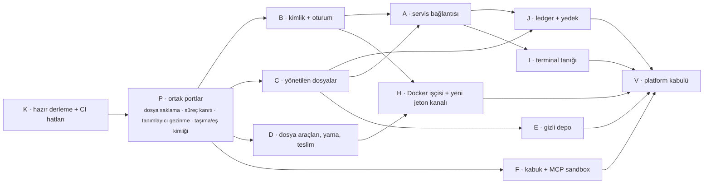

# NATIVE-PLATFORMLAR iş planı (taslak, 2026-10-21)

Durum: **taslak plan; owner kararları (§6) açık, uygulama kabul edilmedi.** Karar kaynağı:
[owner kararı 2026-10-21](../decisions/owner-decisions.md#dis-proje-windows-2026-10-21) — tam native Windows ve
macOS beta kapsamında; beta.1 planlanan tarihte Linux/WSL ile çıkar; betadan çıkış = Deckent Linux, Windows ve macOS'ta
native çalışır. Envanter: HEAD `ed7678130` üzerinde salt okunur kaynak taraması (yan oturum deckent-next-d2, 2026-10-21);
önceki analiz dış proof `WINDOWS-NATIVE-2026-10-03/analysis.md`. **[K]** kaynakta okunmuş olgu, **[T]** tahmin/tasarım
çıkarımı. Gün tahminleri **[T]**, ölçülmedi; bir deneyimli kişi-gün.

## 1. Sonuç

Bir kullanıcı Deckent'i Windows'ta ya da macOS'ta kendi işletim sisteminde kurar; Linux'taki yollar (kurulum → terminal →
model bağlama → `/do` → onay → işçi → teslim → izleme → yedek) aynı tipli sözleşmeyle, aynı güvenlik tabanıyla ya da
owner'ın kabul ettiği ve `known-limits`'te adıyla yazılı farkla çalışır. "Desteklenmiyor" etiketiyle atlanan test kalmaz;
her platform kendi gerçek yüzeyinde kanıtlanır.

## 2. Bugünkü engeller (envanter özeti)

macOS bugün sanılandan yakın: ledger, yönetilen dosyalar, dosya/şifreli depolar ve uid kimliği kapılarını geçiyor **[K]**.
Asıl kilit oturum kanıtının `/proc` okuması (`src/adapters/core/local-principal/internal/session.ts:11`): bu yüzden onay,
operasyon, teslim, benimseme, kuyruk ve soket kimlik doğrulaması macOS'ta `SESSION_REQUIRED` ile düşer; ikinci kilit
native eklentinin yalnız Linux'ta derlenmesi.

| Alan | Linux mekanizması | macOS | Windows | Güvenlik değişmezi |
|---|---|---|---|---|
| A Runtime servis bağlantısı | Unix soket 0700/0600, `SO_PEERCRED`, soyut guard soket, `/proc/<pid>/ns` ile sandbox'lı eş reddi | `getpeereid`/`LOCAL_PEERPID`, `renamex_np`, 104 bayt yol, `/private/tmp` realpath — **M** | named pipe + DACL + `GetNamedPipeClientProcessId` → token SID, `LockFileEx`, N-API — **L** | eş kimliği |
| B OS kullanıcı kimliği, oturum, etkileşimli terminal tanığı | uid, `/proc/<pid>/stat`, `/dev/pts` | libproc `proc_pidinfo`/`proc_pidfdinfo` — **M** | kullanıcı SID (uid→SID göçü), `GetProcessTimes`; denetleyici terminal yok — **L** | onay ve yetki tanığı |
| C Özel/yönetilen dosyalar | uid + mod bitleri, `O_NOFOLLOW`; 66 dosya/~37 modül kendi denetimi | `/tmp`/`/var` symlink, büyük/küçük harf duyarsız APFS, `F_FULLFSYNC` — **S–M** | sahip SID + korumalı DACL, handle tabanlı kimlik/reparse denetimi — **L** | sır, politika, audit anahtarı |
| D `/proc/self/fd` ile tanımlayıcı-göreli gezinme (12 yer) | `openat` + `/proc/self/fd` | `openat` + `F_GETPATH` eklentisi — **M** | handle-göreli açılış + `GetFinalPathNameByHandleW` — **L** | çalışma alanı yalıtımı, yarış koruması |
| E Gizli depolar | 0600 dosya / şifreli dosya | bugün çalışır; Keychain arka ucu — **M** | DPAPI ya da Credential Manager, C'ye bağlı — **M** | sır saklama |
| F Kabuk ve MCP sandbox'ı | bubblewrap + Landlock + seccomp + overlay; POSIX kabuk sınıflandırıcı | Seatbelt (SBPL); PID ad alanı, overlay, seccomp yok — **L** | AppContainer/LPAC + Job Objects + kısıtlı token; PowerShell/cmd sınıflandırıcı — **XL** | yalıtım |
| G Süreç denetimi | süreç grubu + `kill(-pid)` | çoğu çalışır — **S** | Job Objects, POSIX sinyal yok — **M** | iptal/kurtarma |
| H Docker işçisi | `unix://` motor, `--user uid:gid`, host soketi bind-mount (abonelik jetonu kanalı) | Docker Desktop VM'inde host soketi güvenilir değil — **M–L** | `npipe://`, `C:\` yol eşleme, uid −1 — **L** | jeton kanalı |
| I Terminal | Ink + `setRawMode` (taşınabilir) | çoğunlukla doğrulama — **S–M** | geçmiş dosyası C'ye bağlı; Windows Terminal denenmedi — **S–M** | — |
| J Ledger ve yedek | `node:sqlite` + eklentide `flock` | A sonrası — **S** | A ve C sonrası — **M** | tek yazar |
| K Native yardımcılar ve paketleme | build host'ta derlenen eklenti + 4 C yardımcı, `platforms: ["linux"]` | darwin-arm64/x64 hazır derleme, imza/notarization — **M** | win32-x64, MSVC — **M** | tedarik zinciri |
| L Diğer | kurulum aşamaları, SIWC tarayıcı girişi | SIWC — **S** | MachineGuid — **S** | — |

Test kapıları **[T]** (envanter ajanının sayımı; yöntem kaydedilmedi, denetçinin kaba grep sayımı farklı çıktı — ilk N0 dilimi tekrar üretilebilir sayım komutuyla yeniden sayar): 810 platform atlama/çalıştırma yeri (405 `!== 'linux'`, 338 `=== 'win32'`; 276'sı `describe`
düzeyinde, 523'ünün satırında gerekçe yok). Etiketli: Linux soket 97, `/proc` kimliği 79, Windows'ta desteklenmez 49,
`/proc/self/fd` 37. Gerçek atlanan test sayısı bu turda ölçülmedi (10-03'te Windows'ta 1325).

10-03'ten beri yapılanlar **[K]**: test doğruluğu ve barındırılan macOS/Windows platform doğrulaması (148 → 0 başarısız,
eksik ürün özellikleri "desteklenmez" etiketiyle), known-limits, WSL tespiti, macOS `ioreg` kurulum bağı, darwin sır
yardımcısı. Yapılmayanlar: native Windows ret matrisi, B0 native kavram kanıtı, hiçbir native port.

## 3. Bağımlılık grafiği

## 4. Dalgalar

Sıra gerçek bağımlılıktan gelir; paralellik config + DAG + ölçülmüş kapasiteden (Kanun 5), sabit şerit sayısı yok.

- **N0 — ortak temel (iki platform birlikte):** tek `PrivateFileCustody` portu (bugünkü ~37 modüldeki uid/mod denetimleri
  buraya toplanır), süreç kanıtı portu, tanımlayıcı-göreli gezinme portu, taşıma + eş kimliği portu; testleri
  `process.platform` yerine yetenek bildirimiyle kapılamak; darwin/win32 hazır derleme ve CI hatları (K). Taşıma tehlikeleri
  burada kapanır: Windows'ta `constants.O_NOFOLLOW` tanımsız olduğu için kapı kalkınca bağlantıyı sessizce izleme riski;
  `getuid` yokken sahiplik denetimini atlayan yerler (`git-workspace/internal/broker.ts:43,64,152,227`,
  `scratch-store/internal/area.ts:63`) ret olmalı. Linux davranışı değişmez; negatif kanıt Linux'ta da koşar.
- **N1 — macOS çekirdeği:** B (libproc), A (`getpeereid`, `/private/tmp`, 104 bayt), C uyarıları (symlink realpath,
  büyük/küçük harf katlama — `src/platform/core/host/internal/layout/resolve.ts:63` bugün yalnız win32'de katlar), D, J, G.
  Çıkış: macOS'ta terminal → model → onay → yedek gerçek yüzeyde.
- **N2 — Windows çekirdeği:** C (SID + DACL), B (SID göçü dahil; mevcut kayıtlarda uid metni var → sürümlü göç), A (named
  pipe), J, G (Job Objects), E (DPAPI/Credential Manager), D. Çıkış: native Windows'ta terminal → model → onay → yedek.
- **N3 — yalıtım:** F macOS Seatbelt; F Windows AppContainer + Job Objects + PowerShell/cmd sınıflandırıcı; sandbox'lı eş
  reddinin karşılığı (§6 b). Owner kararları a/b'ye bağlı.
- **N4 — işçiler ve teslim:** H (Docker Desktop motor uçları, yol eşleme, uid modeli, yeni jeton kanalı §6 d), işçi girişleri
  (macOS'ta Claude Code girişi büyük olasılıkla Keychain'de **[T, doğrulanmalı]**), teslim ve benimseme.
- **N5 — platform kabulü:** her platformda temiz makinede init → `/do` → teslim → geri al provası, ret matrisi, fiziksel
  terminal tanıkları (Windows Terminal, macOS Terminal; owner U5 S12), `known-limits` ve README güncel, "desteklenmez"
  atlama etiketi kalmaz.

Tahmin **[T]**: macOS ~60–110 kişi-gün (sandbox ~20–40), Windows ~110–190 kişi-gün; ortak N0 ikisini de kısaltır. 10-03
aralıkları yeniden ölçülmedi; ilk dilim süreleri effort aracıyla kaydedilip tahmin düzeltilir.

## 5. Geliştirme ortamı

- **Linux** ana geliştirme yeri olarak kalır; ortak portlar ve Linux negatif kanıtı burada.
- **Windows (bu makine, Windows 11 Pro):** `C:\deckent-win\deckent-next` 10-03'ten eski (son commit `97590485`, build yok)
  ve Windows Node 24.15 (ikisi de 2026-10-21 bu oturumda WSL'den `/mnt/c` git ve `cmd.exe` ile okundu) Deckent'in istediği ≥ 24.22.0'ın altında. N2 öncesi: Node 24.22+/26, MSVC build araçları, taze
  klon; Deckent burada paralel geliştirilir ve native testler burada koşar. WSL'den sürme yolu (`cmd.exe`/`powershell.exe`)
  10-03 notunda.
- **İlk gerçek kullanıcı:** owner'ın Windows projesi (`verhex-eggres-shield`, Rust + Windows 11 hedefli) WSL motoruyla kurulamadı (`/mnt/c` → `BOOTSTRAP_STATE_UNSAFE`) ve owner kararıyla N2'yi bekliyor; N2 kabulü bu projede gerçek iş olarak yapılır.
- **macOS:** yerel makine yok; bugün yalnız barındırılan runner'lar. Gerçek yüzey kabulü (terminal tanığı, Keychain,
  Seatbelt, Docker Desktop) için fiziksel ya da bulut Mac gerekir (§6 f).
- Her kart başlamadan önce kullandığı platform API'sinin güncel resmî belgesi okunur ve tarihiyle kaydedilir (Seatbelt,
  libproc, Win32 named pipe/ACL/Job Objects/AppContainer/DPAPI, Docker Desktop); bu taslak için okunmadı.

## 6. Owner kararları (açık)

Bu kararlar N0–N2'yi bloklamaz; N3/N4 başlamadan gerekir (f, N1 kabulünden önce). **Kural:** her madde owner'a ancak
`jev-review.mjs prepare/ask` ile hazırlanmış logged Jev vakası (iki çekimser seçenek dahil), önerilen seçenek ve
kazanç/kayıp satırıyla gider. Aşağıdaki "ön öneri" Jev'den geçmedi.

Terimler: **Seatbelt** macOS'un uygulama kum havuzu (sandbox) mekanizması, kuralları SBPL diliyle yazılır, Apple
tarafından belgelenmemiş ve kullanımdan kaldırılmış sayılır. **AppContainer / LPAC** Windows'un uygulamayı ayrı ve kısıtlı
bir kimlikle çalıştırma mekanizması (LPAC daha dar olanı). **Job Object** Windows'ta bir süreç ağacını birlikte sınırlayıp
birlikte öldürme mekanizması. **DACL** Windows dosya/kanal erişim listesi. **DPAPI / Credential Manager** Windows'un kullanıcı
hesabına bağlı şifreleme ve parola deposu. **Keychain** macOS'un parola deposu. **getpeereid / sandbox_check** macOS'ta
soketin karşı ucundaki sürecin kullanıcısını ve kum havuzunda olup olmadığını sorma çağrıları. **CredUI / Windows Hello**
Windows'ta kullanıcıdan parola/biyometrik onay isteyen pencere.

- **a Kabuk ve MCP sandbox'ı.** Linux'ta komutlar bubblewrap ile ayrı ad alanlarında, yazmalar katman (overlay) üzerinde
  çalışır; macOS'ta bunların karşılığı yok, Windows'un AppContainer'ı da birebir denk değil.
  1. Native'de host kabuğu ve MCP sandbox'ı reddedilir, iş yalnız Docker işçisinde — kazanç: taban düşmez; kayıp: native
     kullanıcı yerel kabuk aracını kullanamaz. 2. Seatbelt / AppContainer + Job Object'e taşınır, denk olmayan güvenceler
     adıyla known-limits'e yazılır — kazanç: tam yerel deneyim; kayıp: en büyük iş (macOS L, Windows XL) ve daha zayıf yalıtım.
  3. Yalnız host, sandbox isteyen çağrı varsayılan ret — kazanç: hızlı; kayıp: yalıtım yok, kullanıcı her şeyi onaylar.
  Ön öneri: 1 ile başla, 2'yi N3'te kanıtla.
- **b Servis soketinde kum havuzundaki süreci reddetme.** Linux'ta servis, bağlanan süreç bir sandbox içindeyse onu
  ad alanı karşılaştırmasıyla reddeder; diğer platformlarda bu karşılaştırma yok.
  1. Sandbox profili soketi/kanalı hiç göstermez — kazanç: basit; kayıp: profil hatası sessizce açık bırakır. 2. Bağlanan
  sürecin jetonu sorulur (Windows: AppContainer/bütünlük düzeyi; macOS: audit token + `sandbox_check`) — kazanç: Linux'a en
  yakın güvence; kayıp: iki platform için ayrı native kod. 3. Zayıf değişmez kabul edilip yazılır — kayıp: güvence düşer.
  Ön öneri: 2, yedeği 1.
- **c Windows'ta "gerçek terminalde insan var" tanığı.** Linux'ta yetki yazımları (izin modu, sır yazma) çağıranın gerçek
  bir terminale bağlı olmasını ister; Windows'ta denetleyici terminal kavramı yok.
  1. Konsol bağlantısı denetimi — kayıp: bir program konsolu taklit edebilir. 2. Windows Hello / CredUI ile kullanıcı
  varlığı — kazanç: güçlü; kayıp: her yetki yazımında pencere. 3. Desktop aracı kaydı gelene kadar native'de yetki
  yazımları ret — kayıp: native Windows kullanıcısı bu ayarları yapamaz. Ön öneri: 2.
- **d Docker Desktop altında işçi jeton kanalı.** İşçiye abonelik jetonu bugün host'taki izinli bir soket dosyasıyla
  taşınıyor; Docker Desktop konteynerleri bir sanal makinede çalıştığı için bu soket güvenilir biçimde ulaşmıyor.
  1. Deneme başına bağlı kimlik bilgisiyle yerel TCP — kayıp: dosya izninden zayıf eş kimliği. 2. Docker Desktop'a özgü
  soket iletme — kayıp: kanıtsız, sürüme bağlı. 3. İşçiler için Linux/WSL motoru korunur — kayıp: Windows'ta "native"
  tam olmaz, macOS'ta karşılığı yok. Ön öneri: önce 2'yi ölç, olmazsa 1.
- **e Windows'ta sırlar.** 1. Beta çıkışından önce DPAPI/Credential Manager zorunlu — ön öneri; kazanç: anahtar başka
  hesaplardan korunur; kayıp: M boyutunda iş. 2. Ortam değişkeni sırları görünür uyarıyla — **güvenlik tabanının
  altındadır** (anahtar ortam değişkenine girmez kuralı); yalnız geçiş dönemi uyarısıdır, beta çıkış kapısını karşılamaz.
  macOS'ta Keychain paralel seçim.
- **f macOS doğrulama makinesi.** Fiziksel Mac, bulut Mac ya da yalnız barındırılan runner — son seçenekte gerçek yüzey
  kanıtı (terminal tanığı, Keychain, Seatbelt, Docker Desktop) eksik kalır, N5 kapanamaz. Ön öneri: fiziksel ya da bulut Mac.

## 7. Kanun kontrolü

1. Kanıt ve kapanış — **uyumlu:** her dalga gerçek yüzey + çalışan binary + kalıcı kanıtla kapanır; barındırılan platform
   yeşili tek başına kabul değil (bugünkü 0 başarısız atlamalarla geldi).
2. Yetki sınırı — **uyumlu:** owner 2026-10-21 kapsamı açtı; bu taslak iş kabul etmez, §6 kararları owner'ındır.
3. Owner iletişimi — **uyumlu:** sonuç ve kararlar sade Türkçe; teknik ayrıntı tabloda.
4. Doküman haritası — **uyumlu:** PLAN Sıradaki 18 bu belgeye bağlanır; toplu pakette `ARCHITECTURE.md:1012`'deki
   "Linux+WSL2 → macOS → native Windows" sırasına 10-21 beta-kapsamı notu eklenir; known-limits her dalgada.
5. İş bölme ve kök neden — **uyumlu:** kök neden dağınık platform denetimleri; N0 ortak portlarla çözer; sabit şerit yok.
6. Model/provider tek kaynak — **ilgili, çatışma yok:** §6 d jeton kanalı ve N4 işçi girişleri (Keychain, Docker soketi)
   provider ortamına dokunur; kaynaklar registry/config'ten okunur. PRE-8 proje anahtarı ayrı kart.
7. Yerel doğrulama — **uyumlu:** dilimde hedefli kontrol (`VITEST_MAX_FORKS=2`), Windows'ta native hedefli koşu; sürüm
   adayında tam suite → Astra → hosted CI.
8. İkinci görüş — **açık:** §6 kararları için logged Jev hazırlanmadı; §6 kuralı gereği Jev'siz owner'a sunulmaz.
9. Alp Discipline — kapsam dışı: arm64 Linux yayını, Desktop D-dilimleri, Enterprise merkezi; güvence kaybı görülürse
   dalga durur ve owner'a gelir.
10. Enterprise katmanı — **uyumlu:** portlar Core sözleşmesi olarak, Enterprise/ERP'nin Core'u değiştirmeden üç
    platformda giydirebileceği biçimde tasarlanır.
North star — güvenlik tabanı düşürülmez; düşen her güvence owner kararıyla ve adıyla yazılır; ölçülmemiş süre iddia edilmez.

## 8. İki bakış

- **Dogfood:** Deckent kendini Linux'ta geliştirmeye devam eder; Windows'ta paralel geliştirme Deckent'in kendi
  platform farklarını gerçek kullanımda yakalar (owner'ın Windows projesi ilk kullanıcı).
- **Hedef ürün:** müşteriler ERP/CRM süreçlerini çoğunlukla Windows masaüstü ve sunucularında yürütür; onay, sır, yalıtım ve
  teslim üç platformda aynı sözleşmeyle çalışmazsa kabul modeli (genel kabul kriteri + kalıcı kanıt) platforma göre
  değişir. Kod doğrulaması yalnız git adapter kanıtıdır.
