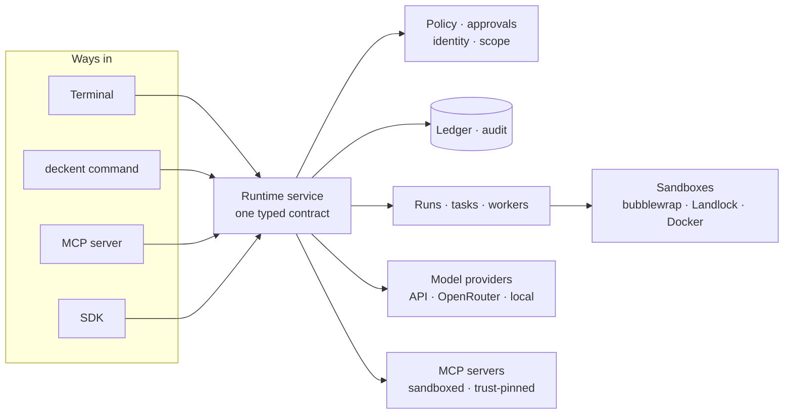
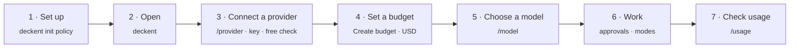
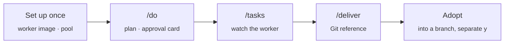
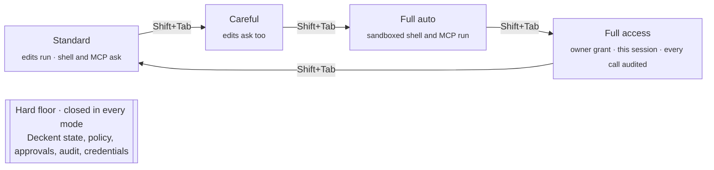
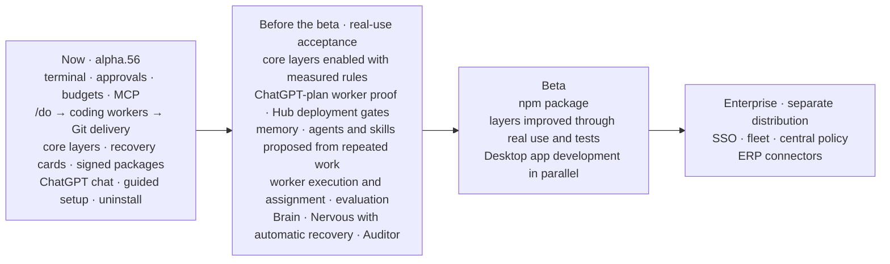

<div align="center">

# Deckent

**Agent Control & Execution Plane**

Deckent turns what people and AI agents ask for into authorized, isolated and recorded work on your own machines.

*policy-driven agent runtime · governed execution · self-hosted agent control plane*

[](https://github.com/Verhex/deckent-next/actions/workflows/ci.yml)
[](LICENSE)
[](package.json)
[](CHANGELOG.md)

[Türkçe](README.tr.md) · [What it is](#what-is-deckent) · [How it works](#how-it-works) · [Get started](#get-started) · [First job](#your-first-job) · [Everyday use](#everyday-use) · [Safety](#safety-and-control) · [Today](#what-works-today) · [Roadmap](#roadmap)


</div>

<!-- Node and pre-release badges read public main package.json, not this local branch.
Keep package.json version and CHANGELOG.md release line together at each release.
npm badges: enable only after the first npm publish. The unscoped name `deckent` is not usable (conflicts with an existing
package); the planned name is the scoped `@verhex/deckent` (proposed name; not finalized). Verify package identity first.
[](https://www.npmjs.com/package/@verhex/deckent)
[](https://www.npmjs.com/package/@verhex/deckent)
-->

> [!NOTE]
> This README describes **pre-release `1.0.0-alpha.56.1`**, the latest released version; [CHANGELOG.md](CHANGELOG.md)
> lists every release, newest first. Deckent is not on npm yet: install it from source as shown in
> [Get started](#get-started). An npm package is planned for the beta, probably as `@verhex/deckent` (the name is
> not final yet).

## What is Deckent

AI agents can now run commands, change code and call business systems. Getting them to act is no longer the hard part.
The hard part is knowing who allowed an action, where it ran, what it cost and how to undo it. Most tools leave that to
the person watching the screen.

Deckent is the layer that answers those questions. You install it on your own machines, and every request goes through
the same checks, whether it comes from a person at the terminal, an AI agent over MCP or a script: identity, scope,
policy, approval and budget. The work then runs in a sandbox or a Docker worker, and every decision and effect is written
to a durable ledger. For example, before a paid model call Deckent reserves the most the call could cost against the
project's budget; if the price is unknown or the budget is too small, the call is refused before anything is sent.

The same foundations are built to serve one person on a laptop and a company with many teams. Software work is the first use:
coding workers (Claude Code, Codex and Cursor) do a task in Docker and Deckent delivers the change to Git. Business
systems such as an ERP or a CRM use the same contract: a declared operation, a write that applies only if the record is
unchanged, a resend that can never apply twice, acceptance on evidence, and a planned undo (compensation) when something
must be reversed. Core ships that contract and a generic HTTP target; connectors
for specific ERP products are not built yet.

The open-source Core (Apache-2.0) runs on its own. A proprietary Enterprise edition is planned as a separate distribution
that plugs into Core's extension registry without editing Core; Enterprise SSO, fleet management and ERP connectors
belong there. The [glossary](docs/glossary.md) explains the terms used below, such as scope, Run and approval.

## How it works

You ask for something in plain words. Deckent turns it into checked, isolated steps, and nothing runs unless policy and
your permission mode allow it.


Three jobs make this work:

| | |
|---|---|
| 🗼 **Govern** | One identity, scope and policy model for people and AI agents. When something needs approval, the window shows exactly what: the full command, where it runs, on whose behalf, the risk, whether it can be undone and a deadline. A role description (persona) or a model's advice never grants permission. |
| 🛫 **Execute** | Runs, tasks and workers are admitted, scheduled and recovered on your machines. Agent shell commands and MCP servers run in sandboxes (bubblewrap, Landlock) where the host provides one; coding workers run in Docker. Models come from Anthropic, OpenAI, DeepSeek, Z.ai and Zhipu (GLM), OpenRouter, a local server or an OpenAI-compatible endpoint with published prices. |
| 📜 **Prove** | Every decision and effect lands in a durable ledger and audit trail. Approvals are sealed, patches are retained, and a change is tried on a separate copy of your repository before it is delivered. |

Every way in uses the same typed contract: one set of operations and checks. Operations that need the runtime go through one local runtime service per
project, which checks identity, scope and policy on each call, writes the result to the ledger and lets effects happen
only where policy allows. Setup, observation and some patch steps use the same contract locally, without the service.



## Get started

For an AI assistant installing on your behalf, use the [AI installation guide](docs/ai-install.md); it names the steps only you can complete.

### Requirements

- Linux, or Windows through WSL2, on x86_64. Native Windows is not supported, and on macOS the runtime service does not
  run yet (see [Not yet](#not-yet)).
- Node.js 24.22.1 or newer on 24.x, or 26.12.1 or newer (Node 25 is not supported).
- Docker. Building from source uses it to compile the locked bubblewrap sandbox (0.13.0), and coding workers run in it.
  After the build, a first chat needs neither Docker nor a paid call if you use a local model server such as Ollama or
  LM Studio.
- Git and a C build toolchain (for the native sandbox helper).

### Install from source

Until the npm package is published, build Deckent once from source and link the `deckent` command:

```sh
git clone https://github.com/Verhex/deckent-next.git
cd deckent-next
npm ci
node scripts/build-bwrap.mjs --arch all --out .pack/bwrap/first-build
node scripts/build-bwrap.mjs --stage-dev .pack/bwrap/first-build
npm run build
npm link
```

The build ends with `bubblewrap=present` or `bubblewrap=staged from …`. If it stops with `BUBBLEWRAP_BUILD_REQUIRED`,
Docker was not reachable: start it, run both `build-bwrap` commands again with a new `--out` directory (for example
`.pack/bwrap/second-build`), then `npm run build`. On Ubuntu 24.04 and later the kernel may block the user
namespaces bubblewrap needs; Deckent then says so and falls back to Landlock. The
[operator reference](.deckent/docs/architecture/operator-reference.md#source-build-and-sandbox-posture) explains both
cases and how an administrator lifts the restriction. The [contributor quickstart](CONTRIBUTING.md#a-30-minute-quickstart)
lists the prerequisites again and runs one test without a provider key.

### Your first session

This takes you from an empty project to a governed chat and its cost, without leaving Deckent. Change to your own project folder,
outside the Deckent source checkout; from here on everything is `deckent`.



1. **Set up once per project.** A *scope* is the stable name that ties policy, work records and spending to this project;
   it is not a folder or a sandbox. Choose one, such as `my-project`, preview the first-run policy and install it:

   ```sh
   deckent init policy --scope my-project --preview
   deckent init policy --scope my-project --apply
   deckent doctor
   ```

   The policy lets you connect and call models, keep keys and set budgets in that scope; each of those actions is still
   checked and recorded. `deckent doctor` reports what is ready and exits non-zero if setup cannot start. `deckent init`
   runs the same setup step by step and lists what is still missing.
2. **Open the terminal** with `deckent`. It opens in the scope you just set up (`deckent --scope my-project` picks one
   explicitly) and starts the runtime service in the background.
3. **Connect a provider** with `/provider`. Type the key into a masked field; Deckent checks it with a free request where
   the provider offers one and stores it under its name. The value is never shown again, and no agent or worker receives
   it. Then choose **Connect a model** and pick an exact model from the provider's list. Connecting makes a model callable in
   this scope; step 5 picks which connected model this session uses.
4. **Set a budget.** Every paid API turn reserves money from one shared USD budget of the scope, so without a budget each
   paid turn is refused, and the windows say why. The first row of `/provider`, **Create budget**, offers 5 to 100 USD or
   another whole-dollar amount up to 1000, then a confirm step. Local models need no budget.
5. **Choose a model** with `/model`, for this session or as your default. A model you cannot use yet is shown locked,
   with the reason and the fix.
6. **Work.** Ask in plain words. Tool calls follow your installation's policy and your permission mode; anything that needs
   you opens the approval window (see [Safety and control](#safety-and-control)).
7. **Check usage** with `/usage`: the tokens this conversation used and the scope's budgets. It is Deckent's
   measurement, not the provider's invoice.

These screens come from the real terminal, recorded on alpha.53 (120×36, the default full-window layout) in a throwaway
project with a small local test model: no provider was called and no real key was used. The empty conversation rows above
each window are trimmed; nothing else is changed.

<table>
  <tr>
    <td width="50%"><br><sub><b>Before a budget.</b> <code>/model</code> offers <b>Create budget</b> first. The local test model is already usable, because local models need no budget; a model this scope may not call is locked with its reason.</sub></td>
    <td width="50%"><br><sub><b>/provider.</b> <b>Create budget</b> first, then each provider with its connection state.</sub></td>
  </tr>
  <tr>
    <td width="50%"><br><sub><b>Budget window.</b> Preset amounts, or another amount with the arrow keys.</sub></td>
    <td width="50%"><br><sub><b>Another amount.</b> Whole dollars, 1 to 1000; nothing is sent before you confirm.</sub></td>
  </tr>
  <tr>
    <td width="50%"><br><sub><b>After the budget.</b> The framed system line records the budget, and the first row now reads <b>Change budget</b>.</sub></td>
    <td width="50%"><br><sub><b>/usage.</b> Tokens this conversation measured and the scope's budgets.</sub></td>
  </tr>
</table>

Steps 3 and 4 also work from the command line, which is how scripts and AI tools do them:

```sh
deckent secret set DECKENT_ANTHROPIC_KEY --main
deckent models create-budget --scope my-project --usd 20
deckent models connect --scope my-project --connection anthropic-api --command-id connect-1 --model claude-sonnet-5-5
```

`secret set` asks for the key in a hidden prompt and refuses a piped key. `--command-id` is any unique name you choose;
repeating the same command with it never connects twice. The
[operator reference](.deckent/docs/architecture/operator-reference.md#provider-connection-details) lists the secret name
of every provider, the local and OpenAI-compatible options and what works with a subscription today.

## Your first job

A chat is only the start. In a job Deckent plans the work, you approve the plan, a coding worker does it in Docker, and
the change is delivered to a Git reference. Nothing reaches one of your branches unless you choose it.



Before you start: Docker is running; the project is a Git repository with at least one commit; a model with a budget is
connected (see [Your first session](#your-first-session)); and the coding CLI you want as the worker is installed and
logged in on this machine (`codex login`, or `claude` and then `/login` for Claude Code). The worker uses that CLI's own
login inside its container; your provider API keys are never passed to workers. On a clean machine we rehearsed everything
up to connecting a model; the job steps below are used every day in Deckent's own development but have not been rehearsed
from scratch yet ([known limits](docs/known-limits.md)).

### One-time setup

Work runs in a worker container, so Deckent needs a worker image, settings that say where work runs, a first kind of
work and a worker pool. `deckent init` installs; the first time you open `deckent` its setup steps (`/setup`) prepare all
four at your own terminal. Each step asks on a card and writes nothing until you confirm.

```sh
# 1. In your project: install, then open the terminal and follow its setup steps (build or pick the worker image,
#    execution settings, first kind of work, worker pool). /setup opens them again later.
deckent init
deckent
#    Without the terminal, doctor prints each missing step with its exact command (see below):
deckent doctor

# 2. If the service was already running, restart it so it reads the new settings
deckent runtime restart
```

The image build uses Docker and the network (the base image and the coding CLIs), and its card names the size and the time
limit before anything starts. The execution settings name the Docker and Git that the setup step found and the image;
the other values keep their defaults (`deckent config explain execution`). The first kind of work is `coding` on the coding
CLI you pick (`codex`, `claude` or `cursor`; a Cursor worker needs one more catalog step, see the operator reference), with
the pool `workers` and one running slot. For another kind, pool name or capacity, or without a terminal,
`deckent doctor` prints the missing steps with their exact commands, for example:

```sh
deckent init registry --scope my-project --provider codex --kind coding --pool my-workers \
  --execution-slots 2 --in-flight-slots 2 --discovery repository --preview
deckent init pool --scope my-project --preview
```

Each `--preview` shows what would change and writes nothing; run the same command with `--apply` to write it.
`--discovery repository` lets the worker CLI load your repository's own instruction files, hooks and MCP settings; leave it
out to hide them (the default).
The [operator reference](.deckent/docs/architecture/operator-reference.md#first-job-setup-in-detail) explains every value,
what each preview checks, and what to do on an installation set up before the current first-run policy.

### Run the job

1. **Ask.** In the terminal type `/do` and your request in plain words (`deckent do --request "<text>"` from the command
   line). A connected model plans it, and Deckent prints the plan with an acceptance line for each task:

   ```text
   Plan for Run <run-id> · <status>
   Task t1: <what the task does> · kind coding · WorkClass <class>
     Acceptance: <the criterion the result must meet>
   Permissions checked by policy at admission: <one task/execute per task>
   Waiting for your TTY approval <approval-id>, expires <time>. The model cannot authorize this work.
   ```

   *WorkClass* is the kind of effort the task needs; it selects the worker and the model.

2. **Approve.** A card asks you to approve creating the Run. Judge the plan and its acceptance lines (the card's risk and
   undo lines are not classified yet for plans), then press `y`. The card expires after 10 minutes, and the model cannot
   approve for you. The line `Run <run-id> admitted. Follow /tasks or /monitor.` then means the work started, not that its
   result was accepted.
3. **Watch** with `/tasks`, or `/monitor` (`deckent monitor` outside the terminal). When the worker finishes successfully (today
   that means exit code 0; the content is not verified independently yet), the task waits for delivery.
4. **Deliver** with `/deliver`. The window first sums up the work in plain words: its title, what changed, why it was
   accepted (the worker's own report is marked as a claim), the risk and what yes or no will do. It then lists the
   changed files. `y` writes the change only to a dedicated reference under `refs/deckent/deliveries/`, never to a branch,
   your index or your working files.
5. **Adopt** it into a branch if you want, with a separate `y`. Deckent moves only a branch you allowed and nobody has
   checked out, so create one first:

   ```sh
   git branch deckent/first-job HEAD
   deckent config set execution.adoption.targets '["refs/heads/deckent/first-job"]'
   ```

   Look at the result with `git log deckent/first-job` and merge it yourself. If the project uses the delivery queue (the
   service's per-branch queue of deliveries), an adoption can be rolled back with its own confirmation; the
   [operator reference](.deckent/docs/architecture/operator-reference.md#delivery-queue-inspect-and-undo) shows the
   commands.


<sub><b>/tasks.</b> Workers and Runs in one live window; cancelling asks for approval (empty here: no background work yet).</sub>

## Everyday use

### In the terminal

`deckent` opens the interactive terminal. Every slash command answers in its own window; <kbd>Esc</kbd> closes it and leaves
one framed `Deckent system` line in the conversation instead of a wall of text. Settings are changed by choosing, not
typing: `/config` walks from section to key to the allowed values, and each change goes through policy and may become
an approval. `/help` lists every command by purpose; the most used ones are:

| Purpose | Commands |
|---|---|
| Work | `/do` ask for a job · `/tasks` live work · `/runs` every Run, with hold, resume and close · `/deliver` · `/cancel` |
| Approvals | `/approvals` pick a pending approval and decide it |
| Settings | `/provider` · `/model` · `/config` · `/mode` · `/mcp` · `/policy` |
| Information | `/status` · `/usage` · `/context` · `/doctor` · `/monitor` · `/scope` · `/help` |

<table>
  <tr>
    <td width="50%"><br><sub><b>Chat.</b> Your lines and Deckent's answers are visibly distinct, with time and tokens per turn.</sub></td>
    <td width="50%"><br><sub><b>Approval window.</b> What, where, on whose behalf, scope, why, risk, undo and a live deadline. The answers are a list; "this session" and "always in this project" appear only where policy offers them.</sub></td>
  </tr>
  <tr>
    <td width="50%"><br><sub><b>/status.</b> A human summary first; identities, process and build under the details.</sub></td>
    <td width="50%"><br><sub><b>Modes.</b> <kbd>Shift</kbd>+<kbd>Tab</kbd> cycles the modes you are allowed; full access is clearly marked.</sub></td>
  </tr>
  <tr>
    <td width="50%"><br><sub><b>/help.</b> Commands grouped by purpose, one line each; the window scrolls.</sub></td>
    <td width="50%"><br><sub><b>/mcp.</b> Add a server step by step; each configured server shows its trust state and where it runs (here a sandbox with network).</sub></td>
  </tr>
  <tr>
    <td width="50%"><br><sub><b>/provider.</b> Each provider with its connection state, OpenRouter included.</sub></td>
    <td width="50%"><br><sub><b>/config.</b> Section, key, then one of the allowed values; the current one is marked.</sub></td>
  </tr>
  <tr>
    <td width="50%"><br><sub><b>System lines.</b> Each closed window leaves one framed summary line.</sub></td>
    <td width="50%"></td>
  </tr>
</table>

### On the command line

The `deckent` command does one thing per call and prints text for people; add `--json` for the same result as data.
On a person's terminal, commands that change something pick missing values with arrow keys and confirm on a card; AI
tools, pipes and CI pass every value as a flag and are never asked. `deckent --help` lists every command, and
`deckent <command> --help` shows the details.

```sh
deckent doctor                            # health of this installation
deckent monitor                           # live, read-only view of installations and work
deckent run list                          # Runs of this scope, newest first
deckent approval list                     # waiting approvals first, with the time left
deckent report --scope my-project --run <id>   # one Run's cost and acceptance evidence
deckent audit verify                      # check the audit history
deckent backup create --scope <id> --set <folder>   # write a verifiable recovery set (passphrase at the prompt)
deckent policy grants --mine              # your standing "always" grants
deckent memory                            # the scope's memory journal: facts and lessons
deckent agents                            # the scope's agents and skills
deckent models roles show                 # which model serves which role
```

### Connect an AI client over MCP

MCP works in two directions. To give Deckent's own agent an MCP server, add it with `/mcp` or
`deckent mcp add context7 -- npx -y @upstash/context7-mcp`. It starts only after you trust it, and by default it runs in a
sandbox with network access and its own home folder; a server configured for `host` runs without a sandbox, and `/mcp`
shows where each one runs.

To let an outside AI client use Deckent, register `deckent-mcp`, Deckent's stdio MCP server, in that client; in Claude
Code that is `claude mcp add deckent -- deckent-mcp --project /path/to/project`. Most of its tools need the runtime
service, so keep `deckent runtime serve` running. The client acts as a separate MCP actor that can only observe at
first. To let it do more, open `/policy` (**MCP permissions**), choose a scope and a capability group and grant it after
reviewing the exact rules; the same works from the command line:

```sh
deckent policy mcp list --json
deckent policy mcp grant --group work --scope my-project --preview
deckent policy mcp grant --group work --scope my-project --apply --expect <preview-digest>
```

Applying needs your approval at your own terminal and is audited. [Policy and AI](docs/policy-and-ai.md) explains how
human and AI authority differ.

### The runtime service

Model turns, approvals, `/do` and recovery run in one local runtime service per project. `deckent` starts it in the
background when none is running, and a service the terminal started stops itself after 15 minutes without work.
`deckent runtime serve` runs it in the foreground instead; `deckent runtime restart` restarts it with the current build
and configuration, and `deckent runtime describe` shows the running one. The
[operator reference](.deckent/docs/architecture/operator-reference.md#runtime-service) covers logs, stop permission and
older installations.

## Safety and control

Two things decide every tool call an agent makes: your installation's policy and the permission mode you chose. Policy
sets the limits; the mode only chooses how often you are asked inside them, and a deny always wins. You move between
the modes you are allowed with <kbd>Shift</kbd>+<kbd>Tab</kbd> or `/mode`.



| Mode | Runs without asking | Asks first |
|---|---|---|
| **Standard** | Reads, ordinary file edits | Shell commands, protected paths, MCP calls |
| **Careful** | Reads | Every edit as well |
| **Full auto** | Edits, shell commands contained in the sandbox, MCP calls | Host shell, destructive commands (`rm -r`, …), protected paths |
| **Full access** | Everything policy allows above the hard floor; every call is audited | The hard floor and whatever policy still requires; needs a grant from the installation owner (on a solo install, that is you); switched on for this session, or saved as your start mode with `/mode start full-access` |

The installation owner opens full auto and full access with
`deckent init policy --scope <id> --modes full-auto,full-access --preview` and then `--apply` at their own terminal;
AI tools, pipes and CI cannot. Agent shell commands run in a sandbox: in the first three modes the project is writable
within the call's approval, `.git` is read-only, your home folder is hidden and the network is off. Full access needs an
open bubblewrap sandbox, which adds the network and your home folder but still hides Deckent's own state and known
credential files. If no sandbox is available, a closed mode falls back to the host and says so (the default
`terminal.shell.realm: prefer-sandbox`); that fallback has no filesystem boundary, so set `require-sandbox` when
confinement is mandatory. The [operator reference](.deckent/docs/architecture/operator-reference.md#sandbox-views)
describes each view and its limits.

### Approvals

When a call needs you, the approval window shows the full command, where it runs, on whose behalf, why it asks, the risk,
whether it can be undone and how long you have; if nobody decides, nothing runs. A model can never approve. A tool call's approval can be answered only in the
terminal that started that turn. Approvals that wait without a running turn, such as a `/do` plan, can be picked and
answered with `/approvals` or `deckent approval list` at a verified terminal. You can answer once; where policy offers it,
also for this session or always in this project; your "always" grants are listed with `deckent policy grants --mine` and removed with `deckent policy revoke`. For an
operation on a business system the card names the operation, the target and a short digest of the input; the individual
fields it will write are not shown yet.

### API keys

Store a provider key once, in the masked field of `/provider` or with `deckent secret set NAME --main` (a hidden prompt;
a key passed as an argument or through a pipe is refused). Never put it in `ANTHROPIC_API_KEY`, a shell profile or a
`.env` file: other tools read those. Fresh installations on Linux, WSL and macOS keep keys in an encrypted store.
Provider calls resolve the key inside the runtime, so it never reaches a prompt, the shell environment, an agent or a
worker. The encrypted store's unlock key sits next to it, so other programs running as your user could still open it;
`deckent doctor --verbose` says who can read your store, and the
[operator reference](.deckent/docs/architecture/operator-reference.md#secret-stores-and-strict-install) shows the stores
and a stricter setup.

### Spending

Each scope has one USD budget shared by every API provider. Before a paid call Deckent reserves the most it could cost;
afterwards it settles the call from the usage the provider reported, multiplied by the verified published price
(OpenRouter calls settle from the cost OpenRouter reports). A remote model without a verified price is refused. A call
that never reported its final usage stays reserved until you resolve it with `deckent models reconcile-spending`. If a
charge ever exceeds what was reserved, the scope stops new paid calls until you lift the freeze with
`deckent models revise-budget --scope <id> --usd <n> --unfreeze`. The settled amount is Deckent's calculation, not the
provider's invoice, so keep a spending limit in your provider account as well. The
[operator reference](.deckent/docs/architecture/operator-reference.md#spend-settlement) covers price tiers and
OpenRouter settings.

## What works today

- **Work with an agent in the terminal**: streamed turns, file edits and a sandboxed shell, approval and monitor windows,
  permission modes, MCP tools, conversation compaction, in English and Turkish.
- **Ask for a job in plain words**: `/do` plans it with acceptance criteria, you approve, a coding worker (Claude Code,
  Codex or Cursor) does it in Docker, and `/deliver` writes the result to Git and adopts it into a branch only when you
  choose.
- **Orchestrate work**: Runs, tasks and attempts (each try of a task) are admitted, scheduled, held, resumed, cancelled and recovered, all
  recorded in a durable SQLite ledger.
- **Choose models and control cost**: connect your own key, pick a model per session or as default, run local models,
  use the Anthropic prompt cache, and keep every paid call inside a budget you set.
- **Govern**: local identities, scoped policy, one approval broker for every surface, standing grants you can
  list and revoke, and an audit trail you can verify.
- **Operate**: `deckent monitor` for a read-only view, `deckent doctor` for health, `deckent config` for settings, and
  `deckent backup create|verify|restore` for verifiable recovery sets on a schedule if you choose.
- **Manage signed content**: import and verify signed agent and skill packages, inspect trust and revocations, and decide
  changes on scoped cards. Public Hub connections still need deployment setup; no source is enabled by default.
- **Remove an installation with a preview**: `deckent uninstall --dry-run --json` shows the plan. Applying it needs your
  terminal card; data stays by default, and purge needs a managed backup and proven ownership. Images stay protected.
  The [AI installation guide](docs/ai-install.md#uninstall) explains the steps and remaining limits.
- **Core layers, in code and not yet proven in real use**: the system picks the worker model for each kind of work from a
  list you can see; memory fills from accepted work and is verified by you or an independent evaluator; lost workers are
  detected and recorded as proposals; the Brain can plan with your own Claude subscription inside a sandbox, after your own
  login and consent; agents and skills are versioned and every AI change to them is signed. Each switch (memory, lost-worker
  detection, recovery, agent statistics) starts off and has a shadow mode that applies nothing; memory verification and
  recovery in shadow still call their model, so data goes to that provider and the call is spent. Automatic recovery does not
  act until you promote a measured rule, grant its exact action and enable the mode. The new rights come from a policy upgrade by the
  installation owner: `deckent policy upgrade --template current` for a policy from the first-run template, or
  `deckent init policy --scope <id> --upgrade --person <issuer>/<subject>` for a hand-written one
  ([known limits](docs/known-limits.md#core-layers)).

### Not yet

- **No npm package.** Install from source until the beta.
- **No Desktop app, Dashboard or remote HTTP API.** Use the terminal, the `deckent` command, MCP or the SDK.
- **No coordination of multi-step business processes yet.** One request becomes one Run; longer processes that
  coordinate several rounds and waits are planned.
- **No ERP or CRM connectors.** The operation contract and a generic HTTP target exist; product connectors do not.
- **Delivery is never automatic.** A rule records whether it *would* deliver each queued item, but it only advises; every
  delivery, adoption and rollback waits for your `y`.
- **Coding tasks are accepted on the worker's exit code.** The content is not verified independently yet, and the
  window says so.
- **Subscriptions are partial.** A Claude Code worker runs with your own Claude login, and the Brain (the planner behind
  `/do`) can use your Claude subscription where Deckent's bubblewrap sandbox works (Linux and WSL). Sign in with ChatGPT
  serves terminal chat on Linux and WSL from your own private local store; the Codex worker on that plan is not activated yet.
  Chatting in the terminal with a Claude subscription is not available yet (see [Roadmap](#roadmap)).
- **Platforms.** Native Windows is not supported. On macOS the local runtime service does not run yet (its socket is
  Linux-only), so chat, jobs and backup cannot be used there. Delivery, adoption, rollback and key grants need a terminal
  witness that exists only on Linux (WSL included) and are refused on other systems. arm64 is not shipped. A Docker
  worker shares the host kernel; it is not a virtual machine.
- **Recovery sets are not fully encrypted.** Only the authority key inside a set is encrypted with your passphrase; keep
  sets on storage you trust.
- **No Enterprise SSO, fleet management or central policy service** in Core.

[Known limits](docs/known-limits.md) lists every open, untried or partial item with its impact and a workaround.

## Roadmap

Dates are not promised; the order is. Alpha.56 includes the core layers, recovery cards and signed Hub package
management, plus guided first use, ChatGPT chat sign-in and safe uninstall. The protected layer switches still start off;
their real-use proof and the ChatGPT-plan Codex worker activation remain gates before the beta. The beta then hardens
these layers through real use, and Desktop app development starts alongside it.



The **Brain** turns a request into a plan and accepts the results; the **Nervous** layer watches running work and
recovers it automatically when it stalls or fails; the **Auditor** checks what was accepted. Assignment picks the worker
and model for each kind of work, evaluation scores the outcomes, and memory carries what was learned to the next job.
Every layer acts only through the same policy and approvals as everything else.

## Learn more

- [Architecture overview](docs/architecture-overview.md): layers, security, extension points and current limits
- [Policy and AI](docs/policy-and-ai.md): human and AI authority, delegation, administration commands and compliance evidence
- [Glossary](docs/glossary.md): scope, realm, work lifecycle, approvals and spending
- [Known limits](docs/known-limits.md): what is not tried, not built or still open, with the impact and a workaround
- [Operator reference](.deckent/docs/architecture/operator-reference.md): setup values, sandbox views, key stores,
  spending, worker images, patch custody and recovery sets in detail
- [ARCHITECTURE.md](ARCHITECTURE.md): detailed engineering contracts and implementation notes
- [CHANGELOG.md](CHANGELOG.md): what each release brought
- [CONTRIBUTING.md](CONTRIBUTING.md) · [Code of Conduct](CODE_OF_CONDUCT.md) · [Security](SECURITY.md)

## License

Apache-2.0 (see [LICENSE](LICENSE)).
