<div align="center">

<h1>
  <picture>
    <source media="(prefers-color-scheme: dark)" srcset=".github/assets/brand/lockup-on-dark.svg">
    <source media="(prefers-color-scheme: light)" srcset=".github/assets/brand/lockup-on-light.svg">
    
  </picture>
</h1>

**Agent Control & Execution Plane**

deckent turns what people and AI agents ask for into authorized, isolated and recorded work on your own machines.

*policy-driven agent runtime · governed execution · self-hosted agent control plane*

[](https://github.com/Verhex/deckent-next/actions/workflows/ci.yml)
[](LICENSE)
[](package.json)
[](CHANGELOG.md)

[Türkçe](README.tr.md) · [What it is](#what-is-deckent) · [How it works](#how-it-works) · [Get started](#get-started) · [First job](#your-first-job) · [See it work](#see-it-work) · [Everyday use](#everyday-use) · [Safety](#safety-and-control) · [Today](#what-works-today) · [Roadmap](#roadmap)

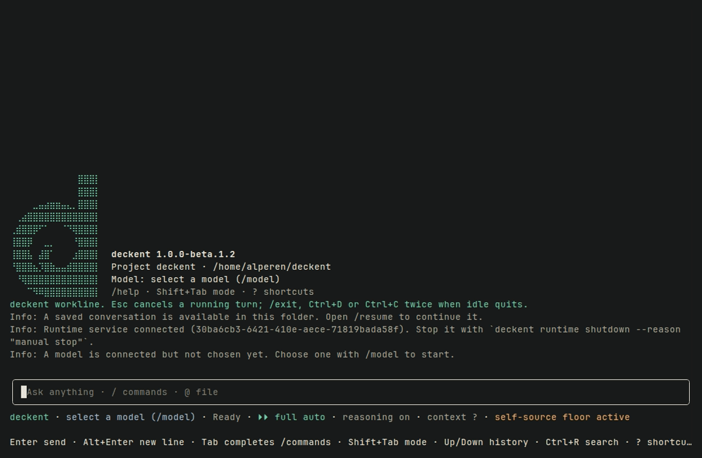

</div>

<!-- Node and pre-release badges read public main package.json, not this local branch.
Keep package.json version and CHANGELOG.md release line together at each release.
npm badges: enable only after the first npm publish. The unscoped name `deckent` is not usable (conflicts with an existing
package); the planned name is the scoped `@verhex/deckent` (proposed name; not finalized). Verify package identity first.
[](https://www.npmjs.com/package/@verhex/deckent)
[](https://www.npmjs.com/package/@verhex/deckent)
-->

> [!NOTE]
> This README describes **beta pre-release `1.0.0-beta.1.2`**, the current release candidate; [CHANGELOG.md](CHANGELOG.md)
> lists beta releases, newest first; older releases are in [CHANGELOG-alpha.md](CHANGELOG-alpha.md).
> deckent is not on npm yet: install it from source as shown in
> [Get started](#get-started). An npm package is planned during the beta line, probably as `@verhex/deckent` (the name is
> not final yet). The eight acceptance gates remain open during the beta line; beta acceptance is announced separately.
>
> Alpha.64 is the last alpha. Once it writes approval origin, delivery mode, Brain origin or resource-key records,
> alpha.63.3 cannot read them: **there is no rollback to alpha.63.3**. Recovery requires a forward fix;
> keep pre-upgrade backups for data recovery. See [known limits](docs/known-limits.md).

## What is deckent

AI agents can now run commands, change code and call business systems. Getting them to act is no longer the hard part.
The hard part is knowing who allowed an action, where it ran, what it cost and how to undo it. Most tools leave that to
the person watching the screen.

deckent is the layer that answers those questions. You install it on your own machines, and every request goes through
the same checks, whether it comes from a person at the terminal, an AI agent over MCP or a script: identity, scope,
policy, approval and budget. The work then runs in a sandbox or a Docker worker, and every decision and effect is written
to a durable ledger. For example, before a paid model call deckent reserves the most the call could cost against the
project's budget; if the price is unknown or the budget is too small, the call is refused before anything is sent.

The same foundations are built to serve one person on a laptop and a company with many teams. Software work is the first use:
coding workers use a connected Claude/Codex CLI in a bubblewrap sandbox or an eligible Docker profile, and deckent delivers
the change to project files or a Git reference. Business
systems such as an ERP or a CRM use the same contract: a declared operation, a write that applies only if the record is
unchanged, a resend that can never apply twice, acceptance on evidence, and a planned undo (compensation) when something
must be reversed. Core ships that contract and a generic HTTP target; connectors
for specific ERP products are not built yet.

The open-source Core (Apache-2.0) runs on its own. A proprietary Enterprise edition is planned as a separate distribution
that plugs into Core's extension registry without editing Core; Enterprise SSO, fleet management and ERP connectors
belong there. The [glossary](docs/glossary.md) explains the terms used below, such as scope, Run and approval.

## How it works

You ask for something in plain words. deckent turns it into checked, isolated steps, and nothing runs unless policy and
your permission mode allow it.

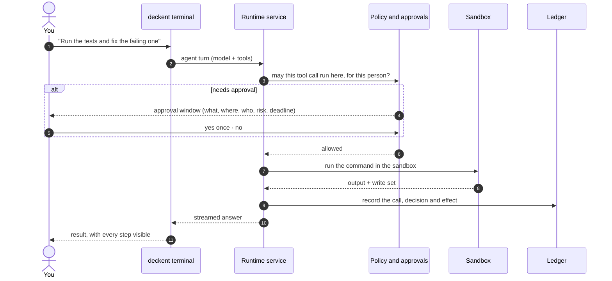

Three jobs make this work:

| | |
|---|---|
| 🗼 **Govern** | One identity, scope and policy model for people and AI agents. When something needs approval, the window shows exactly what: the full command, where it runs, on whose behalf, the risk, whether it can be undone and a deadline. A role description (persona) or a model's advice never grants permission. |
| 🛫 **Execute** | Runs, tasks and workers are admitted, scheduled and recovered on your machines. Agent shell commands and MCP servers run in sandboxes (bubblewrap, Landlock) where the host provides one; coding workers use bubblewrap or Docker according to their profile. Models come from Anthropic, OpenAI, DeepSeek, Z.ai and Zhipu (GLM), OpenRouter, a local server or an OpenAI-compatible endpoint with published prices. |
| 📜 **Prove** | Every decision and effect lands in a durable ledger and audit trail. Approvals are sealed, patches are retained, and a change is tried on a separate copy of your repository before it is delivered. |

Every way in uses the same typed contract: one set of operations and checks. Operations that need the runtime go through one local runtime service per
project, which checks identity, scope and policy on each call, writes the result to the ledger and lets effects happen
only where policy allows. Setup, observation and some patch steps use the same contract locally, without the service.

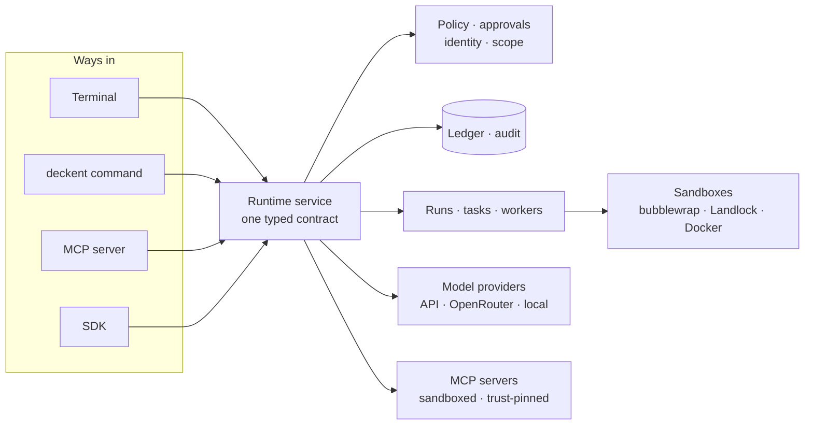

## Get started

For an AI assistant installing on your behalf, use the [AI installation guide](docs/ai-install.md); it names the steps only you can complete.

### Requirements

- Linux, or Windows through WSL2, on x86_64. Native Windows is not supported, and on macOS the runtime service does not
  run yet (see [Not yet](#not-yet)).
- Node.js 24.22.1 or newer on 24.x, or 26.12.1 or newer (Node 25 is not supported).
- Docker. Building from source uses it to compile the locked bubblewrap sandbox (0.13.0); Docker worker profiles also need it.
  After the build, a first chat needs neither Docker nor a paid call if you use a local model server such as Ollama or
  LM Studio.
- Git and a C build toolchain (for the native sandbox helper).

### Install from source

Install a supported Node version from the [Node.js download page](https://nodejs.org/en/download), choosing Linux for
WSL2 too, then check `node --version` and `npm --version` in that terminal. Ubuntu's `apt install nodejs` may supply
Node 18, which cannot run deckent. If npm reports `EBADENGINE`, upgrade Node to the range in [package.json](package.json),
open a new terminal and run `npm ci` again in the clone.

Until the npm package is published, build deckent once from source and link the `deckent` command:

```sh
git clone https://github.com/Verhex/deckent-next.git
cd deckent-next
npm ci
node scripts/build-bwrap.mjs --arch all --out .pack/bwrap/first-build
node scripts/build-bwrap.mjs --stage-dev .pack/bwrap/first-build
npm run build
npm link
```

If the clone already exists, enter it with `cd deckent-next` and check `git status`; continue there instead of cloning
over it. A completed clone with an interrupted dependency install can resume with `npm ci` (it replaces `node_modules`,
not your source changes). If the clone itself is incomplete, keep that folder and clone to a different directory.
After a failed bubblewrap build, use a fresh `--out` directory and stage only a completed build before `npm run build`.

An npm notice about moderate vulnerabilities is a dependency audit, separate from whether `npm ci` completed.
If installation exited successfully, the next build step is available; the notice is not a security clearance.
Read `npm audit` for the affected packages and report them to the maintainers. Keep the lockfile for this setup;
do not run `npm audit fix --force`, which can install incompatible dependency versions.

The build ends with `bubblewrap=present` or `bubblewrap=staged from …`. If it stops with `BUBBLEWRAP_BUILD_REQUIRED`,
Docker was not reachable: rootless → `systemctl --user start docker` (`systemctl --user enable docker` for future sessions); system Docker → `sudo systemctl start docker`; Docker Desktop on WSL → start Desktop and enable Settings > Resources > WSL Integration.
Both scripts check Docker before long work; the error gives the detected setup's command (or all three when unknown). Run both `build-bwrap` commands again with a new `--out` directory (for example
`.pack/bwrap/second-build`), then `npm run build`. On Ubuntu 24.04 and later the kernel may block the user
namespaces bubblewrap needs; deckent then says so and falls back to Landlock. The
[operator reference](.deckent/docs/architecture/operator-reference.md#source-build-and-sandbox-posture) explains both
cases and how an administrator lifts the restriction. The [contributor quickstart](CONTRIBUTING.md#a-30-minute-quickstart)
lists the prerequisites again and runs one test without a provider key.

### Update an existing install

In your existing source clone, check `git status` and preserve any local changes before choosing the revision to install.
Fetch the available revisions, replace `<revision>` with the wanted tag or commit, then repeat the install steps:

```sh
git fetch origin --tags
git checkout <revision>
npm ci
node scripts/build-bwrap.mjs --arch all --out .pack/bwrap/update-build
node scripts/build-bwrap.mjs --stage-dev .pack/bwrap/update-build
npm run build
npm link
deckent --version
```

Use a fresh `--out` directory each time, or stage an existing completed build that matches the checked-out bubblewrap lock.
Then run `deckent doctor` in each existing project folder.
If doctor reports `INSTALLATION_IDENTITY_RELOCATED`, see [the known limit](docs/known-limits.md#installation-moved): `deckent init identity --keep` is enough in a project that is not the registered source; the registered source needs more steps and has limits in this beta.

### Your first session

This takes you from an empty project to a governed chat and its cost, without leaving deckent. Change to your own project folder,
outside the deckent source checkout; from here on everything is `deckent`.

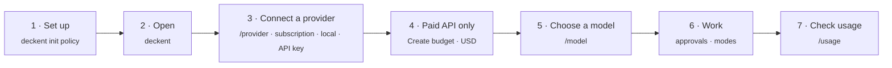

1. **Set up once per project.** A *scope* is the stable name that ties policy, work records and spending to this project;
   it is not a folder or a sandbox. Use a folder you own that other accounts cannot write to. On systems such as Ubuntu
   that create group-writable folders, deckent asks once on a real terminal whether to narrow that folder's permission.
   Yes removes group/other write access from that folder only; no leaves it unchanged and shows `chmod go-w .` guidance.
   For `terminal attach --preview`, this explicit permission step happens before the read-only preview; after yes, copy and run the complete apply command printed at the end.
   It includes `--scope <id> --apply --expect <digest> --command-id <uuid>`; keep the same command id when retrying.
   Attaching a project requires that explicit command id; apply does not generate one.
   Machine output (`--json`), non-TTY and AI callers are refused without a question or permission change.
   Choose a scope such as `my-project`, preview the policy and install it:

   ```sh
   deckent init policy --scope my-project --preview
   deckent init policy --scope my-project --apply
   deckent doctor
   ```

   The policy lets you connect and call models, keep keys and set budgets in that scope; each of those actions is still
   checked and recorded. `deckent doctor` reports what is ready and exits non-zero if setup cannot start. `deckent init`
   runs the same setup step by step and lists what is still missing.
2. **Open the terminal** with `deckent`. It opens in the scope you just set up (`deckent --scope my-project` picks one
   explicitly) and starts the runtime service in the background. To start in Turkish, run `deckent --lang tr`; save that
   preference with `deckent config set --global language '"tr"'` (English: `'"en"'`; the value is JSON, so the quotes are needed). You can also choose it during `deckent init --lang tr`.
3. **Connect a provider** with `/provider`. Choose **Sign in with Claude**, **Sign in with ChatGPT (Codex CLI)**,
   a local model, or **Connect with an API key**. Subscription sign-in uses the CLI's own flow at your terminal;
   an API key goes into a masked field and is stored by deckent. Choose the exact model to connect in this scope.
   First subscription consent defaults to you and AI actors, including connected MCP clients sharing that AI identity.
   You may restrict it to yourself; background/system use needs its own consent. Step 5 selects the session's model.
4. **Set a budget for priced API calls.** Every paid API turn reserves from the scope's shared USD budget and is refused
   without one. In `/provider`, move down past the connections to **Create budget**, or type `budget` to filter the list.
   The window highlights **10 USD**; choose 5, 10, 25, 50 or 100 USD, or **Another amount (arrow keys)** for a whole-dollar
   amount from 1 to 1000, then confirm. Subscription and local models need neither an API key nor a USD budget;
   provider-plan limits still apply to subscriptions.
5. **Choose a model** with `/model`, for this session or as your default. A model you cannot use yet is shown locked,
   with the reason and the fix.
6. **Work.** Ask in plain words. Tool calls follow your installation's policy and your permission mode; anything that needs
   you opens the approval window (see [Safety and control](#safety-and-control)).
7. **Check usage** with `/usage`: the tokens this conversation used and the scope's budgets. It is deckent's
   measurement, not the provider's invoice.

These screens come from the real terminal, recorded on alpha.53 (120×36, the default full-window layout) in a throwaway
project with a small local test model: no provider was called and no real key was used. The empty conversation rows above
each window are trimmed; nothing else is changed.

<table>
  <tr>
    <td width="50%">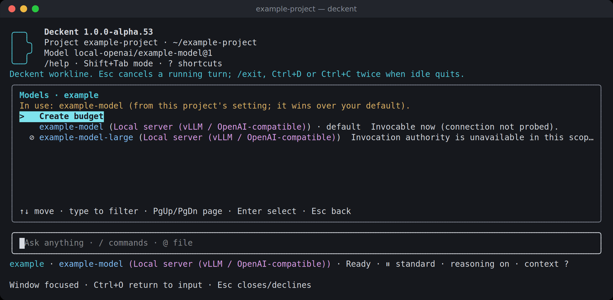<br><sub><b>Before a budget.</b> <code>/model</code> offers <b>Create budget</b> first. The local test model is already usable, because local models need no budget; a model this scope may not call is locked with its reason.</sub></td>
    <td width="50%">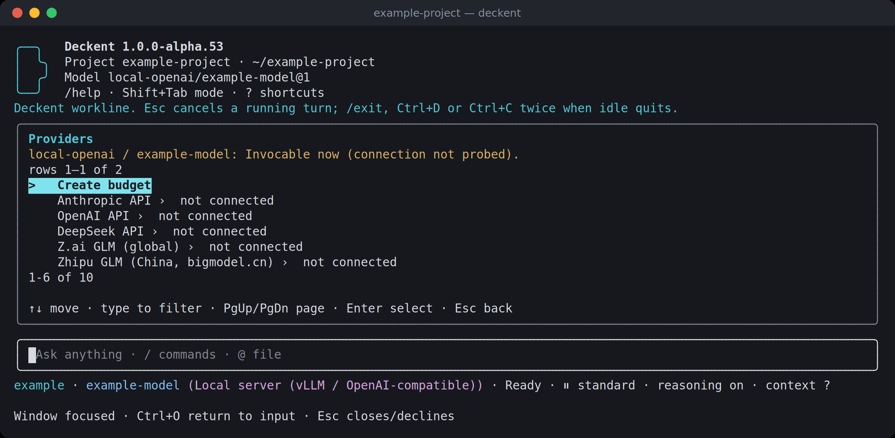<br><sub><b>/provider.</b> Connections come first; move down or filter for <b>Create budget</b>. This illustration predates that order.</sub></td>
  </tr>
  <tr>
    <td width="50%">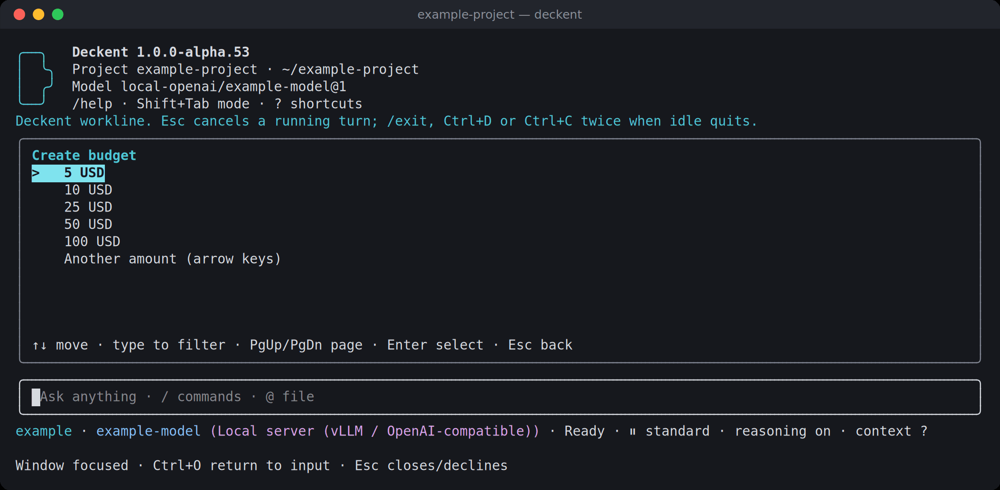<br><sub><b>Budget window.</b> Preset amounts, or another amount with the arrow keys.</sub></td>
    <td width="50%">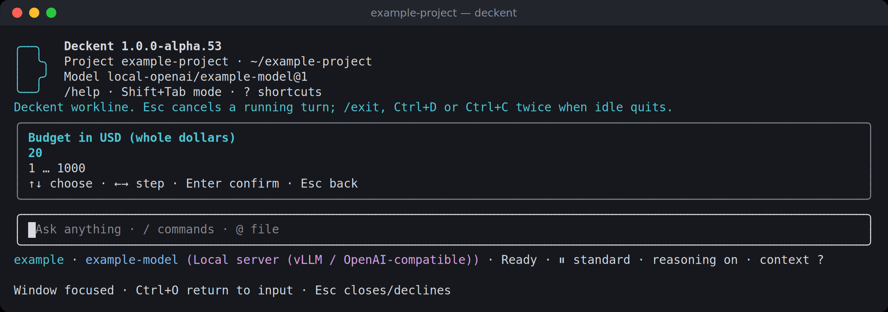<br><sub><b>Another amount.</b> Whole dollars, 1 to 1000; nothing is sent before you confirm.</sub></td>
  </tr>
  <tr>
    <td width="50%">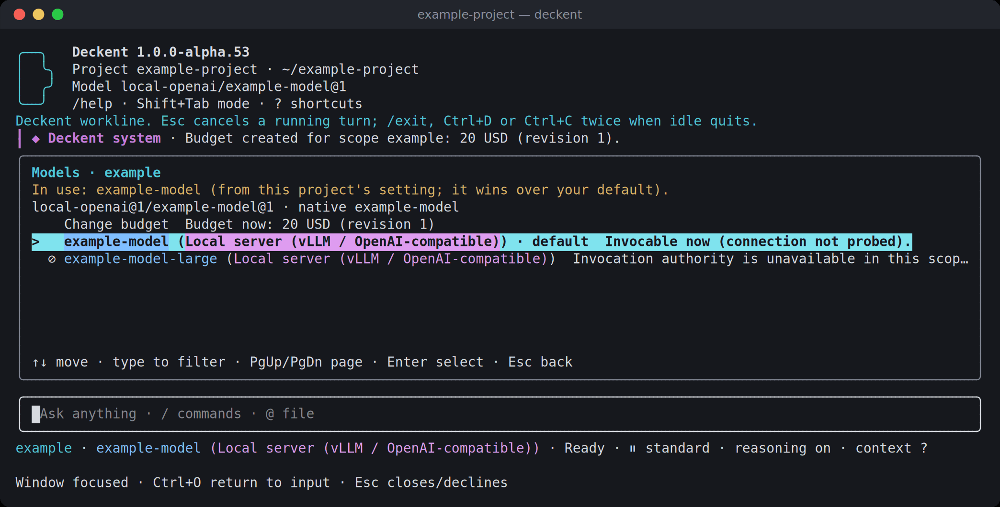<br><sub><b>After the budget.</b> The framed system line records the budget, and the first row now reads <b>Change budget</b>.</sub></td>
    <td width="50%">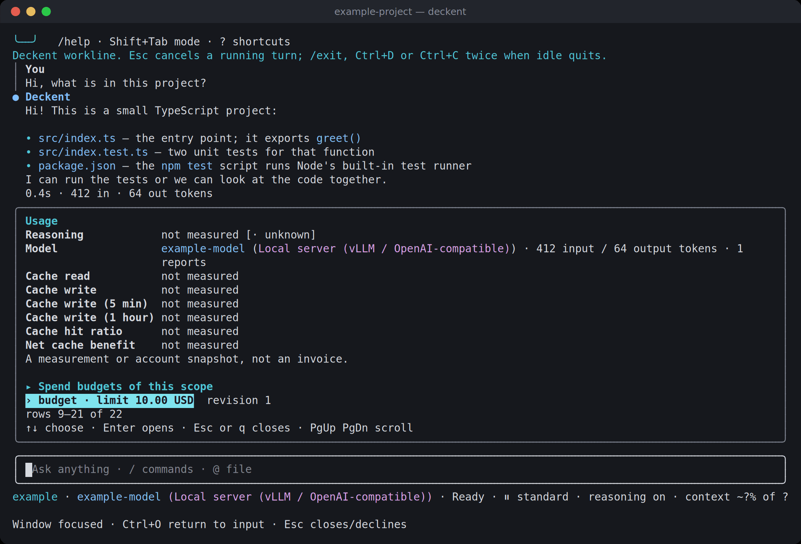<br><sub><b>/usage.</b> Tokens this conversation measured and the scope's budgets.</sub></td>
  </tr>
</table>

For an API-key connection, steps 3 and 4 also have command-line forms; secret entry stays with the person:

```sh
deckent secret set DECKENT_ANTHROPIC_KEY --main
deckent models create-budget --scope my-project --usd 20
deckent models connect --scope my-project --connection anthropic-api --command-id connect-1 --model claude-sonnet-5-5
```

`secret set` asks for the key in a hidden prompt and refuses a piped key. `--command-id` is any unique name you choose;
repeating the same command with it never connects twice. The
[operator reference](.deckent/docs/architecture/operator-reference.md#provider-connection-details) lists the secret name
of every provider, the local and OpenAI-compatible options and what works with a subscription today.

## Your first job

A chat is only the start. deckent plans the job, you approve the plan and a worker runs in its assigned sandbox.
In working-tree mode, confirming delivery writes the patch to your project files. Reference mode writes a Git reference;
branch adoption is a separate confirmation. With no work target or adoption targets, working-tree mode is the default,
including on upgraded installations. The delivery card tells you which effect you are approving.

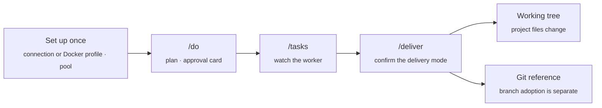

Start in a Git project with at least one commit and a connected model. For a Claude or ChatGPT subscription,
sign in and connect through `/provider`, then open `/setup` to prepare the worker. These Claude/Codex CLI workers run
inside bubblewrap on Linux/WSL and need no Docker image. Signing in to a CLI outside deckent does not complete this setup.
If you use an eligible Docker worker profile instead, `/setup` prepares or selects its image; building one needs Docker
and network access.
Only paid API calls need a USD budget. Real-account and clean-machine first-job checks are still open
([known limits](docs/known-limits.md)).

### One-time setup

The packaged Claude recommendations use Opus 5.5 for everyday work and
[Fable 5.2](https://platform.claude.com/docs/en/models/fable-5-2/overview) for demanding reasoning.
Fable 5.2 requires [Claude Code 2.1.321 or later](https://code.claude.com/docs/en/model-config).
Fable 5.1 remains selectable in the catalog; registration and recommendations do not activate a model.
Using Fable 5.1 for a role requires assigning that role explicitly with `deckent models roles set`.

In `/setup`, choose the worker, its execution settings, the kind of work and the worker pool. Each step shows what
will change and asks before writing. Build or select an image only for a Docker worker; some second-provider setup
paths still require one ([known limits](docs/known-limits.md)).

```sh
# Set up your project and open the terminal; /setup revisits the worker steps.
deckent init
deckent
# Show missing steps and their commands outside the terminal.
deckent doctor
# If the service was already running, reload it after setup.
deckent runtime restart
```

For command-line setup, an existing worker template, Cursor's catalog step or repository instruction settings, use the
[operator reference](.deckent/docs/architecture/operator-reference.md#first-job-setup-in-detail).
It covers connection ids, previews and older installations.

### Run the job

1. **Ask.** In the terminal type `/do` and your request in plain words (`deckent do --request "<text>"` from the command
   line). A connected model plans it, and deckent prints the plan with an acceptance line for each task:

   ```text
   Plan for Run <run-id> · <status>
   Task t1: <what the task does> · kind coding · WorkClass <class>
     Acceptance: <the criterion the result must meet>
   Permissions checked by policy at admission: <one task/execute per task>
   Waiting for your TTY approval <approval-id>, expires <time>. The model cannot authorize this work.
   ```

   *WorkClass* is the kind of effort the task needs; it selects the worker and the model.

2. **Approve.** A card asks you to approve creating the Run. Judge the plan and its acceptance lines (the card's risk and
   undo lines are not classified yet for plans), then press `y`. The card expires after 10 minutes, and the model cannot
   approve for you. The line `Run <run-id> admitted. Follow /tasks or /monitor.` then means the work started, not that its
   result was accepted.
3. **Watch** with `/tasks` or `/monitor` (`deckent monitor` outside the terminal). Coding acceptance checks the process
   outcome, retained patch and required result report, including declared acceptance-check results. Content is not
   independently verified; the report-support and untyped-check limits remain in [known limits](docs/known-limits.md).
4. **Deliver** with `/deliver`. Read the title, change summary, evidence, risk and the effect of yes or no.
   In working-tree mode, `y` writes the patch into your project files without committing or staging it. Changed-file
   conflicts refuse delivery; preserve your edits and follow the card's next step. Undo is a separate working-tree
   rollback confirmation and refuses conflicting later edits. In reference mode, `y` writes under
   `refs/deckent/deliveries/`; your working files and index stay unchanged, and branch adoption is separate.
5. **Adopt in reference mode** into a branch if you want, with a separate `y`. deckent moves only a branch you allowed and nobody has
   checked out, so create one first:

   ```sh
   git branch deckent/first-job HEAD
   deckent config set execution.adoption.targets '["refs/heads/deckent/first-job"]'
   ```

   Look at the result with `git log deckent/first-job` and merge it yourself. If the project uses the delivery queue (the
   service's per-branch queue of deliveries), an adoption can be rolled back with its own confirmation; the
   [operator reference](.deckent/docs/architecture/operator-reference.md#delivery-queue-inspect-and-undo) shows the
   commands.

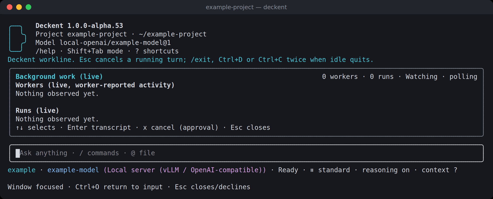

<sub><b>/tasks.</b> Workers and Runs in one live window; cancelling asks for approval (empty here: no background work yet).</sub>

## See it work

Real sessions on `1.0.0-beta.1.2` in a throwaway installation, recorded from the terminal. Each scene that uses a model
chooses it with `/model`, so the status bar names it. Approvals are answered by a labelled synthetic person in that
installation, and waits for the model and the runtime are cut.

<table>
  <tr>
    <td width="50%">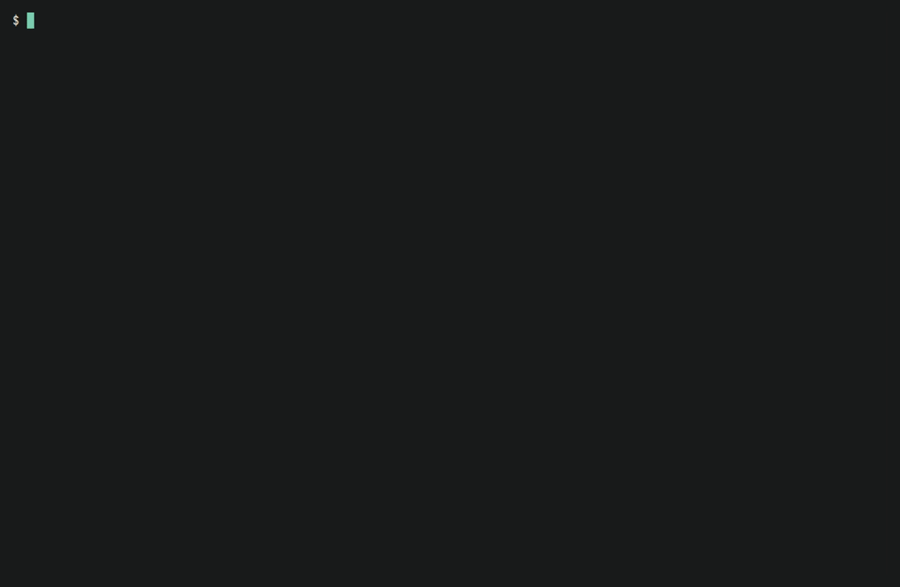<br><sub><b>Install.</b> <code>deckent --version</code>, then <code>deckent init</code> in a fresh throwaway installation: language, scope, who uses it, the first-run permissions, the command sandbox and a final check. The first <code>deckent</code> then offers the management rights, a model connection and a coding CLI before the chat opens. No model is used.</sub></td>
    <td width="50%"><br><sub><b>Plan and workers.</b> <code>/do</code> turns one request into three read-only tasks; the plan card names each task's worker, gpt-6-luna on the Codex subscription, and the synthetic person approves it. The monitor shows a task waiting for an execution slot: one subscription sign-in runs one worker at a time, so the tasks take turns. The Run ends accepted on exit code, with the content not independently verified. Planner: Claude Sonnet 5.5 (Anthropic API).</sub></td>
  </tr>
  <tr>
    <td width="50%">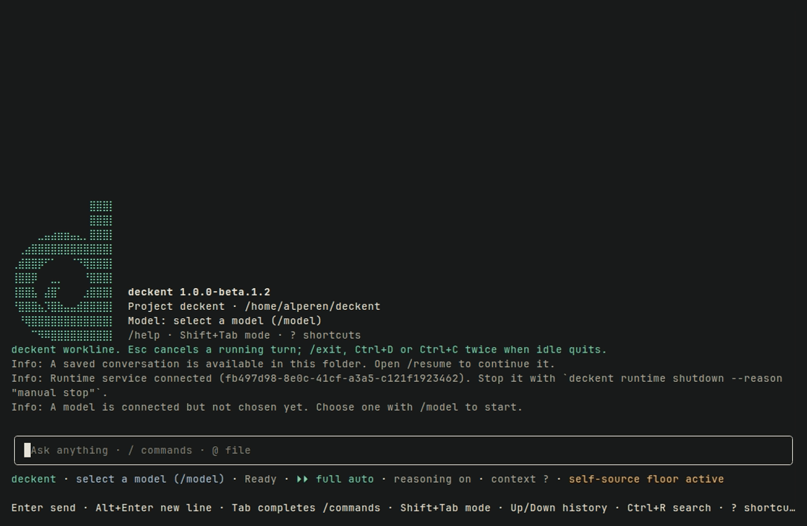<br><sub><b>Plan, evidence, delivery.</b> GPT-6.1 Sol (OpenAI API) plans one task with its acceptance criterion and the synthetic person approves it. The task is accepted on the worker's exit code; the delivery card shows the changed file and its line counts, the worker's report as an unchecked claim and “System verification: none recorded”. The synthetic person says yes, and the file is written into the checkout with no commit. Worker: Claude Sonnet 5.5 (Claude subscription).</sub></td>
    <td width="50%"><br><sub><b>Approval and modes.</b> <kbd>Shift</kbd>+<kbd>Tab</kbd> steps to standard, so a shell command opens the approval window: what, where, on whose behalf, scope, why, risk, undo and a live deadline. The synthetic person allows it once; <code>/mode</code> lists the same modes. Model: DeepSeek V4.1 Flash (DeepSeek API).</sub></td>
  </tr>
  <tr>
    <td width="50%"><br><sub><b>Refused and recorded.</b> The agent's shell runs in a bubblewrap sandbox that hides your home folder and keeps deckent's authority files read-only. Its shell command that appends to the policy file is a kind that always asks, even in full auto; the synthetic person answers No, nothing is written, and the audit log keeps a <code>policy-turn</code> record of the refused call. Model: Claude Sonnet 5.5 (Anthropic API).</sub></td>
    <td width="50%"></td>
  </tr>
</table>

## Everyday use

### In the terminal

`deckent` opens the interactive terminal. Every slash command answers in its own window; <kbd>Esc</kbd> closes it and leaves
one framed `deckent system` line in the conversation instead of a wall of text. Settings are changed by choosing, not
typing: `/config` walks from section to key to the allowed values, and each change goes through policy and may become
an approval. `/help` lists every command by purpose; the most used ones are:

| Purpose | Commands |
|---|---|
| Work | `/do` ask for a job · `/tasks` live work · `/runs` every Run, with hold, resume and close · `/deliver` · `/cancel` |
| Approvals | `/approvals` pick a pending approval and decide it |
| Settings | `/provider` · `/model` · `/config` · `/mode` · `/mcp` · `/policy` |
| Information | `/status` · `/usage` · `/context` · `/doctor` · `/monitor` · `/scope` · `/help` |

<table>
  <tr>
    <td width="50%">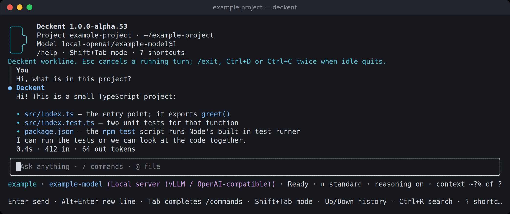<br><sub><b>Chat.</b> Your lines and deckent's answers are visibly distinct, with time and tokens per turn.</sub></td>
    <td width="50%">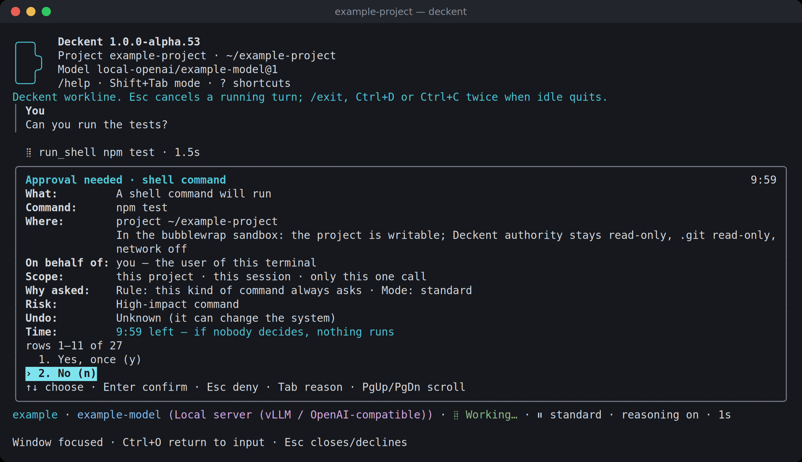<br><sub><b>Approval window.</b> What, where, on whose behalf, scope, why, risk, undo and a live deadline. The answers are a list; "this session" and "always in this project" appear only where policy offers them.</sub></td>
  </tr>
  <tr>
    <td width="50%">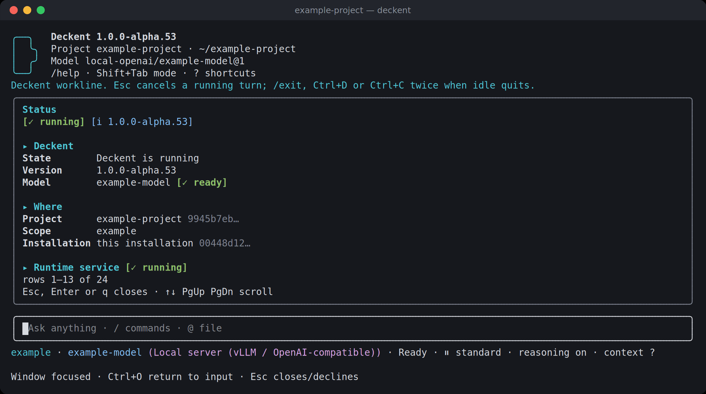<br><sub><b>/status.</b> A human summary first; identities, process and build under the details.</sub></td>
    <td width="50%">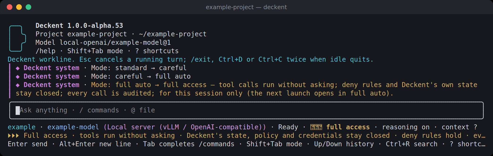<br><sub><b>Modes.</b> <kbd>Shift</kbd>+<kbd>Tab</kbd> cycles the modes you are allowed; full access is clearly marked.</sub></td>
  </tr>
  <tr>
    <td width="50%">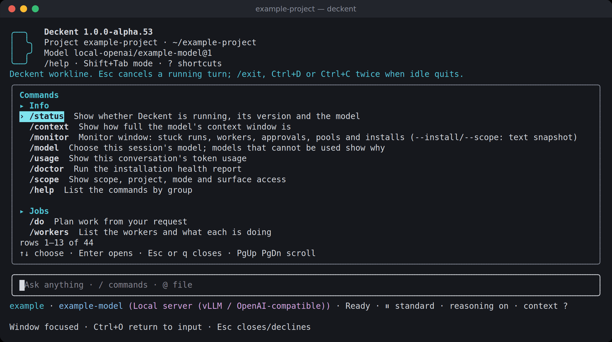<br><sub><b>/help.</b> Commands grouped by purpose, one line each; the window scrolls.</sub></td>
    <td width="50%">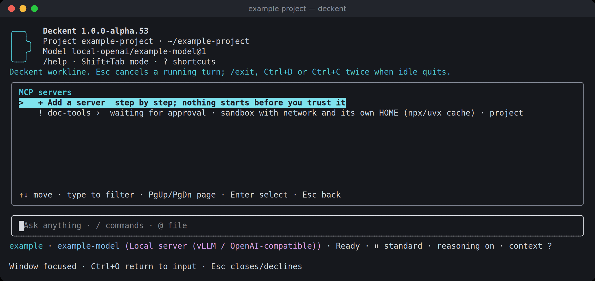<br><sub><b>/mcp.</b> Add a server step by step; each configured server shows its trust state and where it runs (here a sandbox with network).</sub></td>
  </tr>
  <tr>
    <td width="50%">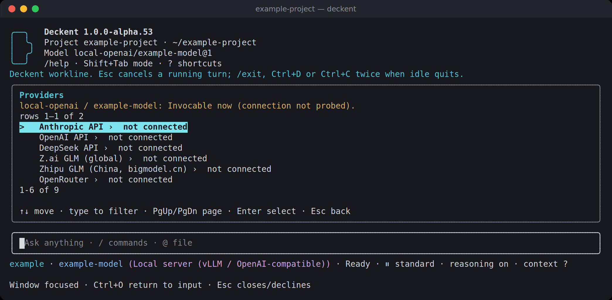<br><sub><b>/provider.</b> Each provider with its connection state, OpenRouter included.</sub></td>
    <td width="50%">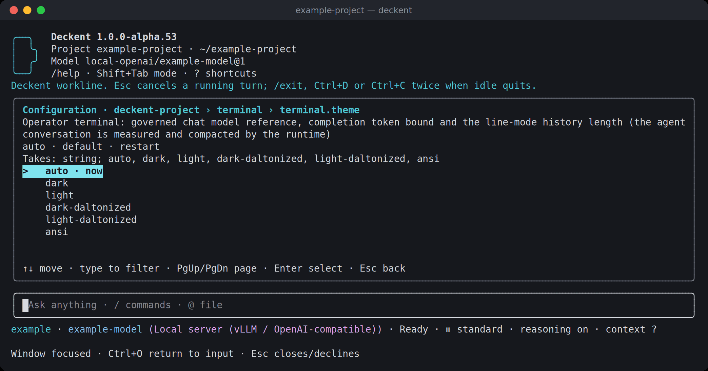<br><sub><b>/config.</b> Section, key, then one of the allowed values; the current one is marked.</sub></td>
  </tr>
  <tr>
    <td width="50%">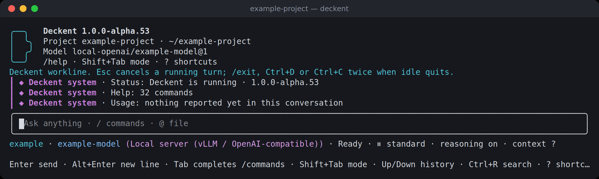<br><sub><b>System lines.</b> Each closed window leaves one framed summary line.</sub></td>
    <td width="50%"></td>
  </tr>
</table>

### On the command line

The `deckent` command does one thing per call and prints text for people; add `--json` for the same result as data.
On a person's terminal, commands that change something pick missing values with arrow keys and confirm on a card; AI
tools, pipes and CI pass every value as a flag and are never asked. `deckent --help` lists every command, and
`deckent <command> --help` shows the details.

```sh
deckent doctor                            # health of this installation
deckent monitor                           # live, read-only view of installations and work
deckent run list                          # Runs of this scope, newest first
deckent approval list                     # waiting approvals first, with the time left
deckent report --scope my-project --run <id>   # one Run's cost and acceptance evidence
deckent audit verify                      # check the audit history
deckent backup create --scope <id> --set <folder>   # write a verifiable recovery set (passphrase at the prompt)
deckent policy grants --mine              # your standing "always" grants
deckent memory                            # the scope's memory journal: facts and lessons
deckent agents                            # the scope's agents and skills
deckent models roles show                 # which model serves which role
```

### Connect an AI client over MCP

MCP works in two directions. To give deckent's own agent an MCP server, add it with `/mcp` or
`deckent mcp add context7 -- npx -y @upstash/context7-mcp`. It starts only after you trust it, and by default it runs in a
sandbox with network access and its own home folder; a server configured for `host` runs without a sandbox, and `/mcp`
shows where each one runs.

To let an outside AI client use deckent, register `deckent-mcp`, deckent's stdio MCP server, in that client; in Claude
Code that is `claude mcp add deckent -- deckent-mcp --project /path/to/project`. Most of its tools need the runtime
service, so keep `deckent runtime serve` running. The client acts as a separate MCP actor that can only observe at
first. To let it do more, open `/policy` (**MCP permissions**), choose a scope and a capability group and grant it after
reviewing the exact rules; the same works from the command line:

```sh
deckent policy mcp list --json
deckent policy mcp grant --group work --scope my-project --preview
deckent policy mcp grant --group work --scope my-project --apply --expect <preview-digest>
```

Applying needs your approval at your own terminal and is audited. [Policy and AI](docs/policy-and-ai.md) explains how
human and AI authority differ.

### The runtime service

Model turns, approvals, `/do` and recovery run in one local runtime service per project. `deckent` starts it in the
background when none is running, and a service the terminal started stops itself after 15 minutes without work.
`deckent runtime serve` runs it in the foreground instead; `deckent runtime restart` restarts it with the current build
and configuration, and `deckent runtime describe` shows the running one. The
[operator reference](.deckent/docs/architecture/operator-reference.md#runtime-service) covers logs, stop permission and
older installations.

## Safety and control

Two things decide every tool call an agent makes: your installation's policy and the permission mode you chose. Policy
sets the limits; the mode only chooses how often you are asked inside them, and a deny always wins. You move between
the modes you are allowed with <kbd>Shift</kbd>+<kbd>Tab</kbd> or `/mode`.

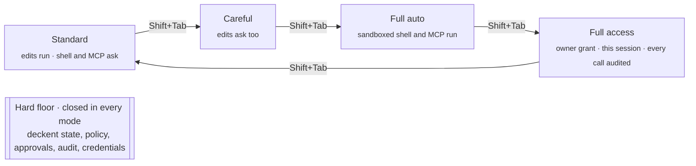

| Mode | Runs without asking | Asks first |
|---|---|---|
| **Standard** | Reads, ordinary file edits | Shell commands, protected paths, MCP calls |
| **Careful** | Reads | Every edit as well |
| **Full auto** | Edits, shell commands contained in the sandbox, MCP calls | Host shell, destructive commands (`rm -r`, …), protected paths |
| **Full access** | Everything policy allows above the hard floor; every call is audited | The hard floor and whatever policy still requires; needs a grant from the installation owner (on a solo install, that is you); switched on for this session, or saved as your start mode with `/mode start full-access` |

The installation owner opens full auto and full access with
`deckent init policy --scope <id> --modes full-auto,full-access --preview` and then `--apply` at their own terminal;
AI tools, pipes and CI cannot. Agent shell commands run in a sandbox: in the first three modes the project is writable
within the call's approval, `.git` is read-only, your home folder is hidden and the network is off. Full access needs an
open bubblewrap sandbox, which adds the network and your home folder but still hides deckent's own state and known
credential files. If no sandbox is available, a closed mode falls back to the host and says so (the default
`terminal.shell.realm: prefer-sandbox`); that fallback has no filesystem boundary, so set `require-sandbox` when
confinement is mandatory. The [operator reference](.deckent/docs/architecture/operator-reference.md#sandbox-views)
describes each view and its limits.

### Approvals

When a call needs you, the approval window shows the full command, where it runs, on whose behalf, why it asks, the risk,
whether it can be undone and how long you have; if nobody decides, nothing runs. A model can never approve. A tool call's approval can be answered only in the
terminal that started that turn. Approvals that wait without a running turn, such as a `/do` plan, can be picked and
answered with `/approvals` or `deckent approval list` at a verified terminal. You can answer once; where policy offers it,
also for this session or always in this project; your "always" grants are listed with `deckent policy grants --mine` and removed with `deckent policy revoke`. For an
operation on a business system the card names the operation, the target and a short digest of the input; the individual
fields it will write are not shown yet.

### API keys

Store a provider key once, in the masked field of `/provider` or with `deckent secret set NAME --main` (a hidden prompt;
a key passed as an argument or through a pipe is refused). Never put it in `ANTHROPIC_API_KEY`, a shell profile or a
`.env` file: other tools read those. Fresh installations on Linux, WSL and macOS keep keys in an encrypted store.
Provider calls resolve the key inside the runtime, so it never reaches a prompt, the shell environment, an agent or a
worker. The encrypted store's unlock key sits next to it, so other programs running as your user could still open it;
`deckent doctor --verbose` says who can read your store, and the
[operator reference](.deckent/docs/architecture/operator-reference.md#secret-stores-and-strict-install) shows the stores
and a stricter setup.

### Spending

Each scope has one USD budget shared by every API provider. Before a paid call deckent reserves the most it could cost;
afterwards it settles the call from the usage the provider reported, multiplied by the verified published price
(OpenRouter calls settle from the cost OpenRouter reports). A remote model without a verified price is refused. A call
that never reported its final usage stays reserved until you resolve it with `deckent models reconcile-spending`. If a
charge ever exceeds what was reserved, the scope stops new paid calls until you lift the freeze with
`deckent models revise-budget --scope <id> --usd <n> --unfreeze`. The settled amount is deckent's calculation, not the
provider's invoice, so keep a spending limit in your provider account as well. The
[operator reference](.deckent/docs/architecture/operator-reference.md#spend-settlement) covers price tiers and
OpenRouter settings.

## What works today

- **Work with an agent in the terminal**: streamed turns, file edits and a sandboxed shell, approval and monitor windows,
  permission modes, MCP tools, conversation compaction, in English and Turkish.
- **Ask for a job in plain words**: `/do` plans it with acceptance criteria, you approve, a coding worker (Claude Code,
  Codex or Cursor) runs in bubblewrap or Docker as configured; `/deliver` writes to project files or a Git reference
  according to the delivery mode. Branch adoption needs a separate confirmation.
- **Orchestrate work**: Runs, tasks and attempts (each try of a task) are admitted, scheduled, held, resumed, cancelled and recovered, all
  recorded in a durable SQLite ledger.
- **Choose models and control cost**: connect your own key, pick a model per session or as default, run local models,
  use the Anthropic prompt cache, and keep every paid call inside a budget you set.
- **Govern**: local identities, scoped policy, one approval broker for every surface, standing grants you can
  list and revoke, and an audit trail you can verify.
- **Operate**: `deckent monitor` for a read-only view, `deckent doctor` for health, `deckent config` for settings, and
  `deckent backup create|verify|restore` for verifiable recovery sets on a schedule if you choose.
- **Manage signed content**: import and verify signed agent and skill packages, inspect trust and revocations, and decide
  changes on scoped cards. Public Hub connections still need deployment setup; no source is enabled by default.
- **Remove an installation with a preview**: `deckent uninstall` offers keep my data (default), keep pending work and delete
  everything (backup first); `--dry-run --json` shows any plan. Applying needs your terminal card; images stay protected.
  The [AI installation guide](docs/ai-install.md#uninstall) explains the steps and remaining limits.
- **Core layers, in code and not yet proven in real use**: the system picks the worker model for each kind of work from a
  list you can see; memory fills from accepted work and is verified by you or an independent evaluator; lost workers are
  detected and recorded as proposals; the Brain can plan with your own Claude subscription inside a sandbox, after your own
  login and consent; agents and skills are versioned and every AI change to them is signed. Each switch (memory, lost-worker
  detection, recovery, agent statistics) starts off and has a shadow mode that applies nothing; memory verification and
  recovery in shadow still call their model, so data goes to that provider and the call is spent. Automatic recovery does not
  act until you promote a measured rule, grant its exact action and enable the mode. The new rights come from a policy upgrade by the
  installation owner: `deckent policy upgrade --template current` for a policy from the first-run template, or
  `deckent init policy --scope <id> --upgrade --person <issuer>/<subject>` for a hand-written one
  ([known limits](docs/known-limits.md#core-layers)).

### Not yet

- **No npm package.** Install from source until the npm package is published.
- **No Desktop app, Dashboard or remote HTTP API.** Use the terminal, the `deckent` command, MCP or the SDK.
- **No coordination of multi-step business processes yet.** One request becomes one Run; longer processes that
  coordinate several rounds and waits are planned.
- **No ERP or CRM connectors.** The operation contract and a generic HTTP target exist; product connectors do not.
- **Delivery is never automatic.** A rule records whether it *would* deliver each queued item, but it only advises; every
  delivery, adoption and rollback waits for your `y`.
- **Coding content is not independently verified.** Checks cover how the worker finished, its saved patch and required
  report, including the acceptance checks it reports; they do not independently judge whether the content meets your request.
- **Subscriptions have limits.** Claude and ChatGPT (Codex CLI) connections support tool chat, coding workers and Brain
  inside bubblewrap on Linux/WSL. Claude's old Docker subscription option is refused. The separate ChatGPT browser sign-in
  supports chat, but its worker is not enabled yet. Signing in does not by itself make a worker ready; real-account checks,
  a walk through the complete release and beta acceptance are still open.
- **Platforms.** Native Windows is not supported. On macOS the local runtime service does not run yet (its socket is
  Linux-only), so chat, jobs and backup cannot be used there. Delivery, adoption, rollback and key grants need a terminal
  witness that exists only on Linux (WSL included) and are refused on other systems. arm64 is not shipped. A Docker
  worker shares the host kernel; it is not a virtual machine.
- **Recovery sets are not fully encrypted.** Only the authority key inside a set is encrypted with your passphrase; keep
  sets on storage you trust.
- **No Enterprise SSO, fleet management or central policy service** in Core.

[Known limits](docs/known-limits.md) lists every open, untried or partial item with its impact and a workaround.

## Roadmap

The beta.1 candidate brings setup and speed improvements to a terminal that already supports subscription tool chat,
coding workers, job plans and approval cards; alpha.64 is the last released alpha.
The beta series is for improving these features through real work and checking complete journeys, including setup on
a clean machine; all eight beta acceptance checks are still open.
An npm package is planned, while the separate ChatGPT browser-sign-in worker, shared package Hub and native Windows/macOS
support still need verification before they are ready.
Desktop development depends on the planned work coordination features, and wider promotion waits for the project owner's
acceptance of that app; a separate Enterprise edition will add company administration and ERP connectors.

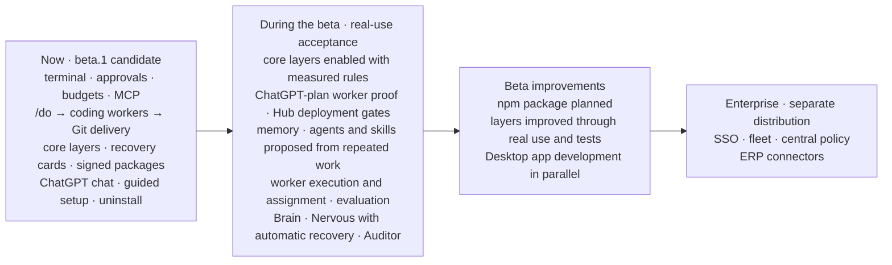

The **Brain** turns a request into a plan and accepts the results; the **Nervous** layer watches running work and
recovers it automatically when it stalls or fails; the **Auditor** checks what was accepted. Assignment picks the worker
and model for each kind of work, evaluation scores the outcomes, and memory carries what was learned to the next job.
Every layer acts only through the same policy and approvals as everything else.

## Learn more

- [Architecture overview](docs/architecture-overview.md): layers, security, extension points and current limits
- [Policy and AI](docs/policy-and-ai.md): human and AI authority, delegation, administration commands and compliance evidence
- [Glossary](docs/glossary.md): scope, execution environments, work lifecycle, approvals and spending
- [Known limits](docs/known-limits.md): what is not tried, not built or still open, with the impact and a workaround
- [Operator reference](.deckent/docs/architecture/operator-reference.md): setup values, sandbox views, key stores,
  spending, worker images, patch custody and recovery sets in detail
- [ARCHITECTURE.md](ARCHITECTURE.md): detailed engineering contracts and implementation notes
- [CHANGELOG.md](CHANGELOG.md): what each beta release brought; [CHANGELOG-alpha.md](CHANGELOG-alpha.md): older alpha releases
- [CONTRIBUTING.md](CONTRIBUTING.md) · [Code of Conduct](CODE_OF_CONDUCT.md) · [Security](SECURITY.md)

## License

Apache-2.0 (see [LICENSE](LICENSE)).
