<div align="center">

# Deckent

**Agent Control & Execution Plane**

Deckent combines a customer-installed runtime, a budget ceiling before every paid API call, sandboxed tools and MCP,
governed approvals, and one typed application contract for human and AI entry points.

*policy-driven agent runtime · governed execution · self-hosted agent control plane*

[](https://github.com/Verhex/deckent-next/actions/workflows/ci.yml)
[](LICENSE)
[](package.json)
[](CHANGELOG.md)

[Türkçe](README.tr.md) · [What it is](#what-is-deckent) · [How a request flows](#how-a-request-flows) · [First session](#your-first-session) · [First job](#get-your-first-job-done) · [In the terminal](#in-the-terminal) · [Safety](#safety-model) · [Get started](#get-started)

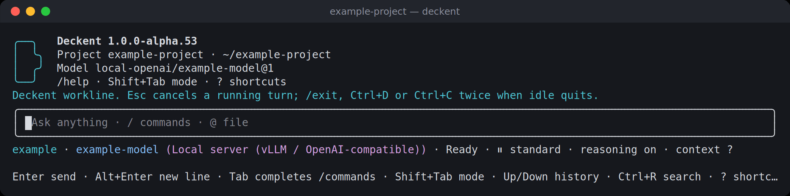

</div>

<!-- Node and pre-release badges read public main package.json, not this local branch.
Keep package.json version and CHANGELOG.md release line together at each release.
npm badges: enable only after the first npm publish. The unscoped name `deckent` is not usable (conflicts with an existing
package); the planned name is the scoped `@verhex/deckent` (proposed name; not finalized). Verify package identity first.
[](https://www.npmjs.com/package/@verhex/deckent)
[](https://www.npmjs.com/package/@verhex/deckent)
-->

> [!NOTE]
> **Pre-release `1.0.0-alpha.49`** (release candidate; the latest released version is the first dated line in [CHANGELOG.md](CHANGELOG.md)). Deckent is not on npm yet; install it from source
> as shown in [Get started](#get-started). Every release is listed in [CHANGELOG.md](CHANGELOG.md).

## What is Deckent

Deckent runs on your own machines and brings policy, approvals, execution and durable records together. Before a
paid API call it reserves the maximum charge against the scope's budget; an unknown price or insufficient budget
refuses the call. People use the terminal or `deckent` command; AI agents and integrations use MCP or the SDK.
These entry points share one typed application contract.

MCP uses a separate actor with observation-only default grants; changing budgets, activating models or invoking them
requires an explicit policy grant naming that MCP actor. Human approval decisions require interactive terminal input
and output.

The open-source Core (Apache-2.0) works on its own. The planned proprietary Enterprise edition is designed
to layer on through the registry without editing Core, as a separate distribution. Today the public extension entry lets a CLI
distribution register effect adapters, secret-store adapters and secret helpers, approval-assurance producers, MCP
capability groups and provider no-charge certifications. Since alpha.20, that distribution can also start
the service and MCP entry with its registrations; automatic service start and restart replay the distribution's
entry (checked by the manual `npm run smoke:dist`, not in CI). Core's bare executables do not discover those modules. Enterprise SSO, ERP integrations and fleet management
remain planned capabilities.

| | |
|---|---|
| 🗼 **Govern** | One identity, scope and policy model for people and AI agents. When something needs approval, the window shows exactly what: the full command, where it runs, on whose behalf, the risk, whether it can be undone, and a deadline. For a business-system operation the card names the operation, the target and a short input digest; the fields it will write are not shown yet ([known limits](docs/known-limits.md)). A persona or a model's advice never grants authority. |
| 🛫 **Execute** | Runs, tasks and workers are admitted, scheduled and recovered on your machines. Agent shell commands and MCP servers run in sandboxes (bubblewrap, Landlock); workers run in Docker. Works with Anthropic, OpenAI, DeepSeek, Z.ai (GLM), a local server or an OpenAI-compatible endpoint with published pricing, and OpenRouter model connections (paid calls require verified pricing and routing), and with Claude Code, Codex and Cursor workers. |
| 📜 **Prove** | Every decision and effect lands in a durable ledger and audit trail. Approvals are sealed, patches are retained, and changes are integrated in an isolated candidate before anything is delivered. |

## How a request flows

You ask for something in plain words. Deckent turns it into checked, isolated steps, and nothing runs unless policy
and your permission mode allow it.

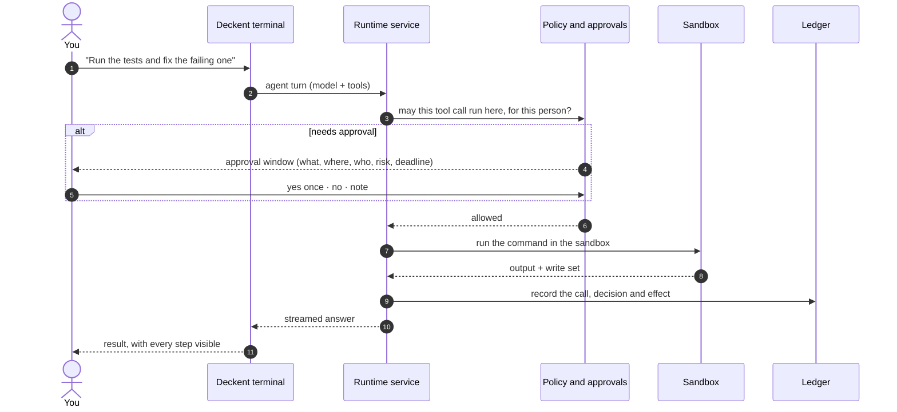

## Your first session

From an empty project to a governed agent turn and what it cost, without leaving Deckent:

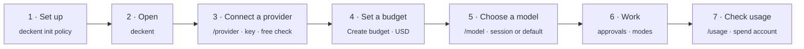

A **scope** is the stable identifier used to bind policy, work records and spending to this project.
`--scope my-project` selects that identifier, not a directory or a sandbox. For a new project, choose
it when previewing the initial policy; for an existing installation, use its configured scope ID.
Reuse the same ID for subsequent commands. The terminal defaults to `terminal.scopeId`; open it with
`deckent --scope my-project` to select this scope explicitly. See the [glossary](docs/glossary.md)
for scope and realm definitions.

```sh
deckent init policy --scope my-project --preview
deckent init policy --scope my-project --apply
```

1. **Set up** once per project: `deckent init policy --scope <id> --preview` shows the first-run policy and
   `deckent init policy --scope <id> --apply` installs it, writes the default terminal scope and chat limits,
   and initializes cancellation settings and an empty migrated ledger. Choose a scope name such as `my-project`. It lets you connect and call models, keep keys and set
   budgets in that scope; every one of those actions is still checked and recorded. On Linux, WSL and macOS a fresh
   installation starts on the encrypted key store.
2. **Open the terminal** with `deckent` (or `deckent --scope my-project` for an explicit scope).
3. **Connect a provider** with `/provider`: Anthropic API, OpenAI API, DeepSeek API, Z.ai GLM, a local server
   such as vLLM, or an OpenAI-compatible endpoint with published pricing. You type the key into a masked field;
   Deckent checks it with a free request and stores it in the secret store under its name; a key the check
   rejects is never stored. Where a provider has no free check, the key is kept unverified and the first turn
   shows any rejection. The value is never shown again and no agent or worker ever receives it. Then choose
   **Connect a model**. Providers with a packaged catalog offer those models; for a provider without one, choose
   an address, then select an exact ID from its bounded `/v1/models` list. Deckent stores that ID unchanged.
   Local loopback models are free-measured; a remote model without a verified published price is listed but
   locked, with the reason and the next step (Zhipu GLM China stays locked because its prices are in CNY).
   OpenRouter offers model connections; paid calls still require verified pricing and routing. Subscriptions today: a Claude Code worker runs with your own Claude login; a subscription-backed Brain is being prepared (not available yet); terminal chat with a Claude subscription is not supported for now, so use an Anthropic API key for chat. Sign in with ChatGPT is listed in `/provider` as not available yet. The same from the
   command line: `deckent secret set <NAME>` and `deckent models connect --scope <id> --connection <kind>
   --command-id <id> --model <exact id>`.
4. **Set a budget.** Every paid API model turn reserves against one shared USD budget of the scope; without one, every
   paid turn is refused and the windows say so (local loopback models and subscription models run without one). The first row of `/provider`, **Create budget**, opens the budget window: 5, 10, 25,
   50 or 100 USD, or another whole-dollar amount from 1 to 1000 with the arrow keys, then a confirm step. Later the
   same row reads **Change budget**. From the command line: `deckent models create-budget --scope <id> --usd <n>` and
   `deckent models revise-budget --scope <id> --usd <n>`.
5. **Choose a model** with `/model`. It lists the catalog's models; one you cannot use yet is locked with the reason
   (no budget, not connected, key missing, not activated) and what fixes it. Pick **This session only** or **This
   session, and make it my default** (your `terminal.defaultModel`). When the project names its own model, the window
   says which setting chose the model in use.
6. **Work.** Ask in plain words. Tool calls follow your company policy and your permission mode; anything that needs
   you opens the approval window (see [Safety model](#safety-model)).
7. **Check usage** with `/usage`: the tokens this conversation measured (reasoning shows *not measured* when the
   provider did not report it) and the scope's budgets; open a budget to read its spend account: limit, reserved and
   settled.

<table>
  <tr>
    <td width="50%">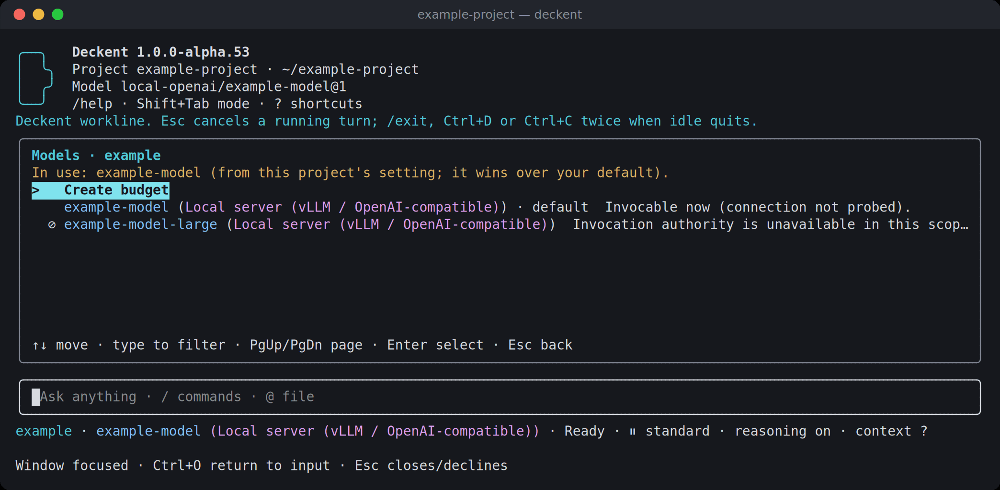<br><sub><b>Before a budget.</b> <code>/model</code> locks every model and names the reason and the next step.</sub></td>
    <td width="50%">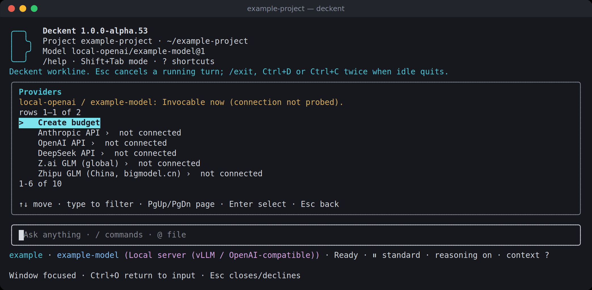<br><sub><b>/provider.</b> <b>Create budget</b> first, then each provider with its connection state.</sub></td>
  </tr>
  <tr>
    <td width="50%">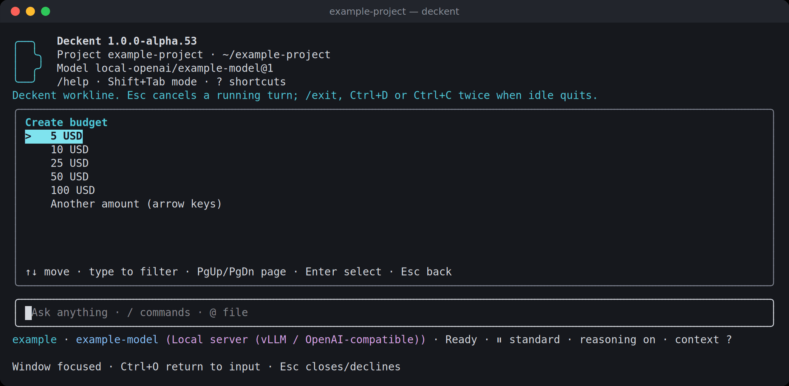<br><sub><b>Budget window.</b> Preset amounts, or another amount with the arrow keys.</sub></td>
    <td width="50%">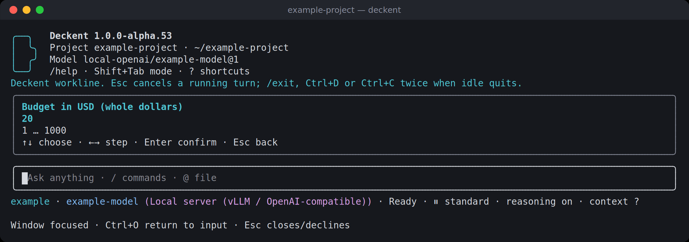<br><sub><b>Another amount.</b> Whole dollars, 1 to 1000; nothing is typed and nothing is sent before you confirm.</sub></td>
  </tr>
  <tr>
    <td width="50%">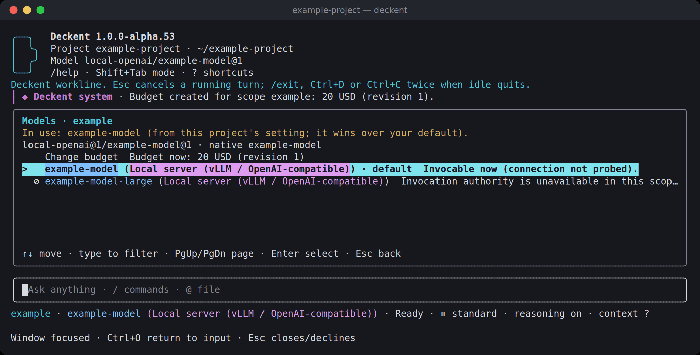<br><sub><b>After the budget.</b> The connected model is ready; the other stays locked until it is connected. The framed line above records the budget.</sub></td>
    <td width="50%">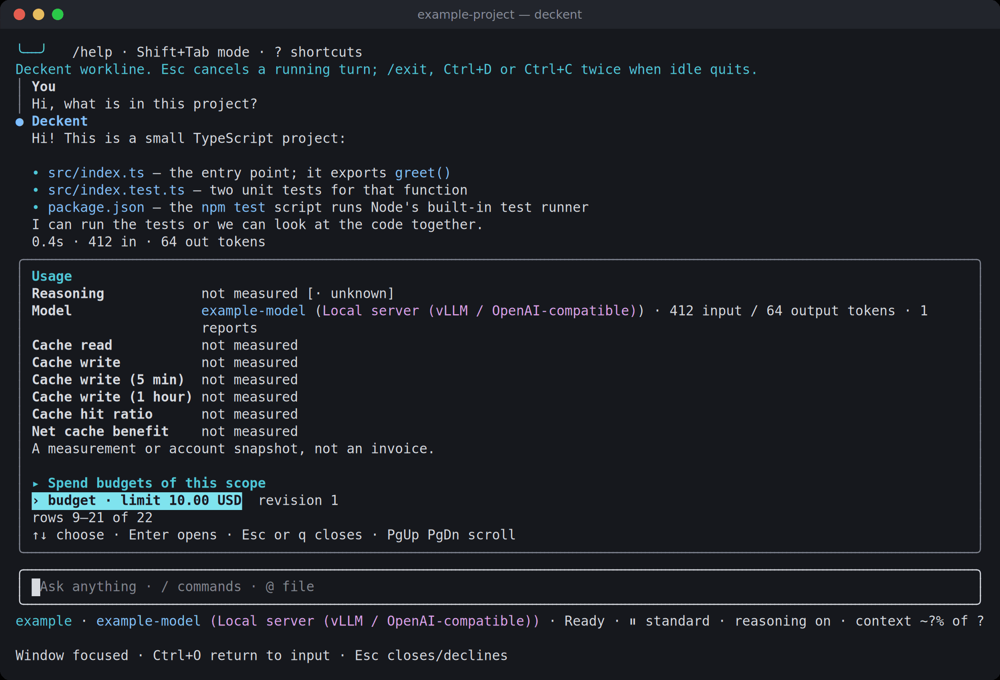<br><sub><b>/usage.</b> Tokens this conversation measured and the scope's budgets. A measurement, not an invoice.</sub></td>
  </tr>
</table>

## Get your first job done

"Your first session" ends with a governed chat. This path goes on to a real job: Deckent plans it, you approve the plan,
a coding worker does it in Docker, and the change is delivered to Git. Steps 1 to 4 are one-time operator setup; a clean-machine rehearsal on 2026-10-15/16 ran the path up to the model step
(the model step and a worker image build on an empty Docker daemon were not exercised; [known limits](docs/known-limits.md)). Commands and messages below come from the current source and its message
catalogs; ids, paths and times are examples. `deckent init` and `deckent doctor` show which of these steps are still missing, with the exact command.

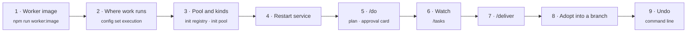

Before you start: Docker is running; the project is a Git repository with at least one commit; the coding CLI you want
as worker (Claude Code or Codex) is logged in on this machine with its own login; and your installation has the current
first-run policy (a fresh `deckent init policy --scope <id> --apply` does; an older one upgrades with
`deckent init policy --scope <id> --upgrade --preview`, then `--apply --expect <value>` with the exact value the preview printed; it binds the
policy revision and the runtime service identity, so a change of either in between is refused and asks for a new preview).

1. **Build the worker image** once, in the Deckent source checkout (it needs Docker and writes a new receipt file):

   ```sh
   npm run worker:image -- /abs/path/worker-images/r4-20260930.json
   ```

   It prints one JSON line with the immutable image id, for example
   `{"imageId":"sha256:f296…5250","tag":"deckent/worker:r4-20260930","imageVersion":"r4-20260930","receipt":"…","activation":"not-activated"}`.
   Nothing is activated; the next step names the image.
2. **Tell Deckent where work runs.** Use the `imageId` from step 1 (the other values are the limits used on the live
   installation):

   ```sh
   deckent config set execution '{"docker":{"executable":"/usr/bin/docker","imageId":"sha256:<from step 1>","memoryBytes":2147483648,"pids":512,"cpus":1,"logMaxSizeKiB":2048,"logMaxFiles":2,"tmpBytes":1073741824,"deadlineMs":1200000,"controlTimeoutMs":15000,"outputBytes":1048576},"git":{"gitExecutable":"/usr/bin/git","timeoutMs":180000,"outputBytes":8388608}}'
   ```

   ```text
   Saved execution in project. Apply: restart. Backup: …/.deckent/config.json.bak.2026-10-13T12-03-51.222Z.…
   Restart required: the running service started with the previous configuration. Restart it with `deckent runtime restart` (or /service-restart in the terminal).
   ```
3. **Declare the pool and the first work kind.** `deckent init registry` writes the first admission registry and pool
   settings for you from the coding CLI it detects; choose the provider, task kind, pool id and capacities for your
   machine (the values below are examples):

   ```sh
   deckent init registry --scope my-project --provider codex --kind coding --pool my-workers \
     --execution-slots 2 --in-flight-slots 2 --discovery repository --preview
   deckent init registry --scope my-project --provider codex --kind coding --pool my-workers \
     --execution-slots 2 --in-flight-slots 2 --discovery repository --apply
   deckent init pool --scope my-project --preview
   deckent init pool --scope my-project --apply
   ```

   Preview detects the CLI's exact version in a temporary, network-free container and shows the proposed versioned
   profile and kind without writing anything; apply repeats the detection and writes through config policy, revision
   checks and audit. An existing registry is never overwritten (typed refusal); add another kind to it with
   `deckent coding template --provider <id> --kind <kind> --preview|--apply`. `deckent config explain admission` shows
   the result.
4. **Restart the service** so it reads the new configuration: `deckent runtime restart` (or `/service-restart` in the
   terminal). It answers `Runtime service restarted (pid 494385, instance 8b1e2392-…).` A fresh `init policy --apply`
   (first-run policy v12 and later) already names the service (`service.identity`) and lets you, and only you, stop it. On an older
   first-run installation run the upgrade above first; if it says it set the service identity, stop the running service
   once by hand (see [The runtime service](#the-runtime-service)) before `runtime restart` works.
   **Before step 5, once: a model and a worker login.** `/do` needs one connected model with a budget, and the worker CLI
   needs its own login on this machine:

   ```sh
   deckent secret set DECKENT_ANTHROPIC_KEY
   deckent models create-budget --scope my-project --usd 10
   deckent models connect --scope my-project --connection anthropic-api --command-id connect-1 --model claude-sonnet-5-5
   ```

   `secret set` asks for the key in a hidden prompt. Each connection kind has its own secret name:
   `DECKENT_ANTHROPIC_KEY`, `DECKENT_OPENAI_KEY`, `DECKENT_DEEPSEEK_KEY`, `DECKENT_GLM_KEY`, `DECKENT_GLM_CN_KEY`
   or `DECKENT_OPENROUTER_KEY` (`/provider` stores under the same name). A local server (vLLM, Ollama or LM Studio) uses
   the optional `DECKENT_LOCAL_ENDPOINT_KEY`; an OpenAI-compatible endpoint uses a name derived from its host,
   `DECKENT_OAICOMPAT_<HOST>`. `--model` takes an exact API model ID;
   the IDs of the packaged catalogs are listed in `assets/model-catalog/<connection>.json` in the source checkout,
   and `/model` lists them in the terminal. The worker CLI (`codex` or `claude`) must be installed on this
   machine and logged in: run `codex login`; for Claude Code run `claude` and type `/login`. Deckent reads that login
   from the CLI's own home (`~/.codex/auth.json`, `~/.claude/.credentials.json`).

5. **Ask for the job.** In the terminal type `/do` and your request in plain words (`deckent do --request "<text>"` is the
   same from the command line). One connected, active model plans it, and Deckent prints the plan:

   ```text
   Plan for Run <run-id> · <status>
   Task t1: <what the task does> · kind coding · WorkClass <class>
     Acceptance: <the criterion the result must meet>
   Permissions checked by policy at admission: <one task/execute per task>
   Waiting for your TTY approval <approval-id>, expires <time>. The model cannot authorize this work.
   ```

   A card opens asking you to approve creating the Run. Today its Risk and Undo lines read "not classified by the
   tool" and "not declared by the tool"; judge the plan and the acceptance line. The card expires after 10 minutes
   (`approvals.requestTtlMs`). Press `y` once to approve; the model cannot approve for you. Then: `Run <run-id> admitted. Follow /tasks or /monitor.` "Admitted" means the work
   started, not that its result was accepted.
6. **Watch it** with `/tasks` (or `/monitor`; `deckent monitor` outside the terminal). When the worker's result is
   accepted, the task waits for delivery.
7. **Deliver it** with `/deliver`: the picker is titled "/deliver · tasks awaiting delivery". The window checks the
   patch against the current source and lists the changed files. Press `y` to write it; it only writes a dedicated
   reference under `refs/deckent/deliveries/`, never a branch, the index or your working tree:

   ```text
   Delivered: commit <commit> → refs/deckent/deliveries/<digest>
   ```
8. **Adopt it into a branch** (optional, its own `y`). Adoption only moves a branch that nobody has checked out, so
   `main` is not offered while it is checked out here. Create a branch and allow it once:

   ```sh
   git branch deckent/first-job HEAD
   deckent config set execution.adoption.targets '["refs/heads/deckent/first-job"]'
   ```

   The window then asks `Adopt commit <commit> into a branch? This moves the branch and needs its own y.` and ends with
   `Adopted: refs/heads/deckent/first-job <from> → <to>`. Your checkout, index and working files are unchanged; look at
   the result with `git log deckent/first-job` and merge it yourself.
9. **Inspect or undo queued adoption** (in live use since 1.0.0-alpha.43; beta acceptance pending). A registered integration target uses
   the service queue. `/deliver` prepares on the current base; after a base/target refusal, `r` offers re-preparation.
   Inspect last-known state with `r`; publish and adopt each show their exact frozen batch and ask a separate `y/N`.
   `/runs` details show authorized scope position, responsibility and outcome. Main/default/protected/checked-out/foreign
   targets remain refused even when allow-listed. Conflicting paths require a new Attempt; no user branch is rebased or merged.

   ```sh
   deckent task integration-queue-list --scope my-project --json
   deckent task integration-queue-inspect --scope my-project --command-id <ticket> --json
   deckent task integration-queue-confirm --scope my-project --command-id <ticket>
   deckent task integration-queue-rollback --scope my-project --source-command-id <ticket> --command-id undo-1
   deckent task integration-queue-confirm --scope my-project --command-id undo-1
   ```

   The rollback card covers one settled item. A failure stops the batch suffix and keeps the adopted prefix; unknown effects
   hold that target for reconciliation. Legacy direct integration commands keep historical receipts, but cannot write through
   an activated queue generation. Queue bounds/TTL come from `targetQueue`; a verification profile and policy are required.
   The queue has been in live use since 1.0.0-alpha.43 and has settled real deliveries; that is not evidence of packaged, hosted, platform or N1 load acceptance, which the beta acceptance still has to show.

   ```text
   Source <source> · affected files match base · proposal <proposal>
   Candidate prepared: <path>
   Delivered commit <commit> at <ref>. Source HEAD, index and working files are unchanged.
   Adopted: <ref> moved from <from> to <to> (sequence 1). Basis: recorded Task acceptance, not verification; checkout, index and working files are unchanged.
   Rolled back: <ref> moved from <to> to <from> (sequence 2). Checkout, index and working files are unchanged.
   ```

### The runtime service

Model turns, approvals, `/do` and recovery run in one local runtime service per project.

- **Start.** `deckent` starts it in the background when none is running and reuses a running one. Its output goes to
  `.deckent/state/runtime-service.log` (under your data root if you moved it). `deckent runtime serve` runs it in the
  foreground instead; Ctrl+C stops it.
- **Idle stop.** A service the terminal started stops itself after 15 minutes without work (`service.idleShutdown.afterMs`);
  the next `deckent` starts it again. A service you started with `runtime serve` never stops by itself.
- **Restart and stop.** `deckent runtime restart` stops the service through the governed stop and starts the current
  build and configuration; `deckent runtime shutdown` only stops it. `deckent runtime describe` shows the running one.
  Both need the service's identity (`deckent config explain service.identity`) and your `shutdown` rule on it, which
  the first-run policy gives the installing person only; by default the local MCP actor cannot stop the service (a policy
  that grants it the `service` MCP group can).
- **Older installations.** A first-run policy older than v12 has neither the service identity nor the `shutdown` rule, so
  `runtime restart` and `runtime shutdown` are refused. Upgrade it with
  `deckent init policy --scope <id> --upgrade --preview`, then `--apply --expect <value>` (see
  [Get your first job done](#get-your-first-job-done)); if the apply sets `service.identity`, stop a service that is
  already running once by hand (Ctrl+C on `runtime serve`) before `runtime restart` works.

## In the terminal

These screens come from the real Deckent terminal (alpha.17, 120×36), recorded in a throwaway sample project. The
model is a small test server on the same machine: no provider was called and no real key was used.

Every slash command answers in its own window. <kbd>Esc</kbd> closes it and leaves one framed `Deckent system` line in
the conversation instead of a wall of text. Settings are changed by choosing, not by typing: `/config` walks from
section to key to the allowed values, numbers move with a bounded arrow-key stepper, and only a few fields (such as an
allowed fetch host or a registry address) take typed text, which is checked first. Each change goes through policy and
may become an approval.

<table>
  <tr>
    <td width="50%">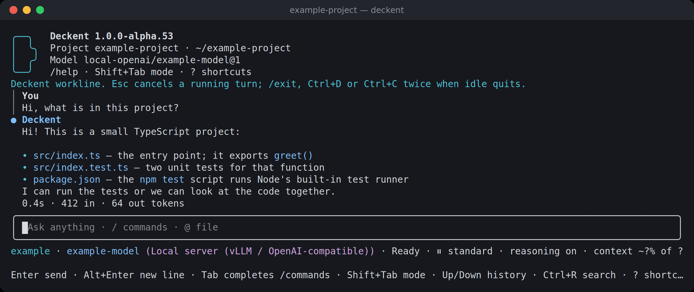<br><sub><b>Chat.</b> Your lines and Deckent's answers are visibly distinct, with time and tokens per turn.</sub></td>
    <td width="50%">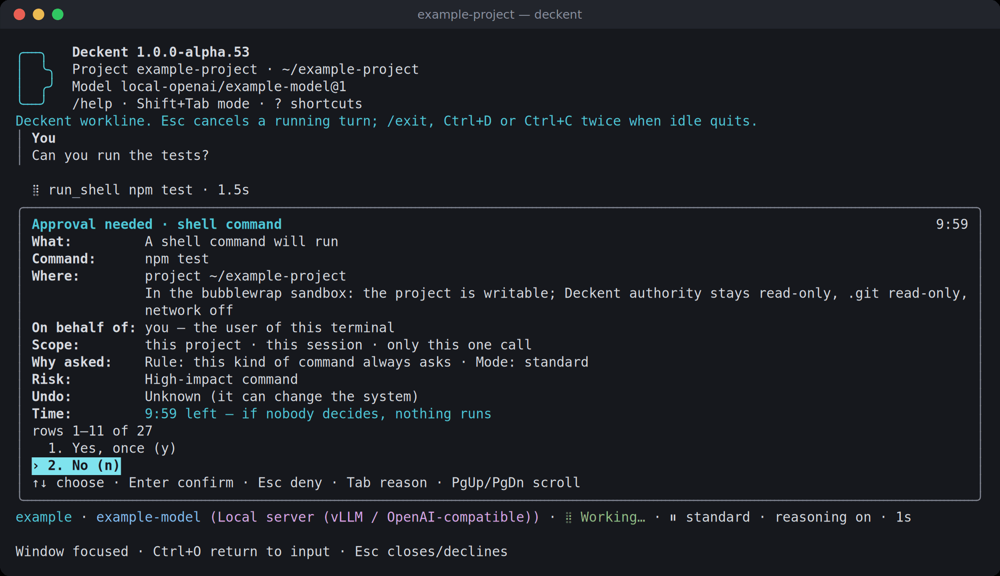<br><sub><b>Approval window.</b> What, where (sandbox), on whose behalf, scope, why, risk, reversibility and a live deadline. <code>y</code> once · <code>n</code> decline · <kbd>Tab</kbd> note (alpha.17 screen; current cards also offer <code>s</code> this session and <code>a</code> always in this project when the card allows them, and <kbd>↑</kbd><kbd>↓</kbd> + <kbd>Enter</kbd>).</sub></td>
  </tr>
  <tr>
    <td width="50%">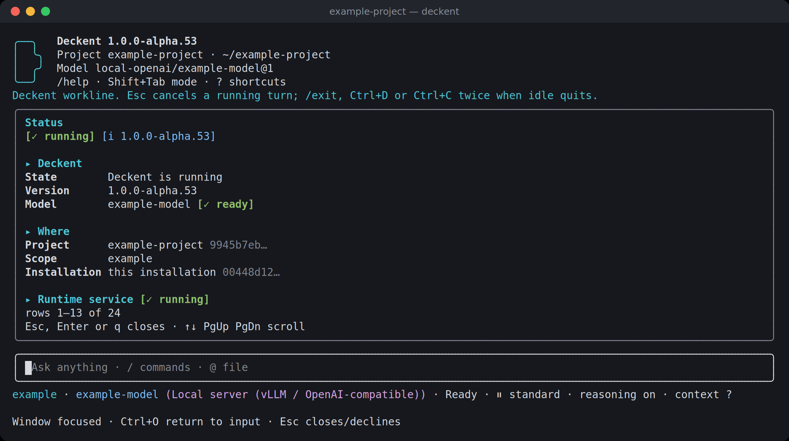<br><sub><b>/status.</b> A human summary first; identities, process and build under the details.</sub></td>
    <td width="50%">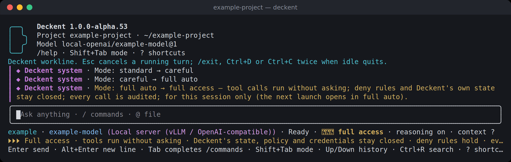<br><sub><b>Modes.</b> <kbd>Shift</kbd>+<kbd>Tab</kbd> cycles the modes you are allowed; full access is clearly marked.</sub></td>
  </tr>
  <tr>
    <td width="50%">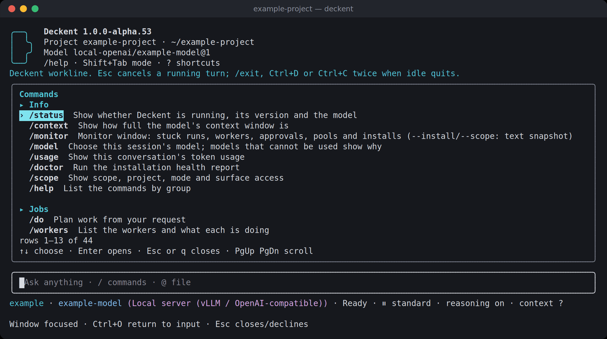<br><sub><b>/help.</b> Commands grouped by purpose, one line each.</sub></td>
    <td width="50%">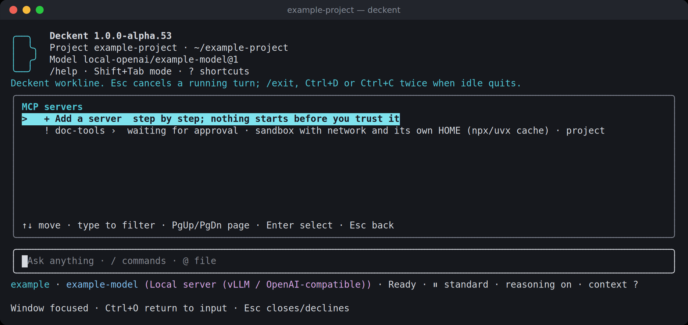<br><sub><b>/mcp.</b> Add a server step by step; configured servers with their trust state.</sub></td>
  </tr>
  <tr>
    <td width="50%">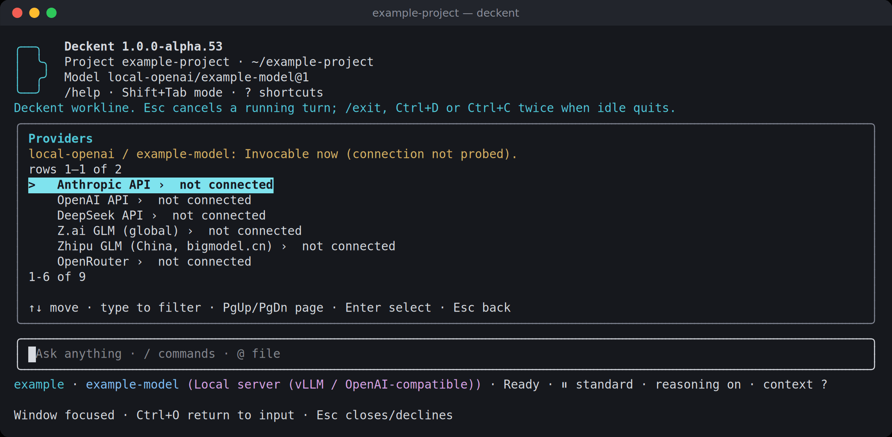<br><sub><b>/provider.</b> Each provider's state. OpenRouter now offers model connections; this screenshot predates them.</sub></td>
    <td width="50%">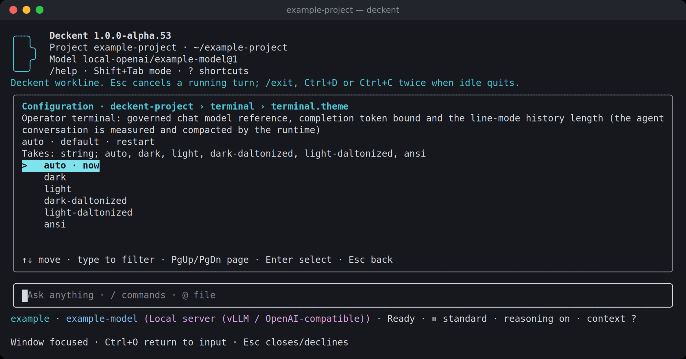<br><sub><b>/config.</b> Section, key, then one of the allowed values; the current one is marked.</sub></td>
  </tr>
  <tr>
    <td width="50%">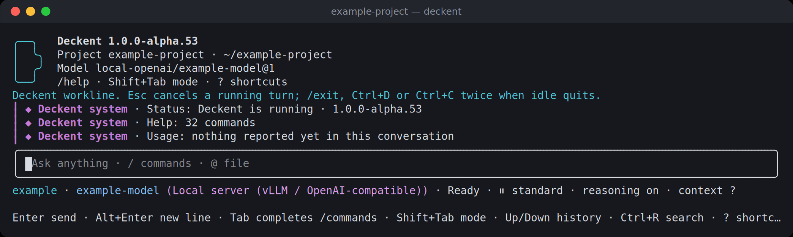<br><sub><b>System lines.</b> Each closed window leaves one framed summary line.</sub></td>
    <td width="50%">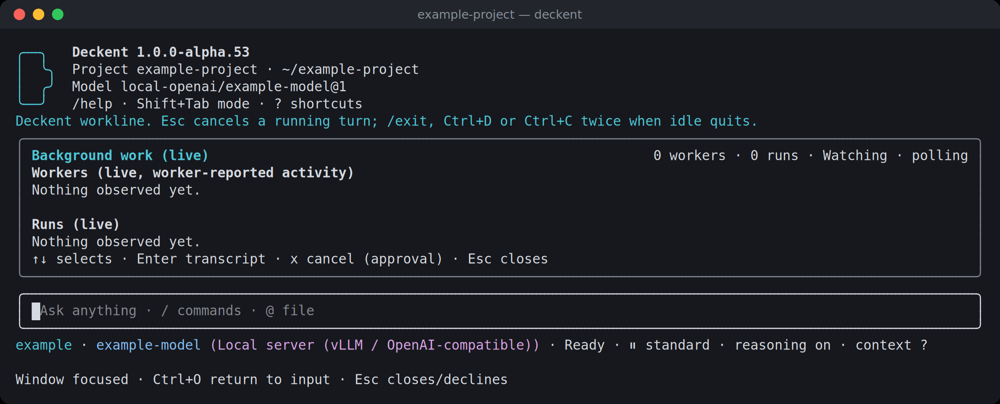<br><sub><b>/tasks.</b> Workers and runs in one live, read-only window (empty here: no background work yet).</sub></td>
  </tr>
</table>

## Safety model

External MCP clients start with observation-only permissions. Open `/policy` (**MCP permissions**), choose an existing scope and a capability group, then grant or revoke it after reviewing the exact rules. Applying requires an attested terminal approval and is audited; no policy JSON needs typing. Pool control, catalog registration and global model configuration are marked **all scopes**. Revoking a group preserves other grants, which may still allow a tool. “Dogfood worker” is a proposed work-only preset; its exact N1 MCP usage is unverified.

CLI choices come from `deckent policy mcp list --json`:

```sh
deckent policy mcp grant --group work --scope <existing-scope> --preview
deckent policy mcp grant --group work --scope <existing-scope> \
  --apply --expect <preview-digest>
# Revoke: the same two steps with `revoke` instead of `grant`.
```

Every tool call an agent makes is decided by two things together: your organization's policy and the permission mode
you chose. You move between the modes you are allowed with <kbd>Shift</kbd>+<kbd>Tab</kbd>, or with `/mode`.

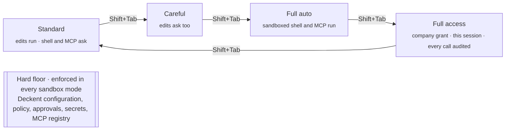

| Mode | Runs without asking | Asks first |
|---|---|---|
| **Standard** | Reads, ordinary file edits | Shell commands, protected paths, MCP calls |
| **Careful** | Reads | Every edit as well |
| **Full auto** | Edits, sandbox-contained shell commands, MCP calls | Destructive commands (`rm -r`, …), protected paths |
| **Full access** | Everything company policy allows above the hard floor; every effect call is audited | The hard floor and whatever company policy still requires (a deny always wins); needs a company grant and lasts for the session |

In standard, careful and full auto, sandboxed shell commands get a **closed view**: the project is writable within the call's approval rules,
`.git` is read-only, HOME is hidden and network access is off. Approved commands still cannot write Deckent authority files.
Landlock also refuses permission and ownership changes, and cannot add or remove entries in directories holding protected paths.
Full access requires a usable **open bubblewrap sandbox**: network and HOME are available, while Deckent state, configuration,
credential patterns and host Docker/session D-Bus sockets remain masked or read-only. Without an open sandbox, full-access shell
calls are refused, including an explicit `host` realm. Closed modes retain the visible `prefer-sandbox` host fallback;
that fallback has no enforced filesystem boundary, so use `require-sandbox` when confinement is required.
The shared credential registry covers gh, Docker, kube, Codex, Git credentials and common cloud CLIs. HOME masking is bounded
(depth 3, 20,000 entries); custom locations, arbitrary filenames and aliases outside those masks need separate isolation.
Full auto still asks before `find -delete`, file truncation (`>`, `>|`) and moves (`mv`); appends (`>>`) remain modifications.

### API keys

You store a provider key once, in the masked field of `/provider` or with `deckent secret set NAME` (a hidden prompt in an
interactive terminal; never an argument, and a piped key is refused); a model profile refers to it by name. Never put it in `ANTHROPIC_API_KEY`, a shell
profile or a `.env` file: other tools read those.

| Store (`secrets.store`) | On disk | Who can read the key |
|---|---|---|
| `core.secret-store.env@1` (when no store is selected) | nothing; read from the environment | every program that inherits that environment |
| `core.secret-store.file@1` | plain text, a 0600 file | Deckent and other programs running as your user |
| `core.secret-store.encrypted-file@1` (recommended; fresh installs start here) | encrypted (AES-256-GCM); the unlock key sits in the same folder, no passphrase | Deckent; other programs running as your user can still open it |

Provider calls resolve keys inside the runtime; keys are not placed in prompts or the shell environment.
Supported sandbox views hide the store; a host realm or fallback has no filesystem confinement.
A provider answer that echoes a stored key is refused.
`deckent doctor` shows which store is active; `deckent doctor --verbose` also says who can read it. When a provider refuses a key (401/403) or a limit is
reached, the terminal says so in plain words; spend limits stay in your provider account.

**Strict install**, for keys no other program on the machine should read:

Fresh Linux/WSL/macOS installations select the encrypted store through `init policy --apply` and Docker `init apply` when the installed policy permits the switch; existing installations keep their selection.

1. Move your keys into the encrypted store: `deckent secret store` lists the registered stores to pick from; leaving env lists config reference names missing in the target and asks yes/no (scripts require `--confirm-env-missing`); `doctor` shows the same names; it copies every key,
   checks it, selects the new store and then removes the old copy (a move to a weaker store asks first). Installations set up
   with `deckent init policy` on Linux, WSL and macOS start on the encrypted store already.
2. Keep other AI tools out of Deckent's state folder, e.g. `Read` deny rules for the store files in Claude Code's
   `~/.claude/settings.json`. This stops their file tools and common shell commands, not every script.
3. Planned: run the Deckent service under its own OS user (or the macOS Keychain) so no program of your account can read the keys.

The file stores are not available on native Windows yet.

### Spending

Each scope has one shared budget in USD for every API provider. Before a paid call, Deckent reserves the most it could
cost at the dearest price tier that can apply; afterwards it settles the call from the usage the provider itself
reported in its final answer, multiplied by the verified published price. That settled amount is Deckent's own
calculation, not the provider's invoice. OpenRouter calls are the exception: they settle from the cost OpenRouter
reports in its answer. A remote model without a verified price is refused and shown locked with
the reason. Where a provider does not say which price tier it used (DeepSeek), the call settles at the published peak
price and is labelled an upper bound. A call that never received its final usage stays held until you resolve it with
`deckent models reconcile-spending`. If a settled charge ever exceeds what was reserved, the scope stops admitting new
calls until you lift the freeze with `deckent models revise-budget --scope <id> --usd <n> --unfreeze`.

## Architecture

Every way in speaks the same typed contract. Runtime-backed operations go through one runtime service, which checks
identity, scope and policy on each operation, writes the result to the ledger and lets effects happen only inside the
place the policy allows. Installation, observation and some patch operations use the same contract locally, without
the service.

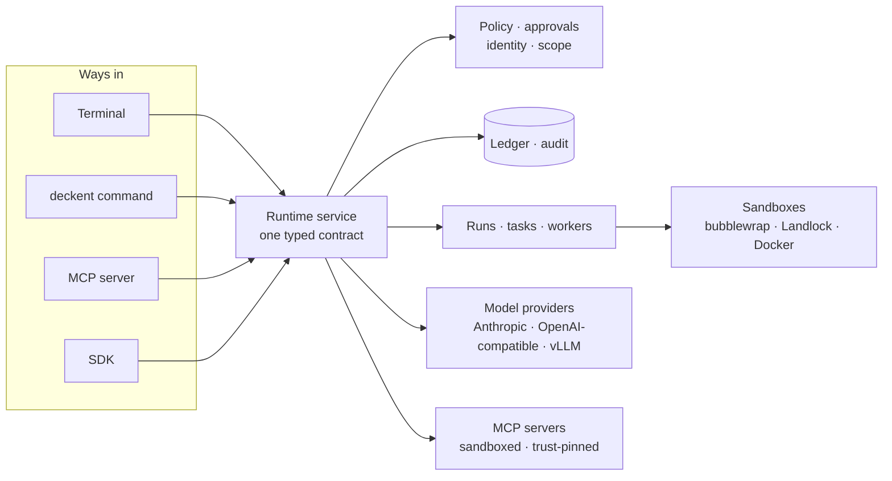

## What you can do today

- **Work with an agent in the terminal**: streamed turns, file edits and a sandboxed shell, approval and monitor
  windows, permission modes, MCP tools, conversation compaction, English and Turkish.
- **Orchestrate work**: admit Runs, Tasks and Attempts, schedule dependencies, reserve capacity, cancel and recover,
  all recorded in a durable SQLite ledger.
- **Ask for a job in plain words**: `/do <request>` (or `deckent do --request "<text>"`) turns it into a plan with an
  acceptance criterion, shows a card for your approval and runs the work on a coding worker; `/deliver` writes the
  result to a Git reference and adopts it into a branch only when you choose. It needs the one-time setup in
  [Get your first job done](#get-your-first-job-done).
- **Use coding workers**: Git-backed checkouts and Docker workers with Claude Code, Codex and Cursor; patches are
  retained, integrated in an isolated candidate, then delivered or released.
- **Govern**: local identity, company-scoped policy, audit and one approval broker for every surface; human
  acceptance or rejection of unverified evidence.
- **Choose models**: a model catalog by client and billing channel, exact activation, local vLLM chat; `/provider` and
  `/model` connect a provider with your own key and pin a model for the session or make it your default; paid calls
  settle from the provider's usage times a verified published tariff under a budget you set in the budget window or
  with `deckent models create-budget` (an unpriced remote model is refused and locked with the reason); spending and
  allocation audit.
- **Cache prompts and watch the cost**: new Anthropic profiles use the 5-minute prompt cache and existing ones change only
  by your choice; `/usage` shows the live account in USD, cache reads and writes, and the estimated net benefit.
- **Use OpenRouter models in the terminal**: connect your key in `/provider`; tools and streaming work, and the cost
  OpenRouter reports settles each call under your budget.
  Before the first paid OpenRouter call, check https://openrouter.ai/settings/plugins that no plugin is enabled with
  "Prevent overrides", and set an OpenRouter credit limit no higher than your Deckent budget; Deckent cannot see either setting.
- **Back up and restore**: `deckent backup create|verify|restore` writes verifiable recovery sets, on a schedule
  if you choose, with retention; a restore runs only while the service is stopped. Only the authority key inside a set is
  encrypted with your passphrase; the ledger and the state archive are plain files, so keep sets on storage you trust
  (full-set encryption is not available yet).
- **Inspect and control**: `deckent audit verify` checks the audit history, `deckent report --scope <id> --run <id>` shows a
  Run's cost and acceptance evidence, `deckent run hold|resume|close` and `deckent pool hold|resume` pause, resume or close work,
  `deckent policy grants --mine` and `deckent policy revoke` list and remove your standing grants, and `deckent identity
  profiles` shows the identity profiles. `deckent init` prepares project instructions (`DECKENT.md`) after a preview.
  `/help` in the terminal lists every slash command.
- **Operate**: `deckent monitor` for a read-only view of every installation, `deckent doctor` for health, `deckent
  config` for settings, bilingual help everywhere.

Not yet available: Mission-level coordination of multi-step business processes, Enterprise SSO and fleet management,
a remote HTTP API, Desktop and Dashboard. A Docker worker shares the host kernel and is not a virtual machine. The
plain list of what is open or untried is in [Known limits](docs/known-limits.md).

## Roadmap

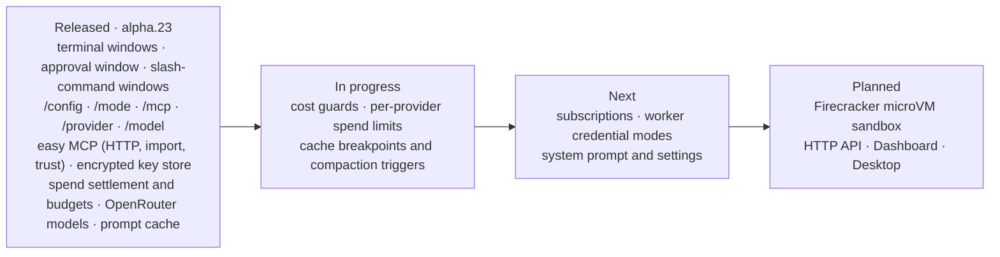

## Get started

Deckent runs on Linux or Windows through WSL2 with Node.js ≥ 24.22.0 (Node 24 and 26 are supported).
Native Windows runtime transport is not supported. A fresh source build needs Docker to build and stage the locked
bubblewrap (currently 0.13.0); it downloads and verifies the locked source and binary digests. A verified staged
bundle can be reused offline. System bubblewrap, when selected, must be ≥ 0.12.0. Docker is also required for coding
workers; the first terminal session itself does not need Docker or a paid call. A C build toolchain is also required
for the native sandbox helper. Until npm publication, build once:

```sh
git clone https://github.com/Verhex/deckent-next.git
cd deckent-next
npm ci
node scripts/build-bwrap.mjs --arch all --out .pack/bwrap/first-build
node scripts/build-bwrap.mjs --stage-dev .pack/bwrap/first-build
npm run build
npm link
```

Use a fresh `--out` directory for another build. The build ends with `bubblewrap=present` or `bubblewrap=staged from …`.
On Linux a build that cannot stage the locked bubblewrap stops with `BUBBLEWRAP_BUILD_REQUIRED` instead of finishing;
start Docker and run it again. Only off Linux does it print `bubblewrap=absent (not Linux)`, which means there is no
bubblewrap sandbox; inspect the sandbox posture with `deckent doctor`. The very first `doctor`, before any service has
run, can report Landlock instead of bubblewrap (`doctor --verbose` names the reason): `doctor` only measures, and the runtime service places the bundled
bubblewrap under `.deckent/bin` when it measures the host. Start the service (`deckent`) and run `doctor` again. See the
[contributor quickstart](CONTRIBUTING.md#a-30-minute-quickstart) for prerequisites and one test without a provider key.

**Ubuntu 24.04 and later.** The kernel may restrict unprivileged user namespaces, which bubblewrap needs. Check with
`sysctl kernel.apparmor_restrict_unprivileged_userns`: `1` means restricted; on WSL a missing key (`cannot stat`) means there is no restriction. Deckent then reports the restriction, falls back
to Landlock visibly, and refuses full-access shell calls because they need the open bubblewrap sandbox. An administrator
can install bubblewrap root-owned as `/usr/local/bin/bwrap` together with an AppArmor profile that allows `userns` for it.

After linking, change to your own project folder, outside the Deckent source checkout.
Long paths and spaces work: the local socket uses a short private directory per installation.
`npm run build` fails clearly if it cannot stage the locked bubblewrap; start Docker and retry,
or use `DECKENT_BWRAP_BUILD=<verified build-bwrap output> npm run build`.

From then on, everything is `deckent`:

```sh
deckent --version
deckent init policy --scope my-project --preview
deckent init policy --scope my-project --apply
deckent doctor                            # non-zero if setup cannot start
deckent                                   # opens in the scope selected by init
# deckent --scope my-project               # explicit scope, same terminal
deckent init preview --profile <file>     # advanced: preview an installation profile file
deckent mcp add context7 -- npx -y @upstash/context7-mcp   # add an MCP server
deckent monitor                           # watch installations and work
deckent --help                            # every command; deckent <command> --help for details
```

**Connect an AI client over MCP.** `deckent-mcp` is Deckent's stdio MCP server; register it in your MCP client, for
example in Claude Code with `claude mcp add deckent -- deckent-mcp --project /path/to/project`. It does not start the
runtime service, and most of its tools need it: keep `deckent runtime serve` running (a service the terminal started stops
after 15 idle minutes). The MCP actor starts with observation-only grants; anything more needs a policy grant naming it
(see [Policy and AI](docs/policy-and-ai.md)).

## Learn more

- [Architecture overview](docs/architecture-overview.md): layers, security, extension points and current limits
- [Policy and AI](docs/policy-and-ai.md): human and AI authority, delegation, administration commands and compliance evidence
- [Glossary](docs/glossary.md): scope, realm, work lifecycle, approvals and spending
- [Known limits](docs/known-limits.md): what is not tried, not built or still open, with the impact and a workaround
- [ARCHITECTURE.md](ARCHITECTURE.md): detailed engineering contracts and implementation notes (English/Turkish)
- [Operator reference](.deckent/docs/architecture/operator-reference.md): worker toolchains, worker images, coding
  profiles, patch custody and installation custody rules
- [CHANGELOG.md](CHANGELOG.md): what each release brought
- [CONTRIBUTING.md](CONTRIBUTING.md) · [Code of Conduct](CODE_OF_CONDUCT.md) · [Security](SECURITY.md)

## License

Apache-2.0 (see [LICENSE](LICENSE)).
