<div align="center">

# Deckent

**Agent Control & Execution Plane**

Deckent, müşterinin kendi altyapısına kurduğu çalışma ortamını, her ücretli API çağrısından önce bütçe tavanını,
sandbox içindeki araçlar ve MCP’yi, policy kontrollü onayları ve insan ile AI girişleri için tek tipli sözleşmeyi birleştirir.

*policy-driven agent runtime · governed execution · self-hosted agent control plane*

[](https://github.com/Verhex/deckent-next/actions/workflows/ci.yml)
[](LICENSE)
[](package.json)
[](CHANGELOG.md)

[English](README.md) · [Deckent nedir](#deckent-nedir) · [Bir istek nasıl akar](#bir-istek-nasıl-akar) · [İlk oturum](#adım-adım-ilk-oturum) · [İlk iş](#adım-adım-ilk-işiniz) · [Terminalde](#terminalde) · [Güvenlik](#güvenlik-modeli) · [Başlarken](#başlarken)

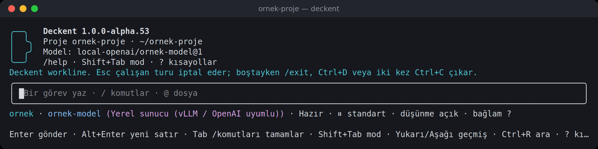

</div>

<!-- Node ve pre-release rozetleri bu yerel dalı değil, public main package.json'u okur.
Her sürümde package.json sürümü ile CHANGELOG.md satırını birlikte güncelleyin.
npm rozetleri: ilk npm yayınından ve paket kimliği doğrulandıktan sonra açılır. Kapsamsız `deckent` adı kullanılamıyor
(mevcut bir paketle çakışıyor); planlanan ad kapsamlı `@verhex/deckent` (önerilen ad; kesinleşmedi).
[](https://www.npmjs.com/package/@verhex/deckent)
[](https://www.npmjs.com/package/@verhex/deckent)
-->

> [!NOTE]
> **Ön sürüm `1.0.0-alpha.46`** (2026-10-18 yayımlandı). Deckent henüz npm'de yok; [Başlarken](#başlarken)
> bölümündeki gibi kaynaktan kurun. Her sürümün içeriği [CHANGELOG.md](CHANGELOG.md) içinde.

## Deckent nedir

Deckent kendi makinelerinizde çalışır; policy, onaylar, yürütme ve kalıcı kayıtları bir araya getirir. Ücretli API
çağrısından önce çağrının tutabileceği en yüksek tutarı kapsamın bütçesinden ayırır; fiyat bilinmiyorsa ya da bütçe
yetmiyorsa çağrıyı reddeder. İnsanlar terminali veya `deckent` komutunu, AI ajanları ve entegrasyonlar MCP veya SDK’yı
kullanır. Bu giriş yolları tek tipli uygulama sözleşmesini paylaşır.

MCP, varsayılanı yalnız gözlem olan ayrı bir aktör kullanır; bütçe değiştirmek, model etkinleştirmek veya çağırmak o MCP
aktörünü adıyla anan açık bir policy izni ister. İnsan onay kararları etkileşimli terminal girişi ve çıkışı gerektirir.

Açık kaynak Core (Apache-2.0) tek başına çalışır. Ayrı dağıtılacak proprietary Enterprise sürümü, Core'u değiştirmeden
kayıt defteri (registry) üzerinden üstüne katmanlanacak şekilde tasarlanmıştır. Bugün public uzantı girişi, CLI
dağıtımının etki adaptörleri, gizli depo adaptörleri ve sır yardımcıları, onay güvencesi üreticileri, MCP yetki grupları
ve sağlayıcı ücretsiz-çağrı sertifikaları kaydetmesini sağlar. alpha.20’den beri aynı dağıtım,
kayıtlarıyla servis ve MCP girişini de başlatabilir; otomatik servis başlatma ve yeniden başlatma dağıtımın girişini
yeniden çalıştırır (elle çalıştırılan `npm run smoke:dist` ile sınanır, CI'da yok). Core'un yalın çalıştırılabilir dosyaları bu modülleri kendiliğinden keşfetmez. Enterprise SSO, ERP
entegrasyonları ve filo yönetimi planlanan yeteneklerdir.

| | |
|---|---|
| 🗼 **Yönetir** | İnsanlar ve yapay zekâ ajanları için tek kimlik, kapsam ve policy modeli. Bir iş onay isterse pencere neyin onaylandığını tam gösterir: tam komut, nerede çalışacağı, kimin adına, risk, geri alınıp alınamayacağı ve süre. İş sistemi operasyonlarında kart operasyonu, hedefi ve kısa bir girdi özetini adlandırır; yazılacak alanlar henüz gösterilmez ([bilinen sınırlar](docs/known-limits.tr.md)). Persona ya da model tavsiyesi asla yetki vermez. |
| 🛫 **Yürütür** | İşler (Run), görevler ve işçiler sizin makinelerinizde kabul edilir, sıralanır ve kurtarılır. Ajanın kabuk komutları ve MCP sunucuları sandbox içinde (bubblewrap, Landlock), işçiler Docker'da çalışır. Anthropic, OpenAI, DeepSeek, Z.ai (GLM), yerel sunucu veya fiyatı yayımlanmış OpenAI uyumlu uç noktalar ve OpenRouter model bağlantılarıyla (ücretli çağrı için fiyat ve yönlendirme doğrulanmalı); Claude Code, Codex ve Cursor işçileriyle çalışır. |
| 📜 **Kanıtlar** | Her karar ve etki kalıcı bir defter ve denetim izine yazılır. Onaylar mühürlenir, yamalar saklanır ve değişiklikler teslimden önce yalıtılmış bir adayda birleştirilir. |

## Bir istek nasıl akar

İsteğinizi düz bir cümleyle söylersiniz. Deckent bunu kontrol edilmiş, yalıtılmış adımlara çevirir; policy ve izin
modunuz izin vermedikçe hiçbir şey çalışmaz.

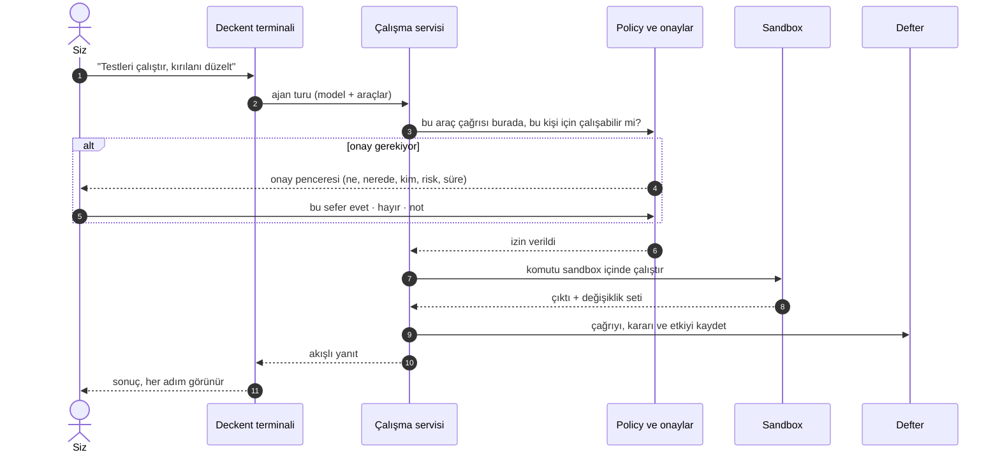

## Adım adım ilk oturum

Boş bir projeden yönetilen bir ajan turuna ve onun maliyetine kadar, Deckent'ten çıkmadan:

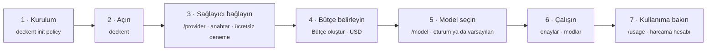

**Kapsam (scope)**, yetki politikasını, iş kayıtlarını ve harcamayı bu projeye bağlayan sabit kimliktir.
`--scope my-project` bir dizini veya yalıtım ortamını değil, bu kimliği seçer. Yeni projede ilk politikayı
önizlerken bir kimlik seçin; mevcut kurulumda ayarlarda tanımlı kapsam kimliğini kullanın. Sonraki
komutlarda aynı kimliği kullanın. Terminalin varsayılanı `terminal.scopeId` değeridir; bu kapsamı
açıkça seçmek için `deckent --scope my-project` ile açın. Kapsam ve yürütme ortamı tanımları için
[sözlüğe](docs/glossary.tr.md) bakın.

```sh
deckent init policy --scope my-project --preview
deckent init policy --scope my-project --apply
```

1. **Kurulum**, proje başına bir kez: `deckent init policy --scope <id> --preview` ilk kurulum policy'sini gösterir,
   `deckent init policy --scope <id> --apply` onu kurar, varsayılan terminal kapsamını ve sohbet sınırlarını
   yazar; iptal ayarlarını ve göçü tamamlanmış boş ledger’ı oluşturur. Örneğin kapsam adı olarak `my-project` seçin. Bu policy o kapsamda model bağlamanıza ve çağırmanıza,
   anahtar saklamanıza ve bütçe belirlemenize izin verir; bu eylemlerin her biri yine kontrol edilir ve kaydedilir.
   Linux, WSL ve macOS'ta yeni bir kurulum şifreli anahtar deposuyla başlar.
2. **Terminali açın**: `deckent` (kapsamı açıkça seçmek için `deckent --scope my-project`).
3. **Sağlayıcı bağlayın**: `/provider` ile Anthropic API, OpenAI API, DeepSeek API, Z.ai GLM, vLLM gibi yerel
   bir sunucu veya fiyatı yayımlanmış OpenAI uyumlu bir uç nokta. Anahtarı gizlenen bir alana yazarsınız;
   Deckent onu ücretsiz bir istekle dener ve gizli depoya adıyla saklar; denemenin reddettiği anahtar asla
   saklanmaz. Ücretsiz denemesi olmayan bir sağlayıcıda anahtar doğrulanmadan saklanır ve olası reddi ilk tur
   gösterir. Değer bir daha gösterilmez ve hiçbir ajan ya da işçi onu almaz. Ardından **Model bağla**'yı seçin.
   Paketlenmiş kataloğu olan sağlayıcılar o modelleri sunar; kataloğu olmayanlarda önce adresi, sonra sınırlı
   `/v1/models` listesinden birebir model kimliğini seçersiniz. Deckent bu kimliği aynen saklar. Bu makinedeki
   yerel modeller ücretsiz ölçülür; yayımlanmış fiyatı doğrulanmamış uzak model, nedeni ve sonraki adımıyla
   kilitli görünür (Zhipu GLM Çin, fiyatları CNY olduğu için kilitli kalır). OpenRouter model bağlantıları
   sunar; ücretli çağrı için fiyat ve yönlendirme yine doğrulanmalıdır. Bugün abonelikler: Claude Code işçisi kendi Claude girişinizle çalışır; abonelikli Brain hazırlanıyor (henüz yok); Claude aboneliğiyle terminal sohbeti şu an desteklenmiyor, sohbet için Anthropic API anahtarı kullanın. ChatGPT ile giriş `/provider`'da henüz kullanılamıyor olarak görünür. Aynısı komut satırından: `deckent secret
   set <AD>` ve `deckent models connect --scope <id> --connection <tür> --command-id <id> --model <birebir
   kimlik>`.
4. **Bütçe belirleyin.** Her ücretli API model turu, kapsamın tek ve ortak USD bütçesinden pay ayırır; bütçe yoksa her
   ücretli tur reddedilir ve pencereler bunu söyler (yerel loopback modeller ve abonelik modelleri bütçesiz çalışır). `/provider`'ın ilk satırı **Bütçe oluştur** bütçe penceresini açar: 5, 10, 25,
   50 ya da 100 USD veya ok tuşlarıyla 1 ile 1000 arasında başka bir tam dolar tutarı, ardından bir onay adımı. Sonra
   aynı satır **Bütçeyi değiştir** olur. Komut satırından: `deckent models create-budget --scope <id> --usd <n>` ve
   `deckent models revise-budget --scope <id> --usd <n>`.
5. **Model seçin**: `/model` katalogdaki modelleri listeler; henüz kullanamayacağınız bir model nedeniyle (bütçe yok,
   bağlı değil, anahtar eksik, etkin değil) ve onu neyin düzelteceğiyle kilitlidir. **Yalnız bu oturum** ya da **Bu
   oturum ve varsayılanım olsun** (sizin `terminal.defaultModel` ayarınız) seçin. Proje kendi modelini belirtiyorsa
   pencere kullanılan modeli hangi ayarın seçtiğini söyler.
6. **Çalışın.** İsteğinizi düz cümleyle söyleyin. Araç çağrıları şirket policy'nize ve izin modunuza uyar; size
   danışılması gereken her şey onay penceresini açar (bkz. [Güvenlik modeli](#güvenlik-modeli)).
7. **Kullanıma bakın**: `/usage` bu konuşmanın ölçtüğü token'ları (sağlayıcı bildirmediyse akıl yürütme *ölçülmedi*
   görünür) ve kapsamın bütçelerini gösterir; harcama hesabını okumak için bir bütçe açın: üst sınır, ayrılan ve
   kesinleşen.

<table>
  <tr>
    <td width="50%">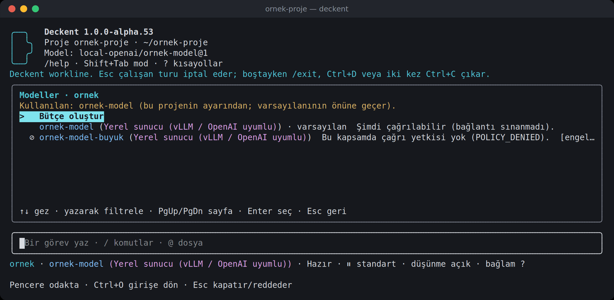<br><sub><b>Bütçeden önce.</b> <code>/model</code> her modeli kilitler; nedeni ve sonraki adımı söyler.</sub></td>
    <td width="50%">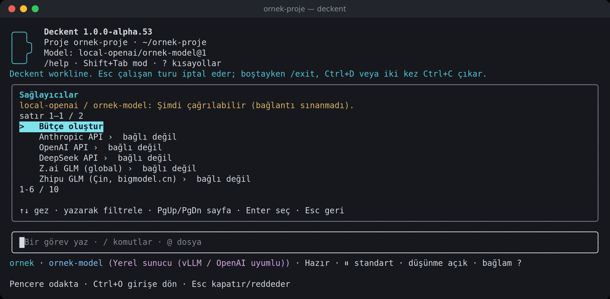<br><sub><b>/provider.</b> Önce <b>Bütçe oluştur</b>, sonra her sağlayıcı bağlantı durumuyla.</sub></td>
  </tr>
  <tr>
    <td width="50%">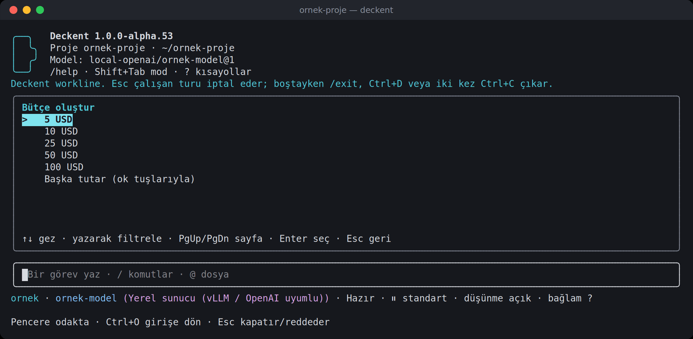<br><sub><b>Bütçe penceresi.</b> Hazır tutarlar ya da ok tuşlarıyla başka bir tutar.</sub></td>
    <td width="50%">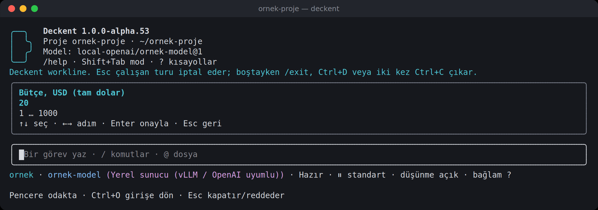<br><sub><b>Başka tutar.</b> Tam dolar, 1 ile 1000 arası; hiçbir şey yazılmaz, onaylamadan hiçbir şey gönderilmez.</sub></td>
  </tr>
  <tr>
    <td width="50%">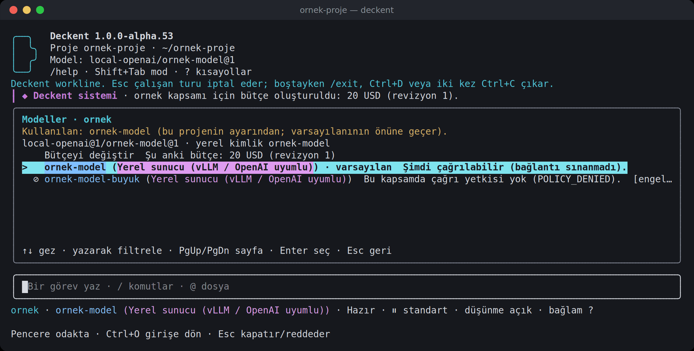<br><sub><b>Bütçeden sonra.</b> Bağlı model hazır; diğeri bağlanana kadar kilitli kalır. Üstteki çerçeveli satır bütçeyi kaydeder.</sub></td>
    <td width="50%">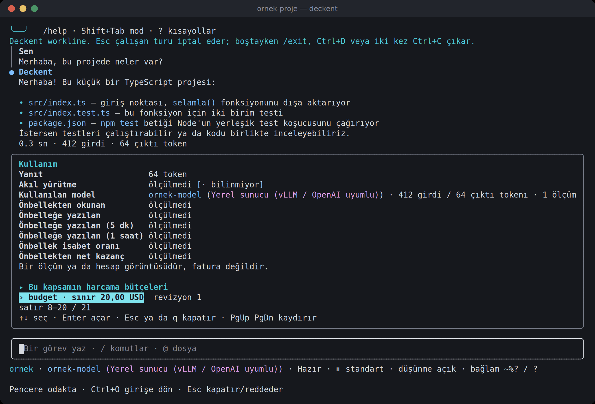<br><sub><b>/usage.</b> Bu konuşmanın ölçtüğü token'lar ve kapsamın bütçeleri. Fatura değil, ölçümdür.</sub></td>
  </tr>
</table>

## Adım adım ilk işiniz

"Adım adım ilk oturum" yönetilen bir sohbetle biter. Bu yol gerçek bir işe devam eder: Deckent planlar, planı siz onaylarsınız,
bir kodlama işçisi Docker içinde yapar ve değişiklik Git'e teslim edilir. 1 ile 4 arası adımlar bir kez yapılan operatör
kurulumudur; yolun temiz bir makinede 2026-10-15/16'da yapılan provası model adımına kadar
gitti (model adımı ve boş bir Docker daemon'unda işçi imajı derlemesi denenmedi; [bilinen sınırlar](docs/known-limits.tr.md)). Aşağıdaki komutlar ve mesajlar güncel kaynaktan ve mesaj
kataloglarından gelir; kimlikler, yollar ve saatler örnektir. `deckent init` ve `deckent doctor` bu adımlardan hangilerinin eksik olduğunu tam komutuyla gösterir.

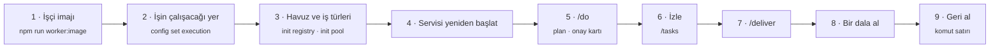

Başlamadan önce: Docker çalışıyor; proje en az bir commit'i olan bir Git deposu; işçi olarak istediğiniz kodlama CLI'ı
(Claude Code ya da Codex) bu makinede kendi girişiyle açık; kurulumunuzda güncel ilk kurulum policy'si var (yeni bir
`deckent init policy --scope <id> --apply` bunu kurar; eski kurulum `deckent init policy --scope <id> --upgrade --preview`,
ardından önizlemenin bastığı değerle `--apply --expect <değer>` ile yükseltilir; değer politika revizyonunu ve runtime servis kimliğini
bağlar, arada biri değişirse uygulama reddedilir ve yeni önizleme ister).

1. **İşçi imajını bir kez derleyin**, Deckent kaynak dizininde (Docker ister ve yeni bir makbuz dosyası yazar):

   ```sh
   npm run worker:image -- /abs/path/worker-images/r4-20260930.json
   ```

   Değişmez imaj kimliğiyle tek satır JSON basar, örneğin
   `{"imageId":"sha256:f296…5250","tag":"deckent/worker:r4-20260930","imageVersion":"r4-20260930","receipt":"…","activation":"not-activated"}`.
   Hiçbir şey etkinleştirilmez; imajı bir sonraki adım adlandırır.
2. **Deckent'e işin nerede çalışacağını söyleyin.** 1. adımdaki `imageId` değerini kullanın (diğer değerler canlı
   kurulumda kullanılan sınırlardır):

   ```sh
   deckent config set execution '{"docker":{"executable":"/usr/bin/docker","imageId":"sha256:<1. adımdan>","memoryBytes":2147483648,"pids":512,"cpus":1,"logMaxSizeKiB":2048,"logMaxFiles":2,"tmpBytes":1073741824,"deadlineMs":1200000,"controlTimeoutMs":15000,"outputBytes":1048576},"git":{"gitExecutable":"/usr/bin/git","timeoutMs":180000,"outputBytes":8388608}}'
   ```

   ```text
   execution, proje katmanına kaydedildi. Uygulama: yeniden. Yedek: …/.deckent/config.json.bak.2026-10-13T12-03-51.222Z.…
   Yeniden başlatma gerekli: çalışan servis önceki yapılandırmayla başladı. `deckent runtime restart` ile (terminalde /service-restart) yeniden başlatın.
   ```
3. **Havuzu ve ilk iş türünü tanımlayın.** `deckent init registry`, bulduğu kodlama CLI'sından ilk kabul kaydını (registry)
   ve havuz ayarlarını sizin için yazar; sağlayıcıyı, görev türünü, havuz kimliğini ve makinenize uygun kapasiteleri
   seçin (aşağıdaki değerler örnektir):

   ```sh
   deckent init registry --scope my-project --provider codex --kind coding --pool my-workers \
     --execution-slots 2 --in-flight-slots 2 --discovery repository --preview
   deckent init registry --scope my-project --provider codex --kind coding --pool my-workers \
     --execution-slots 2 --in-flight-slots 2 --discovery repository --apply
   deckent init pool --scope my-project --preview
   deckent init pool --scope my-project --apply
   ```

   Önizleme CLI'nin tam sürümünü geçici ve ağsız bir container'da ölçer, önerilen sürümlü profili ve görev türünü
   gösterir, hiçbir şey yazmaz; apply ölçümü tekrarlar ve config policy, revizyon kontrolü ve denetim üzerinden yazar.
   Var olan bir kaydın üzerine asla yazılmaz (tipli ret); ona başka bir tür eklemek için
   `deckent coding template --provider <id> --kind <tür> --preview|--apply` kullanın. Sonucu
   `deckent config explain admission` gösterir.
4. **Servisi yeniden başlatın**, yeni yapılandırmayı okusun: `deckent runtime restart` (terminalde `/service-restart`).
   Şunu söyler: `Runtime servisi yeniden başlatıldı (pid 494385, örnek 8b1e2392-…).` Yeni bir `init policy --apply`
   (ilk kurulum politikası v12 ve sonrası) servisi zaten adlandırır (`service.identity`) ve onu yalnız sizin durdurmanıza izin verir.
   Daha eski bir ilk kurulumda önce yukarıdaki yükseltmeyi çalıştırın; servis kimliğini ayarladığını söylerse çalışan
   servisi bir kez elle durdurun ([Runtime servisi](#runtime-servisi)), sonra `runtime restart` çalışır.
   **5. adımdan önce, bir kez: model ve işçi girişi.** `/do` bütçeli, bağlı bir model ister; işçi CLI'ın da bu makinede
   kendi girişi olmalıdır:

   ```sh
   deckent secret set DECKENT_ANTHROPIC_KEY
   deckent models create-budget --scope my-project --usd 10
   deckent models connect --scope my-project --connection anthropic-api --command-id connect-1 --model claude-sonnet-5-5
   ```

   `secret set` anahtarı gizli bir istemde sorar. Her bağlantı türünün kendi gizli adı vardır: `DECKENT_ANTHROPIC_KEY`,
   `DECKENT_OPENAI_KEY`, `DECKENT_DEEPSEEK_KEY`, `DECKENT_GLM_KEY`, `DECKENT_GLM_CN_KEY` ya da `DECKENT_OPENROUTER_KEY`
   (`/provider` aynı adla saklar). Yerel sunucu (vLLM, Ollama ya da LM Studio) isteğe bağlı `DECKENT_LOCAL_ENDPOINT_KEY`
   adını, OpenAI uyumlu bir uç nokta ise host'undan türetilen `DECKENT_OAICOMPAT_<HOST>` adını kullanır. `--model` birebir API model kimliğini alır; paketlenmiş katalogların kimlikleri kaynak
   dizinindeki `assets/model-catalog/<bağlantı>.json` dosyalarında, terminalde ise `/model` ile listelenir. İşçi CLI
   (`codex` ya da `claude`) bu makinede kurulu ve girişli olmalıdır: `codex login` çalıştırın; Claude Code için `claude`
   yazıp `/login` girin. Deckent bu girişi CLI'ın kendi dizininden okur (`~/.codex/auth.json`,
   `~/.claude/.credentials.json`).

5. **İşi isteyin.** Terminalde `/do` yazıp isteğinizi sade sözlerle yazın (komut satırında aynısı
   `deckent do --request "<metin>"`). Bağlı ve etkin bir model planlar, Deckent planı basar:

   ```text
   Run <run-id> için plan · <durum>
   Görev t1: <görevin yaptığı iş> · tür coding · iş sınıfı <sınıf>
     Kabul: <sonucun karşılaması gereken ölçüt>
   Kabulde politikayla denetlenen izinler: <her görev için bir task/execute>
   TTY onayınız bekleniyor: <onay-kimliği>, son tarih <saat>. Model bu işe yetki veremez.
   ```

   Run'ı oluşturmayı onaylamanızı isteyen bir kart açılır. Bugün Risk ve Geri alma satırları "araç sınıflandırmadı" ve
   "araç bildirmedi" der; planı ve kabul satırını değerlendirin. Kart 10 dakika sonra sona erer
   (`approvals.requestTtlMs`). Onaylamak için bir kez `y`; model sizin yerinize onaylayamaz. Sonra:
   `Run <run-id> kabul edildi. /tasks veya /monitor ile izleyin.` Burada "kabul edildi" işin başladığı demektir;
   sonucunun kabul edildiği demek değildir.
6. **İzleyin**: `/tasks` ile (ya da `/monitor`; terminal dışında `deckent monitor`). İşçinin sonucu kabul edilince
   görev teslimi bekler.
7. **Teslim edin**: `/deliver` ile; seçici "/deliver · teslim bekleyen görevler" başlığını taşır. Pencere yamayı güncel
   kaynakla karşılaştırır ve değişen dosyaları listeler. Yazmak için `y`; yalnız `refs/deckent/deliveries/` altında ayrı
   bir referans yazar, hiçbir dala, index'e ya da çalışma ağacınıza dokunmaz:

   ```text
   Teslim edildi: commit <commit> → refs/deckent/deliveries/<özet>
   ```
8. **Bir dala alın** (isteğe bağlı, kendi `y`'si ile). Dala alma yalnız kimsenin checkout etmediği bir dalı
   ilerletir; bu yüzden `main` burada checkout edilmişken sunulmaz. Bir dal açın ve bir kez izin verin:

   ```sh
   git branch deckent/first-job HEAD
   deckent config set execution.adoption.targets '["refs/heads/deckent/first-job"]'
   ```

   Pencere o zaman `<commit> commit'i bir dala alınsın mı? Bu dalı ilerletir ve ayrı bir y ister.` diye sorar ve
   `Dala alındı: refs/heads/deckent/first-job <önce> → <sonra>` ile biter. Checkout'unuz, index'iniz ve çalışma
   dosyalarınız değişmez; sonucu `git log deckent/first-job` ile görün ve birleştirmeyi kendiniz yapın.
9. **Kuyrukta benimsenen işi inceleyin veya geri alın** (1.0.0-alpha.43'ten beri canlıda kullanılıyor; beta kabulü bekliyor).
   Kayıtlı entegrasyon hedefi servis kuyruğunu kullanır. `/deliver` güncel tabanda hazırlar; taban/hedef reddinden sonra `r`
   yeniden hazırlama sunar. Son bilinen durumu `r` ile okuyun; yayın ve benimseme tam ve sabit partiyi ayrı gösterip `y/N`
   sorar. `/runs` ayrıntısı yetkili kapsam konumunu, sorumluyu ve sonucu gösterir. Main/varsayılan/korunan, checkout'taki veya
   yabancı hedef allowlist'te olsa da reddedilir. Çakışan yollar yeni Attempt gerektirir; kullanıcı dalına rebase/merge yapılmaz.

   ```sh
   deckent task integration-queue-list --scope my-project --json
   deckent task integration-queue-inspect --scope my-project --command-id <bilet> --json
   deckent task integration-queue-confirm --scope my-project --command-id <bilet>
   deckent task integration-queue-rollback --scope my-project --source-command-id <bilet> --command-id undo-1
   deckent task integration-queue-confirm --scope my-project --command-id undo-1
   ```

   Geri alma kartı sonuçlanmış tek işi kapsar. Hata partinin kalanını durdurur; benimsenmiş ön ek korunur. Belirsiz etki o
   hedefi uzlaştırmaya kadar tutar. Eski doğrudan entegrasyon komutları tarihsel makbuzları okuyabilir; etkin kuyruk generation'ı
   üzerinden yazamaz. Sınırlar ve bilet ömrü `targetQueue` kaynağındadır; doğrulama profili ve politika gerekir. Kuyruk
   1.0.0-alpha.43'ten beri canlıda kullanılıyor ve gerçek teslimleri sonuçlandırdı; bu, paketlenmiş binary, hosted CI, platform
   veya N1 yük kabulünün kanıtı değildir; bunları beta kabulü göstermelidir.

   ```text
   Kaynak <kaynak> · etkilenen dosyalar base ile aynı · öneri <öneri>
   Aday hazır: <yol>
   Commit <commit>, <ref> referansına teslim edildi. Kaynak HEAD, index ve çalışma dosyaları değişmedi.
   Benimsendi: <ref>, <önce> → <sonra> taşındı (sıra 1). Dayanak: kayıtlı Task kabulü, doğrulama değil; checkout, index ve çalışma dosyaları değişmedi.
   Geri alındı: <ref>, <sonra> → <önce> taşındı (sıra 2). Checkout, index ve çalışma dosyaları değişmedi.
   ```

### Runtime servisi

Model turları, onaylar, `/do` ve kurtarma her proje için tek bir yerel runtime servisinde çalışır.

- **Başlatma.** `deckent`, çalışan servis yoksa onu arka planda başlatır, varsa onu kullanır. Çıktısı
  `.deckent/state/runtime-service.log` dosyasına gider (veri kökünü taşıdıysanız onun altına). `deckent runtime serve`
  onu ön planda çalıştırır; Ctrl+C durdurur.
- **Boşta durma.** Terminalin başlattığı servis 15 dakika iş almazsa kendiliğinden durur (`service.idleShutdown.afterMs`);
  sonraki `deckent` onu yeniden başlatır. `runtime serve` ile başlattığınız servis kendiliğinden durmaz.
- **Yeniden başlatma ve durdurma.** `deckent runtime restart` servisi yönetilen durdurmayla kapatır, güncel derleme ve
  yapılandırmayla yeniden başlatır; `deckent runtime shutdown` yalnız durdurur. `deckent runtime describe` çalışanı
  gösterir. İkisi de servisin kimliğini (`deckent config explain service.identity`) ve sizin o servis üzerindeki
  `shutdown` kuralınızı ister; ilk kurulum politikası bunu yalnız kuran kişiye verir, yerel MCP aktörü varsayılan olarak servisi durduramaz
  (politika ona `service` MCP grubunu verirse durdurabilir).
- **Eski kurulumlar.** v12'den eski bir ilk kurulum politikasında ne servis kimliği ne de `shutdown` kuralı vardır; bu
  yüzden `runtime restart` ve `runtime shutdown` reddedilir. Şöyle yükseltin:
  `deckent init policy --scope <id> --upgrade --preview`, sonra `--apply --expect <değer>` ([Adım adım ilk işiniz](#adım-adım-ilk-işiniz));
  apply `service.identity` ayarlarsa çalışan servisi bir kez elle durdurun (`runtime serve` üzerinde Ctrl+C), sonra
  `runtime restart` çalışır.

## Terminalde

Bu ekranlar gerçek Deckent terminalinden (alpha.17, 120×36), geçici bir örnek projede çekildi. Model, aynı makinedeki
küçük bir deneme sunucusudur: hiçbir sağlayıcı çağrılmadı ve gerçek bir anahtar kullanılmadı.

Her slash komutu kendi penceresinde yanıt verir. <kbd>Esc</kbd> pencereyi kapatır ve konuşmada metin yığını yerine
tek bir çerçeveli `Deckent sistemi` satırı bırakır. Ayarlar yazarak değil seçerek değişir: `/config` bölümden anahtara,
oradan izin verilen değerlere ilerler; sayılar sınırlı bir ok tuşu adımlayıcısıyla değişir ve yalnız birkaç alan
(izinli bir fetch adresi ya da bir kayıt defteri adresi gibi) yazılan metin alır, o da önce kontrol edilir. Her
değişiklik policy'den geçer ve bir onaya dönüşebilir.

<table>
  <tr>
    <td width="50%">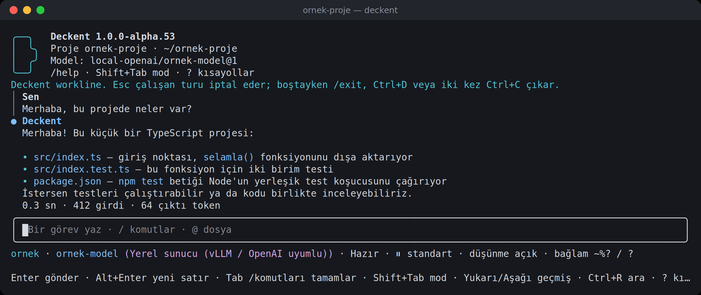<br><sub><b>Sohbet.</b> Sizin satırlarınız ve Deckent'in yanıtları belirgin biçimde ayrışır; her turda süre ve token.</sub></td>
    <td width="50%">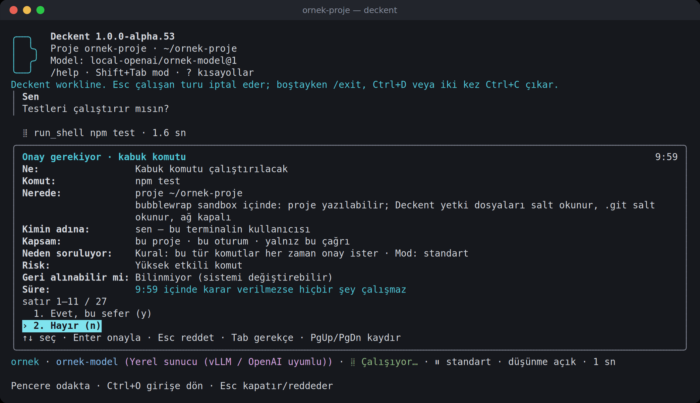<br><sub><b>Onay penceresi.</b> Ne, nerede (sandbox), kimin adına, kapsam, neden, risk, geri alınabilirlik ve canlı süre. <code>y</code> bu sefer · <code>n</code> reddet · <kbd>Tab</kbd> not (alpha.17 ekranı; güncel kartlar izin verdiğinde <code>s</code> bu oturum boyunca ve <code>a</code> bu projede her zaman seçeneklerini, ayrıca <kbd>↑</kbd><kbd>↓</kbd> + <kbd>Enter</kbd> seçimini de sunar).</sub></td>
  </tr>
  <tr>
    <td width="50%">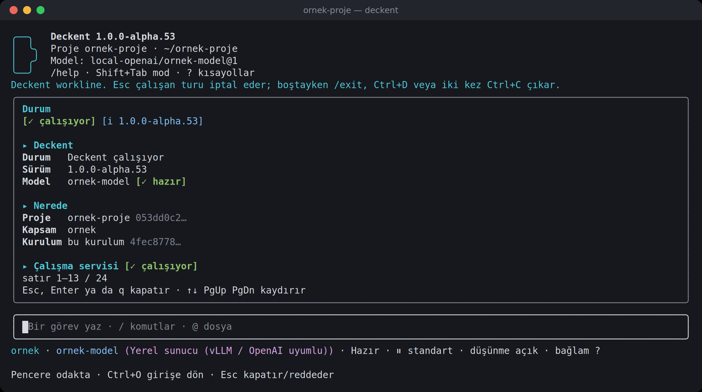<br><sub><b>/status.</b> Önce insan dilinde özet; kimlikler, süreç ve build ayrıntıda.</sub></td>
    <td width="50%">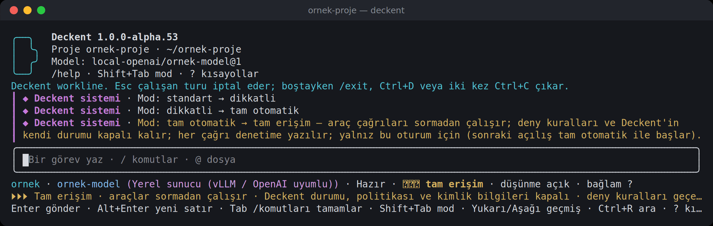<br><sub><b>Modlar.</b> <kbd>Shift</kbd>+<kbd>Tab</kbd> yetkili olduğunuz modlar arasında döner; tam erişim açıkça işaretlenir.</sub></td>
  </tr>
  <tr>
    <td width="50%">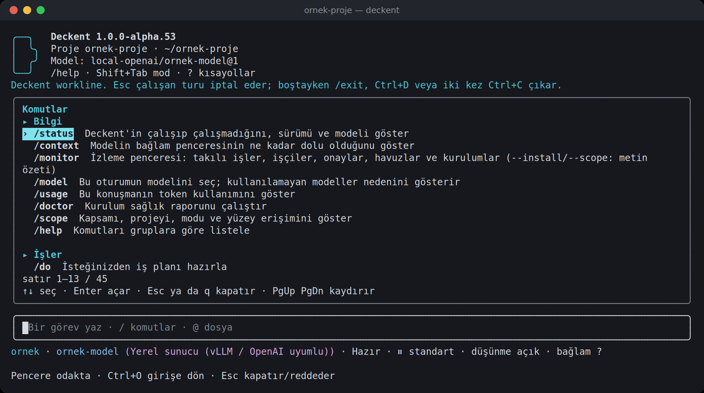<br><sub><b>/help.</b> Komutlar amaca göre gruplu, her biri tek satır.</sub></td>
    <td width="50%">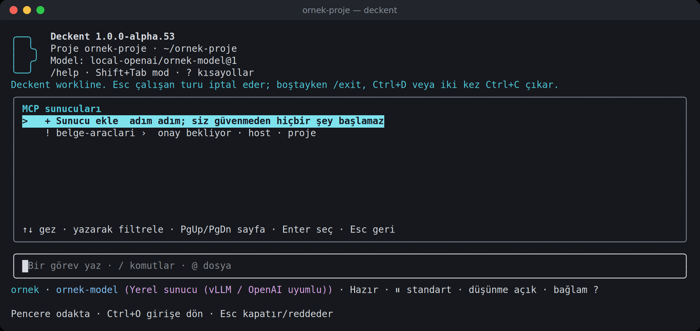<br><sub><b>/mcp.</b> Adım adım sunucu ekleme; yapılandırılmış sunucular güven durumlarıyla.</sub></td>
  </tr>
  <tr>
    <td width="50%">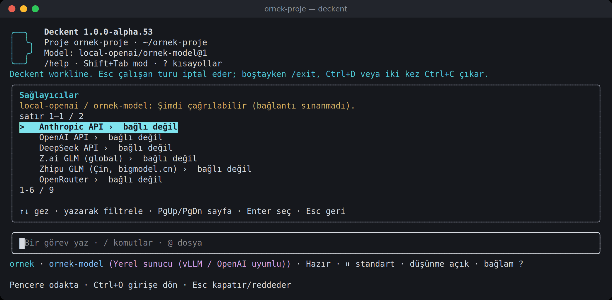<br><sub><b>/provider.</b> Her sağlayıcının durumu. OpenRouter artık model bağlantıları sunar; bu ekran görüntüsü o değişiklikten öncedir.</sub></td>
    <td width="50%">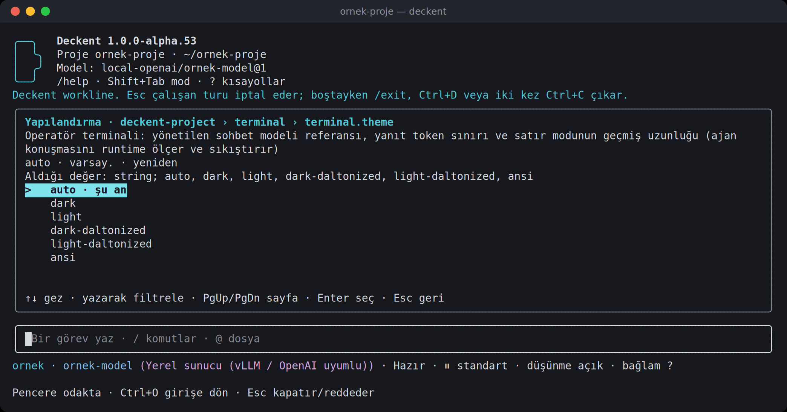<br><sub><b>/config.</b> Bölüm, anahtar, sonra izin verilen değerlerden biri; geçerli olan işaretli.</sub></td>
  </tr>
  <tr>
    <td width="50%">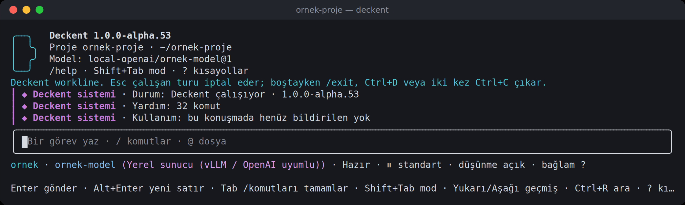<br><sub><b>Sistem satırları.</b> Kapanan her pencere tek bir çerçeveli özet satırı bırakır.</sub></td>
    <td width="50%">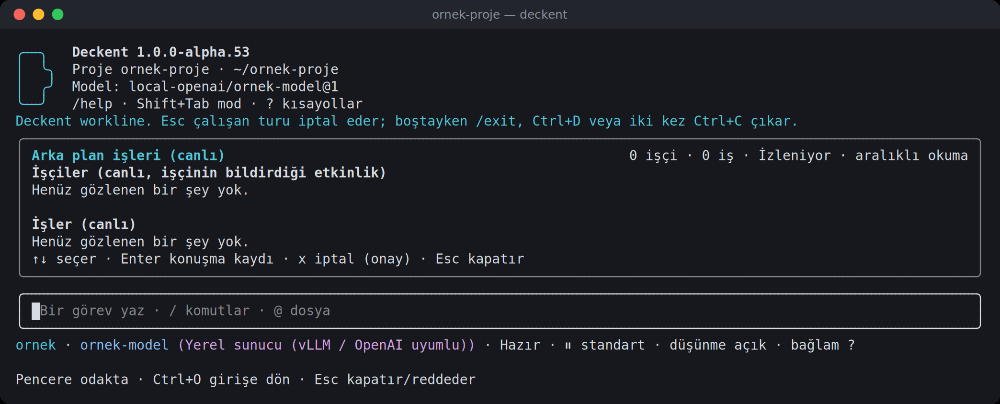<br><sub><b>/tasks.</b> İşçiler ve işler tek bir canlı, salt okunur pencerede (burada boş: henüz arka plan işi yok).</sub></td>
  </tr>
</table>

## Güvenlik modeli

Dış MCP istemcileri başlangıçta yalnız gözlem izni alır. **MCP izinleri** için `/policy` penceresini açıp mevcut kapsamı ve yetki grubunu seçin; değişecek kuralları inceleyip izin verin ya da kaldırın. Uygulama doğrulanmış terminal onayı ister ve denetim kaydına alınır; `policy.json` dosyasına kural yazmanız gerekmez. Havuz yönetimi, katalog kaydı ve genel model yapılandırması **tüm kapsamlar** olarak gösterilir. Grup iznini kaldırmak başka izinleri silmez; araç bu izinlerle açık kalabilir. “Dogfood çalışanı” yalnız iş yetkilerini içeren bir öneridir; kesin N1 MCP kullanımı doğrulanmadı.

CLI seçeneklerini `deckent policy mcp list --json` listeler:

```sh
deckent policy mcp grant --group work --scope <mevcut-kapsam> --preview
deckent policy mcp grant --group work --scope <mevcut-kapsam> \
  --apply --expect <önizleme-özeti>
# Kaldırma: aynı iki adımda `grant` yerine `revoke` kullanın.
```


Ajanın yaptığı her araç çağrısına iki şey birlikte karar verir: kurumunuzun policy'si ve seçtiğiniz izin modu.
Yetkili olduğunuz modlar arasında <kbd>Shift</kbd>+<kbd>Tab</kbd> ya da `/mode` ile geçersiniz.

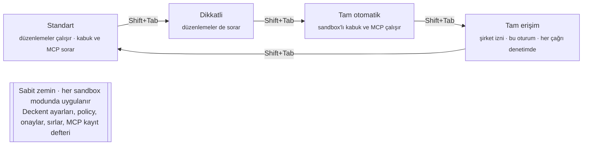

| Mod | Sormadan çalışır | Önce sorar |
|---|---|---|
| **Standart** | Okumalar, sıradan dosya düzenlemeleri | Kabuk komutları, korunan yollar, MCP çağrıları |
| **Dikkatli** | Okumalar | Her düzenleme de |
| **Tam otomatik** | Düzenlemeler, sandbox içinde kalan kabuk komutları, MCP çağrıları | Yıkıcı komutlar (`rm -r`, …), korunan yollar |
| **Tam erişim** | Şirket policy'sinin sabit zeminin üstünde izin verdiği her şey; her etkili çağrı denetime yazılır | Sabit zemin ve şirket policy'sinin hâlâ istediği onaylar (deny her zaman kazanır); şirket izni gerekir ve oturum boyunca geçerlidir |

Standart, dikkatli ve tam otomatik modlarda sandbox'taki kabuk komutu **kapalı bir görünüm** alır: proje, çağrının onay
kuralları içinde yazılabilir; `.git` salt okunur, ağ kapalıdır ve ev klasörünüz gizlidir. Onaylanan komutlar da Deckent'in
yetki dosyalarını değiştiremez. Landlock ayrıca izin ve sahiplik değişikliklerini reddeder; korunan yolları tutan
dizinlerde giriş eklemeyi veya silmeyi de kısıtlar.
Tam erişim, kullanılabilir bir **açık bubblewrap sandbox'ı** gerektirir: ağ ve ev klasörü açılır; Deckent durumu, ayarlar,
kimlik bilgisi kalıpları ve host Docker/oturum D-Bus soketleri maskeli ya da salt okunur kalır. Açık sandbox yoksa tam
erişim kabuk çağrıları, `host` seçilmiş olsa bile reddedilir. Kapalı modlarda `prefer-sandbox` açık bir bildirimle host'a
düşebilir; bu yol dosya sistemi sınırı uygulamaz. Yalıtım gerekiyorsa `require-sandbox` seçin.
Ortak kimlik bilgisi kataloğu gh, Docker, kube, Codex, Git ve yaygın bulut CLI'larını kapsar. Ev klasörü taraması sınırlıdır
(3 derinlik, 20.000 giriş); özel konumlar, farklı dosya adları ve maskelerin dışındaki takma yollar ayrıca yalıtılmalıdır.
Tam otomatik, `find -delete`, dosya kısaltma (`>`, `>|`) ve taşıma (`mv`) için onay ister; ekleme (`>>`) değişiklik sayılır.

### API anahtarları

Sağlayıcı anahtarını bir kez, `/provider`'ın gizlenen alanına ya da `deckent secret set AD` ile kaydedersiniz (etkileşimli
terminalde gizli istem; asla komut argümanı değil, stdin'den verilen anahtar reddedilir); model profili ona adıyla başvurur. Anahtarı `ANTHROPIC_API_KEY`, shell
profili ya da `.env` dosyasına koymayın: başka araçlar oraları okur.

| Depo (`secrets.store`) | Diskte | Anahtarı kim okuyabilir |
|---|---|---|
| `core.secret-store.env@1` (hiçbir depo seçilmemişse) | hiçbir şey; ortam değişkeninden okunur | o ortamı devralan her program |
| `core.secret-store.file@1` | düz metin, 0600 dosya | Deckent ve sizin hesabınızla çalışan diğer programlar |
| `core.secret-store.encrypted-file@1` (önerilen; yeni kurulumlar bununla başlar) | şifreli (AES-256-GCM); açma anahtarı aynı klasörde, parola yok | Deckent; sizin hesabınızla çalışan diğer programlar yine açabilir |

Ajan ve worker istekleri anahtara adıyla başvurur; çalışma zamanı anahtarı isteme veya shell ortamına koymadan çözer.
Desteklenen sandbox'lar depoyu gizler; host'a düşen yol dosya sistemi yalıtımı sağlamaz. Anahtarı geri yansıtan sağlayıcı
yanıtı reddedilir.
`deckent doctor` hangi deponun etkin olduğunu gösterir; `deckent doctor --verbose` kimin okuyabileceğini de söyler. Sağlayıcı anahtarı reddederse (401/403) ya da
bir limit dolarsa terminal bunu açık sözlerle söyler; harcama limitleri sağlayıcı hesabınızda kalır.

**Katı kurulum**, anahtarı makinedeki başka hiçbir programın okumaması gerekiyorsa:

Yeni Linux/WSL/macOS kurulumları, kurulu politika geçişe izin veriyorsa şifreli depoyu `init policy --apply` ve Docker `init apply` ile seçer; mevcut kurulumlar seçimlerini korur.

1. Anahtarlarınızı şifreli depoya taşıyın: `deckent secret store` kayıtlı depoları seçmeniz için listeler; env deposundan çıkarken hedefte eksik olan yapılandırma başvuru adlarını listeler ve evet/hayır sorar (betikler `--confirm-env-missing` ister); `doctor` aynı adları gösterir; her anahtarı kopyalar,
   doğrular, yeni depoyu seçer ve ardından eski kopyayı siler (daha zayıf bir depoya geçiş önce sorar). Linux, WSL ve macOS'ta
   `deckent init policy` ile kurulanlar zaten şifreli depoyla başlar.
2. Diğer yapay zekâ araçlarını Deckent'in durum klasöründen uzak tutun; örneğin Claude Code'un `~/.claude/settings.json`
   dosyasında depo dosyaları için `Read` yasak kuralları. Bu, dosya araçlarını ve yaygın shell komutlarını durdurur, her betiği değil.
3. Planlanan: Deckent servisini ayrı bir işletim sistemi kullanıcısında (ya da macOS Keychain ile) çalıştırmak; böylece hesabınızdaki hiçbir program anahtarları okuyamaz.

Dosya depoları native Windows'ta henüz yok.

### Harcama

Her kapsamın, tüm API sağlayıcıları için ortak tek bir USD bütçesi vardır. Ücretli bir çağrıdan önce Deckent, geçerli
olabilecek en pahalı fiyat kademesinde çağrının tutabileceği en yüksek tutarı ayırır; sonra çağrıyı sağlayıcının kendi
son yanıtında bildirdiği kullanım ile doğrulanmış yayımlanmış fiyatın çarpımından kesinleştirir. Kesinleşen tutar
Deckent'in kendi hesabıdır, sağlayıcının faturası değildir. OpenRouter çağrıları istisnadır: OpenRouter'ın yanıtında
bildirdiği ücretten kesinleşir. Fiyatı doğrulanmamış uzak bir model reddedilir ve nedeniyle
kilitli görünür. Sağlayıcı hangi fiyat kademesini kullandığını söylemiyorsa (DeepSeek) çağrı yayımlanmış en yüksek
fiyattan kesinleşir ve üst sınır olarak işaretlenir. Son kullanımını hiç almamış bir çağrı, `deckent models
reconcile-spending` ile çözene kadar ayrılmış kalır. Kesinleşen bir tutar ayrılandan fazla çıkarsa kapsam yeni
çağrıları kabul etmez; dondurmayı `deckent models revise-budget --scope <id> --usd <n> --unfreeze` ile kaldırırsınız.

## Mimari

Her giriş yolu aynı tipli sözleşmeyi konuşur. Çalışma servisine bağlı işlemler tek bir çalışma servisinden geçer;
servis her işlemde kimliği, kapsamı ve policy'yi kontrol eder, sonucu deftere yazar ve etkilerin yalnız policy'nin
izin verdiği yerde olmasına izin verir. Kurulum, gözlem ve bazı yama işlemleri aynı sözleşmeyi servis olmadan yerelde
kullanır.

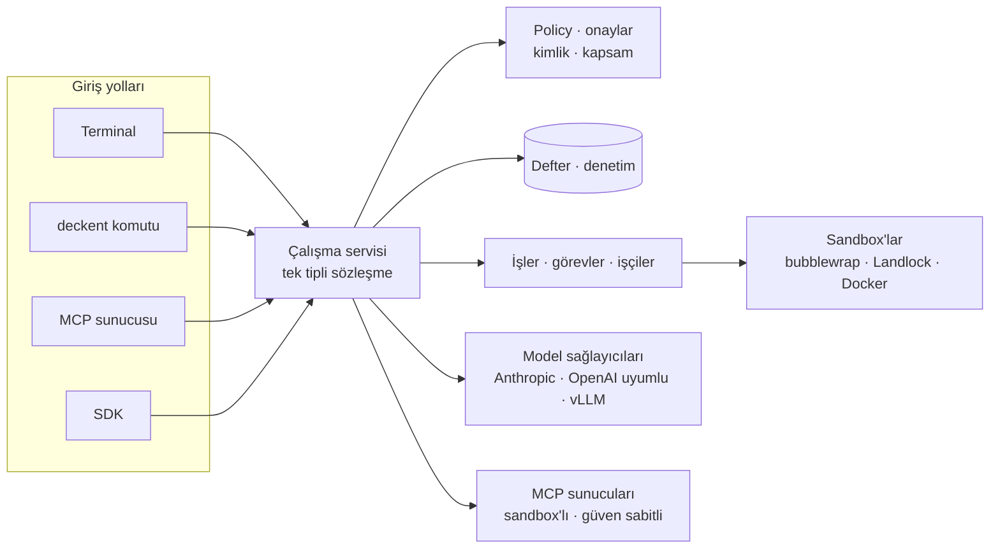

## Bugün neler yapabilirsiniz

- **Terminalde ajanla çalışın**: akışlı turlar, dosya düzenleme ve sandbox'lı kabuk, onay ve izleme pencereleri,
  izin modları, MCP araçları, konuşma sıkıştırma, Türkçe ve İngilizce.
- **İşleri yönetin**: yürütme (Run), görev (Task) ve deneme (Attempt) kabul edin, bağımlılıkları sıralayın, kapasite ayırın, iptal edin ve
  kurtarın; hepsi kalıcı bir SQLite defterine yazılır.
- **İşi sade sözlerle isteyin**: `/do <istek>` (ya da `deckent do --request "<metin>"`) isteği kabul ölçütlü bir plana çevirir,
  onayınız için bir kart gösterir ve işi bir kodlama işçisinde yürütür; `/deliver` sonucu bir Git referansına yazar ve
  yalnız siz seçerseniz bir dala alır. Bir kez yapılan kurulum için
  [Adım adım ilk işiniz](#adım-adım-ilk-işiniz) bölümüne bakın.
- **Kodlama işçileri kullanın**: Git tabanlı çalışma kopyaları ve Claude Code, Codex, Cursor ile Docker işçileri;
  yamalar saklanır, yalıtılmış bir adayda birleştirilir, sonra teslim edilir ya da yayınlanır.
- **Yönetişim**: yerel kimlik, şirket kapsamlı policy, denetim ve her yüzey için tek onay aracısı; doğrulanmamış
  kanıt için insan kabulü ya da reddi.
- **Model seçin**: istemci ve faturalama kanalına göre model kataloğu, birebir etkinleştirme, yerel vLLM sohbeti;
  `/provider` ve `/model` kendi anahtarınızla sağlayıcı bağlar, modeli oturum için sabitler ya da varsayılanınız yapar;
  ücretli çağrılar, sağlayıcının kullanım verisi ile doğrulanmış yayımlanmış tarifenin çarpımından, bütçe penceresinde
  ya da `deckent models create-budget` ile belirlediğiniz bütçe altında kesinleşir (fiyatı bilinmeyen uzak model
  reddedilir ve nedeniyle kilitlenir); harcama ve ayırma denetimi.
- **Önbellekle maliyeti izleyin**: yeni Anthropic profilleri 5 dakikalık istem önbelleğini kullanır, mevcut profiller
  yalnızca sizin seçiminizle değişir; `/usage` canlı hesabı USD olarak, önbellek okuma ve yazmalarını ve tahmini net
  kazancı gösterir.
- **Terminalde OpenRouter modelleri kullanın**: `/provider` ile kendi anahtarınızı bağlayın; araç ve akış çalışır,
  OpenRouter'ın bildirdiği her çağrı ücreti bütçenize kesinleşir.
  İlk ücretli OpenRouter çağrısından önce https://openrouter.ai/settings/plugins sayfasında hiçbir eklentinin
  "Prevent overrides" ile açık olmadığını kontrol edin ve OpenRouter kredi sınırını Deckent bütçenizden yüksek olmayacak
  şekilde ayarlayın; Deckent bu iki ayarı göremez.
- **Yedekleyin ve geri yükleyin**: `deckent backup create|verify|restore` doğrulanabilir kurtarma kümeleri yazar;
  isterseniz zamanlayarak ve saklama süresiyle; geri yükleme yalnızca servis durmuşken çalışır. Kümenin içindeki yalnız
  yetki anahtarı parolanızla şifrelenir; ledger ve durum arşivi düz dosyadır, kümeleri güvendiğiniz bir depoda saklayın
  (kümenin tamamının şifrelenmesi henüz yok).
- **İnceleyin ve denetleyin**: `deckent audit verify` denetim geçmişini doğrular, `deckent report --scope <id> --run <id>`
  bir Run'ın maliyet ve kabul kanıtını gösterir, `deckent run hold|resume|close` ve `deckent pool hold|resume` işi durdurur,
  sürdürür ya da kapatır, `deckent policy grants --mine` ve `deckent policy revoke` kalıcı izinlerinizi listeler ve kaldırır,
  `deckent identity profiles` kimlik profillerini gösterir. `deckent init` önizlemeden sonra proje talimatlarını
  (`DECKENT.md`) hazırlar. Terminalde `/help` tüm slash komutlarını listeler.
- **İşletin**: tüm kurulumlar için salt okunur `deckent monitor`, sağlık için `deckent doctor`, ayarlar için
  `deckent config`, her yerde iki dilli yardım.

Henüz yok: çok adımlı iş süreçlerinin Mission düzeyinde koordinasyonu, Enterprise SSO ve filo yönetimi, uzak HTTP API,
masaüstü ve web paneli. Docker işçisi host çekirdeğini paylaşır; sanal makine değildir. Açık ya da denenmemiş olanların
sade listesi [Bilinen sınırlar](docs/known-limits.tr.md) sayfasındadır.

## Yol haritası

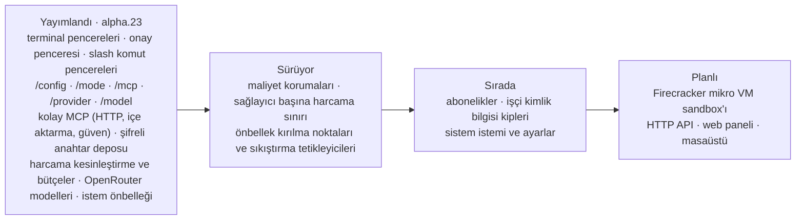

## Başlarken

Deckent Linux veya Windows üzerinde WSL2 ile, Node.js ≥ 24.22.0 kullanarak çalışır (Node 24 ve 26 desteklenir).
Native Windows runtime taşıması desteklenmez. Yeni kaynak derlemesi, kilitli bubblewrap’ı (şu an 0.13.0)
derleyip yerleştirmek için Docker ister; kilitli kaynağı indirir, kaynak ve binary özetlerini doğrular.
Doğrulanmış hazır paket çevrimdışı yeniden kullanılabilir. Sistem bubblewrap seçilirse sürümü en az 0.12.0
olmalıdır. Kodlama işçileri de Docker ister; ilk terminal oturumu Docker veya ücretli çağrı gerektirmez.
Native yalıtım yardımcısı için C derleme araçları da gerekir.
npm paketi yayımlanana kadar bir kez kaynaktan derleyin:

```sh
git clone https://github.com/Verhex/deckent-next.git
cd deckent-next
npm ci
node scripts/build-bwrap.mjs --arch all --out .pack/bwrap/first-build
node scripts/build-bwrap.mjs --stage-dev .pack/bwrap/first-build
npm run build
npm link
```

Sonraki build için yeni bir `--out` dizini kullanın. Build `bubblewrap=present` ya da `bubblewrap=staged from …` ile biter.
Linux'ta kilitli bubblewrap yerleştirilemezse build bitmez, `BUBBLEWRAP_BUILD_REQUIRED` ile durur; Docker'ı başlatıp
yeniden çalıştırın. Yalnız Linux dışında `bubblewrap=absent (not Linux)` basar; bu bubblewrap sandbox'ının olmadığı
demektir; yalıtım durumunu `deckent doctor` ile inceleyin. Hiçbir servis çalışmadan yapılan ilk `doctor` bubblewrap yerine
Landlock gösterebilir (`doctor --verbose` nedenini söyler): `doctor` yalnız ölçer, paketlenmiş bubblewrap'ı `.deckent/bin` altına runtime servisi, ana makineyi
ölçerken yerleştirir. Servisi başlatın (`deckent`) ve `doctor`'ı yeniden çalıştırın. Ön koşullar ve sağlayıcı anahtarı
gerektirmeyen tek test için [katkıcı hızlı başlangıcına (EN)](CONTRIBUTING.md#a-30-minute-quickstart) bakın.

**Ubuntu 24.04 ve sonrası.** Çekirdek, bubblewrap'ın ihtiyaç duyduğu ayrıcalıksız kullanıcı ad alanlarını kısıtlayabilir.
`sysctl kernel.apparmor_restrict_unprivileged_userns` ile bakın: `1` kısıtlı demektir; WSL'de anahtar yoksa (`cannot stat`) kısıt yok demektir. Deckent o zaman kısıtı bildirir,
görünür biçimde Landlock'a düşer ve tam erişimli kabuk çağrılarını reddeder; çünkü onlar açık bubblewrap sandbox'ı ister.
Bir yönetici, bubblewrap'ı root sahipli `/usr/local/bin/bwrap` olarak, ona `userns` izni veren bir AppArmor profiliyle
kurabilir.

Bağladıktan sonra Deckent kaynak dizininin dışındaki kendi proje klasörünüze geçin.
Uzun ve boşluklu yollar çalışır: yerel soket, kuruluma özel kısa ve 0700 izinli dizini kullanır.
`npm run build`, kilitli bubblewrap yerleştirilemezse açık bir hatayla durur; Docker’ı başlatıp yeniden deneyin
veya `DECKENT_BWRAP_BUILD=<doğrulanmış build-bwrap çıktısı> npm run build` kullanın.

Bundan sonra her şey `deckent` ile yapılır:

```sh
deckent --version
deckent init policy --scope my-project --preview
deckent init policy --scope my-project --apply
deckent doctor                            # kurulum başlayamazsa sıfır dışı çıkış
deckent                                   # init ile seçilen kapsamda açılır
# deckent --scope my-project               # açık kapsam seçimi, aynı terminal
deckent init preview --profile <dosya>    # ileri düzey: bir kurulum profili dosyasını önizle
deckent mcp add context7 -- npx -y @upstash/context7-mcp   # MCP sunucusu ekle
deckent monitor                           # kurulumları ve işleri izle
deckent --help                            # tüm komutlar; ayrıntı için deckent <komut> --help
```

**Bir yapay zekâ istemcisini MCP ile bağlayın.** `deckent-mcp`, Deckent'in stdio MCP sunucusudur; MCP istemcinize kaydedin,
örneğin Claude Code'da `claude mcp add deckent -- deckent-mcp --project /proje/yolu`. Runtime servisini kendisi başlatmaz ve
araçlarının çoğu servise ihtiyaç duyar: `deckent runtime serve` açık kalsın (terminalin başlattığı servis 15 dakika boşta
kalınca durur). MCP aktörü yalnız gözlem izinleriyle başlar; fazlası onu adıyla anan bir politika izni ister
(bkz. [Politika ve AI](docs/policy-and-ai.tr.md)).

## Daha fazlası

- [Mimariye genel bakış](docs/architecture-overview.tr.md): katmanlar, güvenlik, eklentiler ve bugünkü sınırlar
- [Politika ve AI](docs/policy-and-ai.tr.md): insan ve AI yetkisi, devir, yönetim komutları ve uyum kanıtı
- [Sözlük](docs/glossary.tr.md): kapsam, yürütme ortamı, iş yaşam döngüsü, onay ve harcama
- [Bilinen sınırlar](docs/known-limits.tr.md): denenmemiş, yapılmamış ya da hâlâ açık olanlar; etkisi ve varsa yolu
- [ARCHITECTURE.md](ARCHITECTURE.md): ayrıntılı mühendislik sözleşmeleri ve uygulama notları (EN/TR)
- [İşletim başvurusu](.deckent/docs/architecture/operator-reference.tr.md): işçi araç sürümleri, işçi imajları, kodlama
  profilleri, yama muhafazası ve kurulum muhafaza kuralları
- [CHANGELOG.md](CHANGELOG.md): her sürümün getirdikleri
- [CONTRIBUTING.md](CONTRIBUTING.md) · [Davranış kuralları](CODE_OF_CONDUCT.md) · [Güvenlik](SECURITY.md)

## Lisans

Apache-2.0 (bkz. [LICENSE](LICENSE)).
